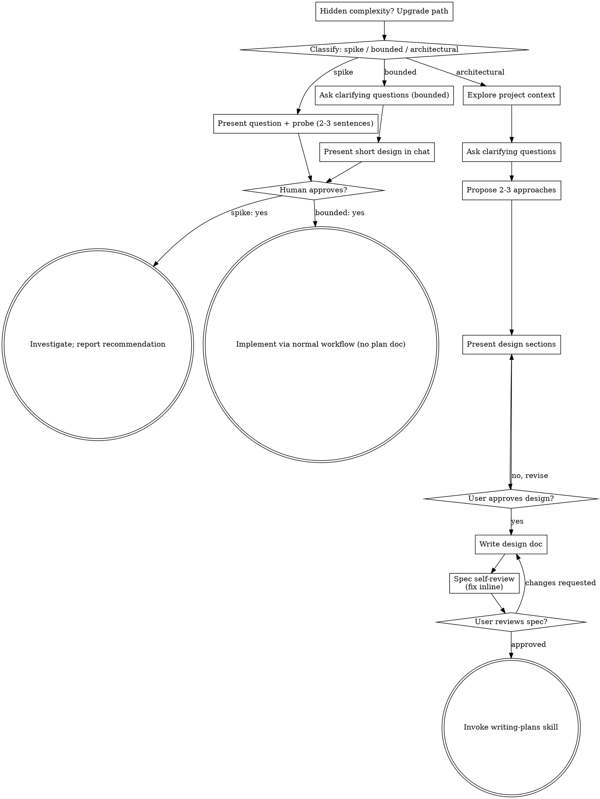

<!-- 2026-10-11 21:13 KST -->

# 대화 기록 02: PRD 세션

원본 기록 `7bcdb840-1242-4a49-9fca-1156b818fb3e.jsonl`에서 옮김. 사용자 메시지와 클로드의 답을 그대로 싣고, 도구 호출은 이름과 설명만 한 줄로 적음. 클로드의 내부 추론과 도구 결과는 싣지 않음. 메일 주소는 가렸음.

## [10-09 15:37] 신 학생

Superpowers의 brainstorming 스킬로 아래 요구를 정리해서 PRD.md를 만들어 줘.
정리하다가 물어볼 것이 있으면 먼저 물어봐 줘.

## 누가
대학 1학년 학생이 혼자 상식 공부를 하며 풂

## 무엇을
4지선다 상식 퀴즈 웹 앱
- 카테고리 4개(한국사, 세계지리, 과학, 예술과 문화)
- 카테고리마다 10문제, 총 40문제

## 왜
틀린 문제를 그 자리에서 알고 넘어가게 하려고
- 답을 고르면 곧바로 정답 여부와 한 줄 해설을 보여 줌

## 언제
- 한 판은 카테고리 1개의 10문제
- 10문제가 끝나면 점수를 보여 줌

## 어디서
- 브라우저에서 파일을 열면 동작함, 서버 없음
- 파일은 index.html, style.css, script.js, questions.js 4개

## 게임 모드
1. 연습
   - 시간 제한과 힌트 없음, 맞히면 1점
   - 순위표에 기록하지 않음. 시작 화면과 결과 화면에 "순위표에 기록되지 않음"을 표시함
   - 틀린 문제만 다시 풀 수 있음
2. 스피드
   - 문항마다 15초, 시간이 지나면 오답
   - 해설이 나오면 타이머가 멈추고, [다음]을 누르면 다시 15초부터 셈
3. 힌트
   - 문항마다 힌트 1번, 누르면 오답 보기 2개를 지움
   - 힌트를 쓰고 맞히면 0.5점

틀린 문항은 모든 모드에서 0점

## 구현 단계
1. 연습 모드와 점수 (모드 선택 화면, 틀린 문제 다시 풀기는 아직 없음)
2. 스피드 모드, 힌트 모드, 모드 선택 화면, 틀린 문제 다시 풀기
3. 점수 저장과 순위표(localStorage)

## 문항 규칙
1. 문항마다 정답은 하나만이어야 함
2. 해설에는 확인한 출처를 명시해야 함
3. "가장 ~한"처럼 최상급 표현이 사용된 문항은 기준과 시점에 따라 답이 달라지므로, 
   이를 문제에 명시해야 함

- [10-09 15:37] 도구 호출: `Skill` superpowers:brainstorming

## [10-09 15:37] 신 학생

Base directory for this skill: /Users/logistex/.claude/plugins/cache/superpowers-dev/superpowers/6.4.2/skills/brainstorming

# Brainstorming Ideas Into Designs

Help turn ideas into fully formed designs and specs through natural collaborative dialogue.

Start by classifying how much process the request needs, then work
through your path: understand the context, refine the idea, present a
design, and get your human partner's approval.

## Establish Shared Understanding

The outcome of brainstorming is an understanding your human partner can
recognize and correct, grounded in what they want to accomplish.

1. **Discover intent.** Use the request and available context to identify
   the intended outcome, who it is for, and what success looks like. When
   that information is missing, ask one focused question about purpose or
   intended use before proposing features or an approach. Knowing the app
   genre does not tell you why your partner wants it. Gathering missing
   requirements does not ask them to authorize the task again.
2. **Write back your understanding.** Summarize the intended outcome,
   relevant constraints, and success criteria in a short note your partner
   can assess. Separate what they said from assumptions. Invite correction
   and incorporate their answer before treating this as the design brief.
3. **Carry intent into the design.** Preserve the agreed understanding in
   the selected path's design artifact: the written spec for architectural
   work, or the in-chat design/probe for bounded work and spikes. Check
   proposed features and technical choices against that understanding.

When the request already supplies the purpose and constraints, reflect
that understanding instead of asking the same questions again. Keep the
note concise; its accuracy and the opportunity to correct it matter.

<HARD-GATE>
Before taking any implementation action, including invoking an
implementation skill, writing product code, scaffolding, installing
product dependencies, or creating an external project, complete the
selected path's prerequisites:

- Spike: the human partner approves the question and probe.
- Bounded: the human partner approves the short in-chat design.
- Architectural: the human partner reviews and approves the written spec,
  then reviews the written implementation plan and selects its execution
  method. Conversational design approval only permits writing the spec;
  written-spec approval only permits invoking writing-plans.

A reply approves the stage actually presented. Approval of an idea or
feature scope does not approve artifacts that do not exist yet. Resume
at the earliest incomplete stage; do not turn one approval into permission
to skip the rest of the selected path. Read-only project exploration is
allowed while those prerequisites remain incomplete.
</HARD-GATE>

## Three Paths

Before your first question, classify the request and say the
classification out loud — "this looks bounded, so I'll present a short
design here rather than write a spec" — so your human partner can
override it:

- **Spike** — a feasibility question ("can we...", "is it possible...",
  "quick and dirty is fine") whose output is an answer, not code you
  keep. Present the question and what you'll try in 2-3 sentences, get
  a nod, then find out as cheaply as correctness allows. No design
  doc, no spec file. Report findings as a recommendation; anything you
  built stays labeled throwaway.
- **Bounded** — a well-scoped change to code that already exists in
  this repo: a new flag, a small endpoint, a one-file fix.
  Understanding the kind of app is not enough — bounded means the flow
  you are changing is already here to read. If there is no existing
  flow to change, the task is not bounded. Ask the clarifying
  questions that matter, present a short design IN CHAT (a few
  sentences to a few short paragraphs), and STOP. Implementation
  starts only after your human partner says yes to that design — a
  bounded task's approval is as hard a gate as an architectural
  one. No spec file, no implementation plan document.
- **Architectural** — new projects, new subsystems, changes that
  restructure how components fit together or alter interfaces others
  depend on. Follow the full process: questions, approaches, sectioned
  design, written spec, then the writing-plans skill.

When in doubt between two paths, take the heavier one. The ratchet is
one-way: hidden complexity discovered mid-task upgrades the path —
stop, say so, and step up. Nothing downgrades mid-task.

## Anti-Pattern: "Too Simple To Need Approval"

Every path ends with your human partner approving the required design
before implementation. A bounded change may need only two sentences in
chat. A new todo-list project is architectural and requires the written
spec and planning handoffs. Scale the artifact to the selected path;
complete that path's reviews before implementation.

## Red Flags

| Thought | Reality |
|---------|---------|
| "This is too simple to need a design" | Follow the selected path: a bounded change gets a short chat design; an architectural change gets the written spec and planning handoffs. |
| "I'll call it bounded and skip the spec" | Reaching for a label to skip work IS the doubt — take the heavier path. |
| "It's bounded and the design is obvious — I'll start while they read it" | The gate is the approval, not the design's length. Present, then stop until you hear yes. |
| "I understand this kind of app, so it's bounded" | Bounded measures the repo, not your familiarity. A new project has no existing flow — it is architectural. |
| "The spike works, so I'll keep the code" | A spike's output is an answer. Keeping the code is a new request — classify it. |
| "It grew, but I'm almost done — no need to re-classify" | Hidden complexity upgrades the path mid-task. Stop and say so. |
| "They approved the spike, so the follow-up change is approved too" | Each task gets its own classification and its own approval. |

## Checklist

Classify first, announce the path, then create a task for each item on
your path and complete them in order.

**Spike:**
1. **Explore project context** — enough to frame the probe
2. **Present question + probe plan** — 2-3 sentences
3. **Get approval** — a nod is enough
4. **Investigate** — as cheaply as correctness allows
5. **Report findings** — a recommendation; label anything built as throwaway

**Bounded:**
1. **Explore project context** — check files, docs, recent commits
2. **Ask clarifying questions** — one at a time, the ones that matter
3. **Present short design in chat** — approach, files touched, testing
4. **Get approval** — STOP and wait for an explicit yes; presenting the design and starting in the same breath is skipping the gate
5. **Implement** — proceed with the normal development workflow (TDD applies); no plan document

**Architectural:**
1. **Explore project context** — check files, docs, recent commits
2. **Offer the visual companion just-in-time** — NOT upfront. The first time a question would genuinely be clearer shown than described, offer it then (its own message); on approval its browser tab opens for you. If no visual question ever arises, never offer it. See the Visual Companion section below.
3. **Ask clarifying questions** — one at a time, understand purpose/constraints/success criteria
4. **Propose 2-3 approaches** — with trade-offs and your recommendation
5. **Present design** — in sections scaled to their complexity, get user approval after each section
6. **Write design doc** — save to `docs/superpowers/specs/YYYY-MM-DD-<topic>-design.md` and commit
7. **Spec self-review** — quick inline check for placeholders, contradictions, ambiguity, scope (see below)
8. **User reviews written spec** — ask user to review the spec file before proceeding
9. **Transition to implementation** — invoke writing-plans skill to create implementation plan

## Process Flow



**Terminal states are path-bound.** Architectural: the ONLY skill you
invoke after brainstorming is writing-plans — never frontend-design,
mcp-builder, or any other implementation skill. Bounded: after
approval, implementation proceeds directly through the normal
development workflow; no plan document. Spike: the terminal state is a
reported recommendation.

## The Process

The subsections below serve the bounded and architectural paths (a
spike stops at "present the probe, get a nod"). Sections from
**Exploring approaches** onward are architectural-path depth — for
bounded work, context plus a few questions plus a short in-chat design
is the whole process.

**Understanding the idea:**

- Check out the current project state first (files, docs, recent commits)
- Before asking detailed questions, assess scope: if the request describes multiple independent subsystems (e.g., "build a platform with chat, file storage, billing, and analytics"), flag this immediately. Don't spend questions refining details of a project that needs to be decomposed first.
- If the project is too large for a single spec, help the user decompose into sub-projects: what are the independent pieces, how do they relate, what order should they be built? Then brainstorm the first sub-project through the normal design flow. Each sub-project gets its own spec → plan → implementation cycle.
- For appropriately-scoped projects, ask questions one at a time to refine the idea
- Prefer multiple choice questions when possible, but open-ended is fine too
- Only one question per message - if a topic needs more exploration, break it into multiple questions
- Focus on understanding: purpose, constraints, success criteria

**Exploring approaches:**

- Propose 2-3 different approaches with trade-offs
- Present options conversationally with your recommendation and reasoning
- Lead with your recommended option and explain why
- YAGNI ruthlessly - remove unnecessary features from every approach and design

**Presenting the design:**

- Once you believe you understand what you're building, present the design
- Scale each section to its complexity: a few sentences if straightforward, up to 200-300 words if nuanced
- Ask after each section whether it looks right so far
- Cover: architecture, components, data flow, error handling, testing
- Be ready to go back and clarify if something doesn't make sense

**Design for isolation and clarity:**

- Break the system into smaller units that each have one clear purpose, communicate through well-defined interfaces, and can be understood and tested independently
- For each unit, you should be able to answer: what does it do, how do you use it, and what does it depend on?
- Can someone understand what a unit does without reading its internals? Can you change the internals without breaking consumers? If not, the boundaries need work.
- Smaller, well-bounded units are also easier for you to work with - you reason better about code you can hold in context at once, and your edits are more reliable when files are focused. When a file grows large, that's often a signal that it's doing too much.

**Working in existing codebases:**

- Explore the current structure before proposing changes. Follow existing patterns.
- Where existing code has problems that affect the work (e.g., a file that's grown too large, unclear boundaries, tangled responsibilities), include targeted improvements as part of the design - the way a good developer improves code they're working in.
- Don't propose unrelated refactoring. Stay focused on what serves the current goal.

## After the Design (architectural path)

**Documentation:**

- Write the validated design (spec) to `docs/superpowers/specs/YYYY-MM-DD-<topic>-design.md`
  - (User preferences for spec location override this default)
- Use elements-of-style:writing-clearly-and-concisely skill if available
- Commit the design document to git

**Spec Self-Review:**
After writing the spec document, look at it with fresh eyes:

1. **Placeholder scan:** Any "TBD", "TODO", incomplete sections, or vague requirements? Fix them.
2. **Internal consistency:** Do any sections contradict each other? Does the architecture match the feature descriptions?
3. **Scope check:** Is this focused enough for a single implementation plan, or does it need decomposition?
4. **Ambiguity check:** Could any requirement be interpreted two different ways? If so, pick one and make it explicit.

Fix any issues inline. No need to re-review — just fix and move on.

**User Review Gate:**
After the spec review loop passes, ask the user to review the written spec before proceeding:

> "Spec written and committed to `<path>`. Please review it and let me know if you want to make any changes before we start writing out the implementation plan."

Wait for the user's response. If they request changes, make them and re-run the spec review loop. Only proceed once the user approves.

**Implementation:**

- Invoke the writing-plans skill to create a detailed implementation plan
- Do NOT invoke any other skill. writing-plans is the next step.

## Visual Companion

A browser-based companion for showing mockups, diagrams, and visual options during brainstorming. Available as a tool — not a mode. Accepting the companion means it's available for questions that benefit from visual treatment; it does NOT mean every question goes through the browser.

**Offering the companion (just-in-time):** Do NOT offer it upfront. Wait until a question would genuinely be clearer shown than told — a real mockup / layout / diagram question, not merely a UI *topic*. The first time that happens, offer it then, as its own message:
> "This next part might be easier if I show you — I can put together mockups, diagrams, and comparisons in a browser tab as we go. It's still new and can be token-intensive. Want me to? I'll open it for you."

**This offer MUST be its own message.** Only the offer — no clarifying question, summary, or other content. Wait for the user's response. If they accept, start the server with `--open` so their browser opens to the first screen automatically. If they decline, continue text-only and don't offer again unless they raise it.

**Per-question decision:** Even after the user accepts, decide FOR EACH QUESTION whether to use the browser or the terminal. The test: **would the user understand this better by seeing it than reading it?**

- **Use the browser** for content that IS visual — mockups, wireframes, layout comparisons, architecture diagrams, side-by-side visual designs
- **Use the terminal** for content that is text — requirements questions, conceptual choices, tradeoff lists, A/B/C/D text options, scope decisions

A question about a UI topic is not automatically a visual question. "What does personality mean in this context?" is a conceptual question — use the terminal. "Which wizard layout works better?" is a visual question — use the browser.

If they agree to the companion, read the detailed guide before proceeding:
`skills/brainstorming/visual-companion.md`

- [10-09 15:37] 도구 호출: `Bash` List project folder and parent, get KST time

- [10-09 15:38] 도구 호출: `AskUserQuestion` 

### [10-09 15:38] 클로드

1번 확인: 문항은 구현 1단계에서 출처를 확인하며 작성함. 다음은 2번 질문입니다.

- [10-09 15:39] 도구 호출: `AskUserQuestion` 

### [10-09 15:39] 클로드

2번 확인: 다시 풀기는 별도 점수로 보여 주고, 틀린 문제가 남으면 반복할 수 있음. 다음은 3번 질문입니다.

- [10-09 15:39] 도구 호출: `AskUserQuestion` 

### [10-09 15:39] 클로드

3번 확인: 순위표는 이름 없이 날짜와 점수, 모드와 카테고리별 표 8개, 표마다 상위 10개. 마지막 4번 질문입니다.

- [10-09 15:39] 도구 호출: `AskUserQuestion` 

### [10-09 15:40] 클로드

[guard] 답을 고치는 중임.

## [10-09 15:40] 점검 장치(guard) 피드백

Stop hook feedback:
[guard] 답을 끝내기 전에 고칠 것이 있음.
- 설명 없이 쓴 이름: 「단계 2」. 무엇을 가리키는지 풀어 적을 것
- 앞의 답은 화면에 나가지 않았음. 고칠 점을 반영해 답 전체를 처음부터 다시 쓸 것.

### [10-09 15:40] 클로드

4개 질문을 모두 확인했습니다. 다음은 코드 구조 접근안 3개입니다.

| 안 | 구조 | 장점 | 단점 |
|---|---|---|---|
| A (추천) | index.html에 화면마다 `<section>`을 두고 보이기, 숨기기로 화면을 바꿈. script.js에는 상태 객체 1개와 모드 규칙표 1개를 둠 | 모드 차이가 규칙표 한 곳에 모임. 스피드, 힌트 모드를 더하는 구현 2단계에서는 규칙표에 줄만 추가하면 됨. HTML 구조가 파일에 그대로 보여 읽기 쉬움 | 화면 수만큼 섹션을 index.html에 미리 만들어야 함 |
| B | 화면 전체를 JS가 `innerHTML`로 그때그때 그림 | index.html이 거의 비어 있음 | 마크업이 JS 문자열 안에 흩어져 고치기 어려움 |
| C | 모드마다 클래스를 두고(연습, 스피드, 힌트) 공통 클래스를 상속함 | 모드별 코드가 분리됨 | 모드 차이가 값 몇 개뿐이라 구조가 과함 |

A를 추천하는 이유: 모드 3개의 차이를 값 5개로 표현할 수 있음(타이머 유무, 힌트 유무, 순위표 기록 유무, 다시 풀기 유무, 힌트를 쓰고 맞힌 문항의 점수). 그래서 표 하나로 충분함.

어느 안으로 할지 알려 주십시오. 정하시면 설계를 3개 부분(화면 흐름, 데이터와 채점, 구현 단계별 범위와 검증)으로 나눠 하나씩 확인받겠습니다.

## [10-09 15:40] 신 학생

A안으로 진행해 줘

### [10-09 15:41] 클로드

[guard] 답을 고치는 중임.

## [10-09 15:41] 점검 장치(guard) 피드백

Stop hook feedback:
[guard] 답을 끝내기 전에 고칠 것이 있음.
- 설명 없이 쓴 이름: 「설계 1부」, 「3단계」. 무엇을 가리키는지 풀어 적을 것 / 뜻이 안 읽히는 문장: 「스피드, 힌트는 3단계부터 기록 후 순위를 표시」. 빠진 목적어나 주어를 채울 것
- 앞의 답은 화면에 나가지 않았음. 고칠 점을 반영해 답 전체를 처음부터 다시 쓸 것.

### [10-09 15:41] 클로드

A안으로 확정함. 설계 3개 부분 가운데 첫째인 화면 흐름을 보여 드립니다.

단계 표기는 요청하신 구현 단계를 가리킴: 구현 1단계(연습 모드와 점수), 구현 2단계(스피드, 힌트 모드, 모드 선택 화면, 다시 풀기), 구현 3단계(점수 저장과 순위표).

```
[모드 선택] → [시작] → [문제] ×10 → [결과]
 (구현 2단계부터)                      ├→ [틀린 문제 다시 풀기] → [문제] → [결과] (연습 모드, 구현 2단계부터)
                                       └→ [처음으로] → [모드 선택]
[모드 선택] → [순위표] (구현 3단계부터)
```

| 화면 | 보여 주는 것 |
|---|---|
| 모드 선택 | 연습, 스피드, 힌트 버튼. 구현 3단계부터 [순위표] 버튼 |
| 시작 | 고른 모드 이름, 카테고리 버튼 4개. 연습 모드면 "순위표에 기록되지 않음" |
| 문제 | 진행(3/10), 현재 점수, 문항, 보기 4개. 스피드 모드는 남은 초, 힌트 모드는 [힌트] 버튼 |
| 문제(답한 뒤) | 보기를 잠금, 고른 보기와 정답 보기를 색으로 구분, 정답 여부, 한 줄 해설과 출처, [다음](10번째 문항은 [결과 보기]) |
| 결과 | 점수(예: 7.5/10). 연습 모드면 "순위표에 기록되지 않음"과 [틀린 문제 다시 풀기](틀린 문항이 있을 때만) |
| 결과(스피드, 힌트 모드) | 구현 3단계부터 앱이 점수를 순위표에 저장하고, 그 점수가 몇 위인지 보여 줌 |
| 순위표 | 모드 2개 × 카테고리 4개 = 표 8개, 표마다 날짜와 점수 상위 10개 |

해석이 갈릴 수 있어 제가 정한 것 2개

- 요청의 "시작 화면"을 카테고리를 고르는 화면으로 봄. 구현 1단계에는 모드 선택 화면이 없으므로 이 화면이 첫 화면이고, 구현 2단계부터 모드 선택 화면이 그 앞에 붙음
- 다시 풀기 결과 화면에는 처음 판 점수와 다시 푼 점수(예: 3/4)를 함께 보여 줌

이 화면 흐름이 맞는지 알려 주십시오. 맞으면 둘째 부분인 데이터와 채점으로 넘어가겠습니다.

## [10-09 15:45] 신 학생

화면 순서를 바꿔 줘.
시작 화면에서 카테고리를 먼저 고르고, 구현 2단계부터는 카테고리를 고른 뒤 모드 선택 화면이 나오게 해 줘.
"순위표에 기록되지 않음"은 구현 1단계에는 시작 화면에, 구현 2단계부터는 모드 선택 화면의 연습 버튼과 결과 화면에 표시해 줘.

### [10-09 15:45] 클로드

화면 흐름을 고쳤습니다. 구현 1단계의 결과 화면 표시만 여쭤볼 것이 남았습니다.

```
구현 1단계: [시작: 카테고리 선택] → [문제] ×10 → [결과] → [처음으로] → [시작]
구현 2단계: [시작: 카테고리 선택] → [모드 선택] → [문제] ×10 → [결과]
                                                               ├→ [틀린 문제 다시 풀기] → [문제] → [결과] (연습 모드만)
                                                               └→ [처음으로] → [시작]
구현 3단계: [시작]의 [순위표] 버튼 → [순위표]
```

| 화면 | 보여 주는 것 |
|---|---|
| 시작 | 카테고리 버튼 4개. 구현 1단계에는 "순위표에 기록되지 않음"도 함께 보임. 구현 3단계부터는 [순위표] 버튼 |
| 모드 선택(구현 2단계부터) | 고른 카테고리 이름, 연습, 스피드, 힌트 버튼. 연습 버튼에 "순위표에 기록되지 않음" |
| 문제 | 진행(3/10), 현재 점수, 문항, 보기 4개. 스피드 모드는 남은 초, 힌트 모드는 [힌트] 버튼 |
| 문제(답한 뒤) | 보기를 잠금, 고른 보기와 정답 보기를 색으로 구분, 정답 여부, 한 줄 해설과 출처, [다음](10번째 문항은 [결과 보기]) |
| 결과 | 점수(예: 7.5/10). 연습 모드면 구현 2단계부터 "순위표에 기록되지 않음"과 [틀린 문제 다시 풀기](틀린 문항이 있을 때만) |
| 결과(스피드, 힌트 모드) | 구현 3단계부터 앱이 점수를 순위표에 저장하고, 그 점수가 몇 위인지 보여 줌 |
| 순위표(구현 3단계부터) | 모드 2개 × 카테고리 4개 = 표 8개, 표마다 날짜와 점수 상위 10개 |

제가 정한 것 2개(바꾸실 거면 말씀해 주십시오)

- [순위표] 버튼을 시작 화면에 둠. 모드 선택 화면이 카테고리를 고른 뒤에 나오므로 시작 화면이 모든 단계의 첫 화면이 되기 때문
- [처음으로]는 시작 화면(카테고리 선택)으로 돌아감

처음 요청에는 "시작 화면과 결과 화면에 표시"라고 되어 있었고, 방금 지시는 구현 1단계를 시작 화면만 언급하셨습니다.

- [10-09 15:45] 도구 호출: `AskUserQuestion` 

### [10-09 15:47] 클로드

[guard] 답을 고치는 중임.

## [10-09 15:47] 점검 장치(guard) 피드백

Stop hook feedback:
[guard] 답을 끝내기 전에 고칠 것이 있음.
- 화면 낱말 2 개를 썼으나 이번 차례에 화면을 보지 않았음. 본 화면이나 문서 출처를 대거나, 확인하지 않았다고 적을 것
- 앞의 답은 화면에 나가지 않았음. 고칠 점을 반영해 답 전체를 처음부터 다시 쓸 것.

### [10-09 15:47] 클로드

구현 1단계의 결과 화면에도 "순위표에 기록되지 않음"을 표시하도록 화면 흐름에 반영함. 다음은 둘째 부분인 데이터와 채점입니다.

questions.js 문항 형식

```js
const QUESTIONS = [
  {
    id: "kh-01",               // 카테고리 약자와 번호
    category: "한국사",         // 한국사, 세계지리, 과학, 예술과 문화
    question: "...",
    choices: ["...", "...", "...", "..."],  // 4개, 서로 다름
    answer: "...",             // 정답 보기의 내용. choices에 정확히 1번 나와야 함
    explanation: "한 줄 해설",
    source: "자료명, URL, 확인한 날짜"
  },
];
```

- 보기를 섞으므로 정답은 보기 번호가 아니라 내용으로 적음
- 최상급 표현을 쓴 문항은 question에 기준과 시점을 적음(예: "2024년 기준, 면적이 가장 넓은")

script.js의 모드 규칙표(A안)

| 모드 | 시간 제한 | 힌트 | 힌트를 쓰고 맞힌 점수 | 순위표 기록 | 다시 풀기 |
|---|---|---|---|---|---|
| 연습 | 없음 | 없음 | 해당 없음 | 안 함 | 함 |
| 스피드 | 15초 | 없음 | 해당 없음 | 함 | 안 함 |
| 힌트 | 없음 | 1번 | 0.5점 | 함 | 안 함 |

채점과 진행 규칙

- 맞히면 1점, 틀리면 0점, 힌트를 쓰고 맞히면 0.5점
- 스피드: 남은 초를 정수로 보여 줌. 0초가 되면 오답 처리하고 해설을 보여 줌. 해설이 나오면 타이머가 멈추고, [다음]을 누르면 15초부터 다시 셈
- 힌트: 오답 2개를 무작위로 골라 누를 수 없게 함. 힌트를 1번 쓰거나 답을 고르면 [힌트]를 더 누를 수 없음
- 다시 풀기: 틀린 문항만 다시 섞어 냄. 결과 화면에 처음 판 점수와 다시 푼 점수(예: 3/4)를 함께 보여 줌. 또 틀린 문항이 있으면 다시 풀기를 반복할 수 있음

localStorage(구현 3단계)

- 키 1개 `quiz-leaderboard`, 값은 `"speed|한국사": [{ date: "2026-10-09", score: 8 }, ...]` 형태
- 점수 내림차순, 동점이면 먼저 기록한 순으로 정렬하고 상위 10개만 남김
- 10위 안에 들지 못하면 결과 화면에 "상위 10위 밖"이라고 보여 줌
- 브라우저가 저장을 막으면 "순위표를 저장할 수 없음"을 보여 주고 게임은 계속함. 어떤 브라우저 설정에서 저장이 막히는지, file://에서 브라우저마다 localStorage를 허용하는지는 확인하지 않았음. 구현 3단계에서 크롬과 사파리로 확인할 예정

위 화면 요소(버튼, 결과 화면 문구)는 이번 설계에서 정하는 것이며, 앱 화면은 아직 없어 보지 않았습니다.

이 데이터 형식과 채점 규칙이 맞는지 알려 주십시오. 맞으면 마지막 부분인 구현 단계별 범위와 검증으로 넘어가겠습니다.

## [10-09 15:51] 신 학생

맞아, 구현 단계별 범위와 검증으로 넘어가 줘.

- [10-09 15:51] 도구 호출: `Bash` Check Node.js version

### [10-09 15:51] 클로드

[guard] 답을 고치는 중임.

## [10-09 15:51] 점검 장치(guard) 피드백

Stop hook feedback:
[guard] 답을 끝내기 전에 고칠 것이 있음.
- 설명 없이 쓴 이름: 「Aside」. 무엇을 가리키는지 풀어 적을 것 / 뜻이 안 읽히는 문장: 「힌트: 정답은 지워지지 않음, 힌트를 쓰고 맞히면 0.5점.」, 「출처의 정확성과 최상급 표현의 기준, 시점은 Node 검사로 걸러지지 않으므로 문항을 쓸 때 웹 자료와 대조함」, 「크롬과 사파리에서 file://로 열어 저장됨」. 빠진 목적어나 주어를 채울 것
- 앞의 답은 화면에 나가지 않았음. 고칠 점을 반영해 답 전체를 처음부터 다시 쓸 것.

- [10-09 15:52] 도구 호출: `Write` /private/tmp/claude-501/-Users-logistex-Library-CloudStorage-SynologyDrive-gDrive----yr26-DS26-vibe-coding-for-DSMP-5---

### [10-09 15:52] 클로드

구현 단계마다 범위와 완료 확인 항목을 정했습니다. 단계 하나를 끝내면 신 교수님의 확인을 받은 뒤 다음 단계로 넘어갑니다.

| 구현 단계 | 범위 | 완료 확인 항목 |
|---|---|---|
| 1단계 | 파일 4개, 시작 화면, 문제 화면, 해설, 결과 화면, 연습 모드 채점, 문항과 보기 섞기, 40문항 작성 | 카테고리 4개를 각각 10문항 끝까지 풂. 점수가 맞힌 문항 수와 같음. 해설과 출처가 나옴. "순위표에 기록되지 않음"이 시작 화면과 결과 화면에 나옴. 같은 카테고리를 두 번 열면 문항 순서가 다름 |
| 2단계 | 모드 선택 화면, 스피드 모드, 힌트 모드, 틀린 문제 다시 풀기. "순위표에 기록되지 않음"을 시작 화면에서 모드 선택 화면의 연습 버튼으로 옮김 | 아래 표 |
| 3단계 | localStorage 저장, 순위표 화면, 결과 화면의 순위 표시 | 아래 목록 |

구현 2단계 확인 항목

| 모드 | 확인할 동작 |
|---|---|
| 스피드 | 15초가 지나면 오답으로 처리하고 해설을 보여 줌. 해설이 나온 동안 타이머가 멈춤. [다음]을 누르면 15초부터 다시 셈 |
| 힌트 | 힌트를 누르면 오답 보기 2개만 지워지고 정답 보기는 남음. 힌트를 쓰고 맞힌 문항은 0.5점으로 채점됨 |
| 연습 | 다시 풀기에 틀린 문항만 나옴. 또 틀린 문항이 있으면 다시 풀기를 반복할 수 있음. 스피드, 힌트 모드의 결과 화면에는 [틀린 문제 다시 풀기]가 없음 |

구현 3단계 확인 항목

- 새로고침해도 순위표 기록이 남음
- 연습 모드 점수는 순위표에 기록되지 않음
- 11번째 기록을 넣어도 표마다 10개만 남음. 동점이면 먼저 기록한 점수가 위에 옴
- 크롬과 사파리에서 index.html을 file://로 열었을 때 순위표 기록이 저장되는지 확인함

문항 검사 방법

- Node.js로 questions.js를 읽어 형식을 검사하는 명령을 개발 중에만 실행함. 배포 파일은 4개로 유지함(Node v26.6.0 설치됨, `node -v`로 확인)
- 검사 항목: 카테고리마다 10문항, 보기 4개가 서로 다름, 정답이 보기에 정확히 1번 나옴, 해설과 출처가 비어 있지 않음
- Node 검사는 출처 내용이 맞는지, 최상급 표현을 쓴 문항에 기준과 시점이 적혔는지는 판정하지 못함. 그래서 문항을 쓸 때 제가 웹 자료와 하나씩 대조함

브라우저 확인 방법

- 신 교수님의 브라우저를 함께 보며 조작하는 도구인 Aside로 index.html을 열어 위 항목을 확인함(전역 지침 CLAUDE.md 10절이 정한 도구)
- 위의 버튼과 화면 문구는 이번 설계에서 정하는 것이며, 앱 화면은 아직 없어 보지 않았음

이 범위와 확인 항목이 맞는지 알려 주십시오. 맞으면 지금까지 확정한 내용으로 PRD.md를 쓰겠습니다.

## [10-09 15:54] 신 학생

3부에 다음을 더해 줘.
1. 구현 2단계 확인 항목에 "카테고리를 고르면 모드 선택 화면이 나오고 연습, 스피드, 힌트 3개가 보임"을 넣어 줘.
2. 문항은 네가 출처와 대조한 뒤에도 최종 확인은 내가 한다고 적어 줘.
3. 브라우저 확인은 내가 직접 하고, 너는 단계마다 내가 확인할 항목을 알려 줘.
4. 이번 범위에서 하지 않을 것도 적어 줘.

### [10-09 15:54] 클로드

붙여 넣으신 4개 항목을 3부(구현 단계별 범위와 검증)에 반영했습니다. 바뀐 부분만 적습니다.

구현 2단계 확인 항목에 추가한 줄

| 화면 | 확인할 동작 |
|---|---|
| 모드 선택 | 카테고리를 고르면 모드 선택 화면이 나오고 연습, 스피드, 힌트 3개가 보임 |

문항 검사 방법에 추가한 줄

- 제가 웹 자료와 대조한 뒤 신 교수님이 40문항을 최종 확인함. 신 교수님이 확인하기 전에는 구현 1단계를 끝난 것으로 보지 않음

브라우저 확인 방법(교체함)

- 신 교수님이 브라우저에서 index.html을 열어 직접 확인함
- 저는 구현 단계마다 끝날 때 신 교수님이 확인할 항목 목록을 드림. 목록은 위 완료 확인 항목에서 뽑음
- Aside(브라우저 조작 도구)로 제가 확인하는 줄은 지움

이번 범위에서 하지 않을 것(추가함)

| 하지 않을 것 | 이유 |
|---|---|
| 서버, 로그인, 이름 입력, 기기 간 순위표 공유 | 서버 없이 혼자 쓰는 앱 |
| 문항 추가, 편집 화면 | 문항은 questions.js를 직접 고침 |
| 여러 카테고리를 섞은 판, 판 길이 선택 | 한 판은 카테고리 1개의 10문제로 정함 |
| 순위표 초기화, 기록 삭제 버튼 | 요청에 없음 |
| 효과음, 애니메이션, 다크 모드, 자동 테스트 도구 | 요청에 없음. 검증은 Node 문항 검사와 신 교수님의 브라우저 확인으로 함 |

이 3부가 맞는지 알려 주십시오. 맞으면 1부(화면 흐름), 2부(데이터와 채점), 3부를 합쳐 PRD.md를 쓰겠습니다.

## [10-09 15:56] 신 학생

맞아, PRD.md를 써 줘.

- [10-09 15:56] 도구 호출: `Bash` Get KST time and list STYLE.md sections

- [10-09 15:56] 도구 호출: `Bash` Read STYLE.md section 10

- [10-09 15:57] 도구 호출: `Write` /Users/logistex/Library/CloudStorage/SynologyDrive-gDrive/연도/yr26/DS26/vibe coding for DSMP/5장 실습 261009/Study03_Quiz_26

- [10-09 15:57] 도구 호출: `Bash` Scan PRD for forbidden marks and placeholders

### [10-09 15:57] 클로드

[guard] 답을 고치는 중임.

## [10-09 15:58] 점검 장치(guard) 피드백

Stop hook feedback:
[guard] 답을 끝내기 전에 고칠 것이 있음.
- 설명 없이 쓴 이름: 「부록 A」. 무엇을 가리키는지 풀어 적을 것 / 뜻이 안 읽히는 문장: 「가운뎃점, 긴 줄, 볼드, `TBD`, `TODO`, `-습니다` 없음(grep으로 PRD.md 전체를 검색해 0건)」. 빠진 목적어나 주어를 채울 것
- 앞의 답은 화면에 나가지 않았음. 고칠 점을 반영해 답 전체를 처음부터 다시 쓸 것.

### [10-09 15:58] 클로드

[PRD.md](PRD.md)를 썼습니다(236줄). 다음 단계로 넘어가기 전에 검토해 주십시오.

PRD.md 구성

| 절 | 내용 |
|---|---|
| PRD 1절 요약 | 결론만 모음. 이 절만 읽어도 앱 전체를 알 수 있게 씀 |
| PRD 2절~3절 | 사용자와 목적, 동작 환경과 코드 구조(A안) |
| PRD 4절~7절 | 화면 흐름, 게임 모드와 채점, 문항, 순위표 |
| PRD 8절 | 구현 단계별 범위와 완료 확인 항목 |
| PRD 9절~10절 | 하지 않을 것, 확인하지 않은 것 2가지 |
| PRD 맨 끝 부록 | 브레인스토밍에서 신 교수님께 묻거나 고치신 결과 9건을 표로 정리함 |

PRD.md를 쓴 뒤 점검한 것

- PRD.md 전체에서 가운뎃점, 긴 줄, 볼드, `TBD`, `TODO`, `-습니다`를 검색한 결과 0건임(grep으로 검색)
- 대화에서 확정한 3개 부분(화면 흐름, 데이터와 채점, 구현 단계별 범위와 검증)과 PRD.md의 내용이 어긋나지 않음(제가 다시 대조함)
- 이 폴더는 git 저장소가 아니어서 커밋하지 않음

다음 할 일: PRD.md를 읽고 고칠 곳을 알려 주십시오. 승인하시면 brainstorming 스킬이 정한 다음 단계인 writing-plans 스킬로 구현 계획을 쓰겠습니다.

## [10-09 16:01] 신 학생

PRD.md에서 "신 교수"를 "사용자"로 바꿔 줘.

- [10-09 16:01] 도구 호출: `Bash` Count occurrences of the two terms in PRD

- [10-09 16:01] 도구 호출: `AskUserQuestion` 

- [10-09 16:03] 도구 호출: `Bash` Replace the term in PRD and recount

### [10-09 16:03] 클로드

[PRD.md](PRD.md)의 "신 교수"를 모두 "사용자"로 바꿨습니다. 남은 "신 교수"는 0건입니다(grep으로 다시 검색).

- 바꾼 뒤 PRD.md의 "사용자"는 16건임. 그중 PRD 2절의 2건(22행, 24행)은 학생을 가리킴(grep으로 셈)
- 조사는 고치지 않아도 됨. "교수"와 "사용자"가 모두 모음으로 끝나므로 "가", "에게", "의"가 그대로 맞음

다음 할 일: PRD.md를 검토해 주십시오. 승인하시면 writing-plans 스킬로 구현 계획을 쓰겠습니다.

## [10-09 16:03] 신 학생

승인할테니, 구현 계획 작성해라.

- [10-09 16:03] 도구 호출: `Skill` superpowers:writing-plans

## [10-09 16:03] 신 학생

Base directory for this skill: /Users/logistex/.claude/plugins/cache/superpowers-dev/superpowers/6.4.2/skills/writing-plans

# Writing Plans

## Overview

Write implementation plans for an engineer who has not seen this codebase or this spec. Assume they write idiomatic code in the project's language once they know the exact interface and the exact test, and that they will make a reasonable choice wherever the plan leaves one open. What they cannot know is what you decided: which files, which names and signatures, which values from the spec, which tests prove each task. Document those. Give them the whole plan as bite-sized tasks. DRY. YAGNI. TDD. Frequent commits.

**Announce at start:** "I'm using the writing-plans skill to create the implementation plan."

**Context:** If working in an isolated worktree, it should have been created via the `superpowers:using-git-worktrees` skill at execution time.

**Save plans to:** `docs/superpowers/plans/YYYY-MM-DD-<feature-name>.md`
- (User preferences for plan location override this default)

## Scope Check

If the spec covers multiple independent subsystems, it should have been broken into sub-project specs during brainstorming. If it wasn't, suggest breaking this into separate plans — one per subsystem. Each plan should produce working, testable software on its own.

## File Structure

Before defining tasks, map out which files will be created or modified and what each one is responsible for. This is where decomposition decisions get locked in.

- Design units with clear boundaries and well-defined interfaces. Each file should have one clear responsibility.
- You reason best about code you can hold in context at once, and your edits are more reliable when files are focused. Prefer smaller, focused files over large ones that do too much.
- Files that change together should live together. Split by responsibility, not by technical layer.
- In existing codebases, follow established patterns. If the codebase uses large files, don't unilaterally restructure - but if a file you're modifying has grown unwieldy, including a split in the plan is reasonable.

This structure informs the task decomposition. Each task should produce self-contained changes that make sense independently.

## Task Right-Sizing

A task is the smallest unit that carries its own test cycle and is worth a
fresh reviewer's gate. When drawing task boundaries: fold setup,
configuration, scaffolding, and documentation steps into the task whose
deliverable needs them; split only where a reviewer could meaningfully
reject one task while approving its neighbor. Each task ends with an
independently testable deliverable.

## Step Granularity

**Each step is one action with a checkable result:**
- "Write the failing test" - step
- "Run it to make sure it fails" - step
- "Implement the minimal code to make the test pass" - step
- "Run the tests and make sure they pass" - step
- "Commit" - step

## Plan Document Header

**Every plan MUST start with this header:**

```markdown
# [Feature Name] Implementation Plan

> **For agentic workers:** REQUIRED SUB-SKILL: Use superpowers:subagent-driven-development (recommended) or superpowers:executing-plans to implement this plan task-by-task. Steps use checkbox (`- [ ]`) syntax for tracking.

**Goal:** [One sentence describing what this builds]

**Architecture:** [2-3 sentences about approach]

**Tech Stack:** [Key technologies/libraries]

**Spec:** [path to the spec/design doc this plan implements — the plan
argues from the spec, so the spec travels with it; executors read both]

## Global Constraints

[The spec's project-wide requirements — version floors, dependency limits,
naming and copy rules, platform requirements — one line each, with exact
values copied verbatim from the spec. Every task's requirements implicitly
include this section.]

## Review Focus

[The five input classes or failure modes the spec implies but no task's
tests exercise that are most likely to bite a person using this software
— one line each, naming the input or condition and the behavior a
reasonable person would expect, most likely first. The spec is a vision
document: it says what the software must do, not everything it will
meet, and its silence on an input is not permission for that input to
break the program. Write the list here, once, with the spec in front of
you. Then, for each line, add the test that pins it to the task that
owns the code, in that task's own step style.]

---
```

## Task Structure

````markdown
### Task N: [Component Name]

**Files:**
- Create: `exact/path/to/file.py`
- Modify: `exact/path/to/existing.py:123-145`
- Test: `tests/exact/path/to/test.py`

**Interfaces:**
- Consumes: [what this task uses from earlier tasks — exact signatures]
- Produces: [what later tasks rely on — exact function names, parameter
  and return types. A task's implementer sees only their own task; this
  block is how they learn the names and types neighboring tasks use.]

- [ ] **Step 1: Write the failing test**

```python
def test_specific_behavior():
    result = function(input)
    assert result == expected
```

- [ ] **Step 2: Run test to verify it fails**

Run: `pytest tests/path/test.py::test_name -v`
Expected: FAIL with "function not defined"

- [ ] **Step 3: Implement `function(input: InputType) -> ResultType` in `exact/path/to/file.py`**

One line on the approach when the signature and the test leave a choice
(which library call, which data structure); a code block only for an
algorithm they do not determine.

- [ ] **Step 4: Run test to verify it passes**

Run: `pytest tests/path/test.py::test_name -v`
Expected: PASS

- [ ] **Step 5: Commit**

```bash
git add tests/path/test.py src/path/file.py
git commit -m "feat: add specific feature"
```
````

## What a Step Contains

A step is done when the implementer can write exactly one reasonable thing
from it. That is the whole requirement: unambiguous, not complete. Each kind
of step carries what makes it unambiguous and nothing more:

- **A test step:** the test's name and its assertions, as code, with the
  spec's exact values in them.
- **A code step:** the exact signature (name, parameters, return type), the
  file it lives in, and the specific values the spec pins. The implementer
  writes the body. A body appears only for an algorithm the signature and
  tests do not determine, or for exact copy the spec fixes.
- **A verification step:** the command to run and the output that means it
  passed.
- **A reference to another task:** that task's Interfaces block says what
  to use; the plan does not repeat that task's code.

A plan is the set of decisions the implementer cannot make alone. A plan
longer than the code it describes has written the code instead. Lines that
decide nothing ("TBD", "handle edge cases", "add appropriate validation",
"write tests for the above", a type or function no task defines) are the
opposite failure, and the self-review catches both.

## Self-Review

After writing the complete plan, look at the spec with fresh eyes and check the plan against it. This is a checklist you run yourself — not a subagent dispatch.

**1. Spec coverage:** Skim each section/requirement in the spec. Can you point to a task that implements it? List any gaps.

**2. Step scan:** Every step must let the implementer write exactly one reasonable thing, and no step may carry more than that: a line that decides nothing is a gap, a function body the signature and tests already determine is a transcript. Fix both.

**3. Type consistency:** Do the types, method signatures, and property names you used in later tasks match what you defined in earlier tasks? A function called `clearLayers()` in Task 3 but `clearFullLayers()` in Task 7 is a bug.

**4. Review Focus:** For each input class or failure mode the spec implies, is there a task whose tests exercise it? The five uncovered ones most likely to bite a person go in the Review Focus section, and each line there gets its test added to the owning task. An empty section means you checked and found none, not that you skipped the check.

**5. Proportion:** Compare the plan's length to the spec's. A plan several times longer than the spec it implements is a transcript of the program, not a plan. If code blocks are most of the document, replace bodies with signatures, test names and assertions, and check that each step is still unambiguous.

If you find issues, fix them inline. No need to re-review — just fix and move on. If you find a spec requirement with no task, add the task.

## Execution Handoff

After saving and self-reviewing the plan, link it for your human partner
to read. If they have already explicitly supplied an execution method, ask
them to review the plan and confirm it captures what they want; wait for that
review before implementation, then use the preserved method. Otherwise, ask
them to review the plan and choose an execution method before implementation.

**When no execution method has already been supplied:**

**"Plan complete and saved to `docs/superpowers/plans/<filename>.md`. Please review the plan. Which execution approach would you prefer?**

- **Subagent-driven** - A fresh subagent implements each task and a fresh reviewer checks it before the next one starts, then a whole-branch review at the end. Most thorough; costs a fresh context per task and per review.
- **Native** - I implement every task myself in this session, the way this harness runs work, then one fresh reviewer on the most capable model checks the whole branch. Cheapest and fastest; no independent review until the end. Runs well with a mid-tier session model, since the plan carries the design.

**For this plan I recommend <one of the two>, because <one sentence from the plan: how much the tasks depend on each other's interfaces, how many there are, what a shipped mistake would cost>. Does the plan capture what you want, and which approach should we use?"**

**When an execution method has already been supplied:**

**"Plan complete and saved to `docs/superpowers/plans/<filename>.md`. Please review the plan. Does it capture what you want?"**

**If Subagent-driven chosen:**
- **REQUIRED SUB-SKILL:** Use superpowers:subagent-driven-development

**If Native chosen:**
- **REQUIRED SUB-SKILL:** Use superpowers:executing-plans

- [10-09 16:04] 도구 호출: `Bash` Check vm scripts share top-level const across runs

- [10-09 16:06] 도구 호출: `Bash` Get current KST time

- [10-09 16:07] 도구 호출: `Write` /Users/logistex/Library/CloudStorage/SynologyDrive-gDrive/연도/yr26/DS26/vibe coding for DSMP/5장 실습 261009/Study03_Quiz_26

- [10-09 16:08] 도구 호출: `AskUserQuestion` 

## [10-09 16:11] 신 학생

[Request interrupted by user for tool use]
