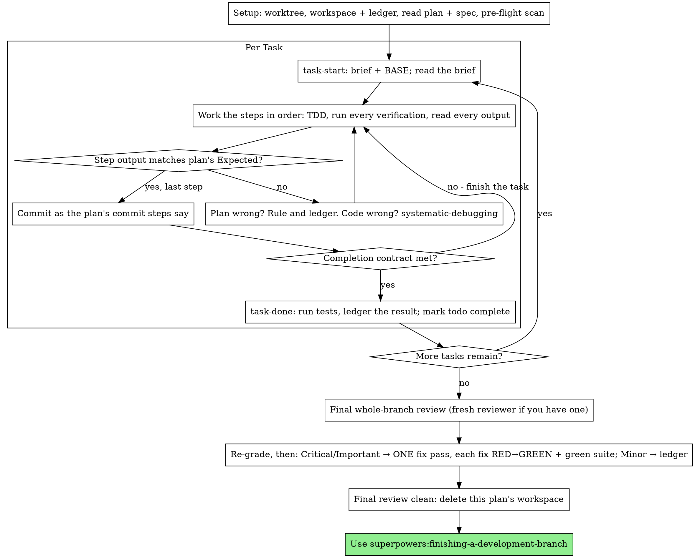

<!-- 2026-10-11 21:13 KST -->

# 대화 기록 09: 3단계 구현 세션

원본 기록 `cdf20cb3-5026-4ed2-ad88-7c3d04be4359.jsonl`에서 옮김. 사용자 메시지와 클로드의 답을 그대로 싣고, 도구 호출은 이름과 설명만 한 줄로 적음. 클로드의 내부 추론과 도구 결과는 싣지 않음. 메일 주소는 가렸음.

## [10-09 19:41] 신 학생

IMPL-PLAN.md를 읽고 3단계를 구현해 줘.
구현을 시작하기 전에 git branch로 지금 어느 브랜치에 있는지 확인하고, 
이번 단계를 어느 브랜치에서 만들지 먼저 알려 줘.
3단계가 끝나면 멈추고, 내가 브라우저에서 확인할 항목을 알려 줘.
깃허브에는 올리지 마.

- [10-09 19:41] 도구 호출: `Bash` Check branches, log, files, and memory notes

- [10-09 19:41] 도구 호출: `Read` /Users/logistex/Library/CloudStorage/SynologyDrive-gDrive/연도/yr26/DS26/vibe coding for DSMP/5장 실습 261009/Study03_Quiz_26

### [10-09 19:41] 클로드

지금은 `master` 브랜치에 있습니다(`git branch` 실행). 3단계는 `master`(48cda7a)에서 새 브랜치 `stage-3`을 만들어 작업하려 합니다.

- 기존 브랜치: `master`, `stage-1`, `stage-2`. `stage-2`는 `master`에 병합 커밋 5b5c8e3으로 이미 병합됨(`git log --graph`로 확인)
- `master`의 마지막 커밋 48cda7a(학번과 이름 표시)도 `stage-3`에 들어감
- 3단계 작업 범위: IMPL-PLAN.md의 Task 10(점수 저장과 결과 화면의 순위), Task 11(순위표 화면). 끝나면 Task 12의 브라우저 확인 항목 9개를 드리고 멈춤
- 커밋은 태스크마다 1개씩 함. 깃허브 push와 `master` 병합은 하지 않음

진행 방식도 하나 여쭙니다. 전역 CLAUDE.md는 구현 계획을 실행할 때 태스크 하나를 끝내면 그 차례를 끝내고 답을 기다리라고 정하고 있습니다. 이번 지시는 3단계를 끝내고 멈추라는 것이라 두 방식이 다릅니다.

1. Task 10과 Task 11을 이어서 끝낸 뒤 확인 항목을 드림(이번 지시대로)
2. Task 10을 끝내면 보고하고 기다림(CLAUDE.md대로)

브랜치 이름 `stage-3`과 진행 방식 1, 2 가운데 무엇으로 할지 알려 주십시오. 답을 받은 뒤 시작하겠습니다.

## [10-09 19:53] 신 학생

stage-3 브랜치로 해 줘. 진행은 1번, Task 10과 Task 11을 이어서 끝낸 뒤 확인 항목을 알려 줘.

- [10-09 19:53] 도구 호출: `Skill` superpowers:executing-plans

### [10-09 19:53] 클로드

순서: `stage-3` 브랜치 만들기 → Task 10 → Task 11 → 확인 항목 안내.

- [10-09 19:53] 도구 호출: `Skill` superpowers:executing-plans

## [10-09 19:53] 신 학생

Base directory for this skill: /Users/logistex/.claude/plugins/cache/superpowers-dev/superpowers/6.4.2/skills/executing-plans

# Executing Plans

Execute the plan yourself, task by task, in this session: no implementer
subagent per task, no reviewer per task. One fresh-context review of the
whole branch at the end.

**Why inline:** Subagent-driven development pays for a fresh implementer
and a fresh reviewer on every task, each re-reading the codebase from zero.
Inline execution pays for one context (yours) plus one reviewer at the end.
What it gives up is a fresh context per task and a second pair of eyes per
task. This skill keeps what those two things bought, by other means: the
brief is the spec, the ledger is your memory, TDD is the per-task gate, and
the final reviewer is the second pair of eyes.

**Core principle:** The plan already did the thinking. Execute it exactly,
prove each step with a test you watched fail and then pass, and leave a
record that survives your own forgetting.

**Narration:** between tool calls, narrate at most one short line — the
ledger and the tool results carry the record.

**Continuous execution:** Do not pause to check in with your human partner
between tasks. They chose inline execution to spend less, not to answer
"should I continue?" after every task. Execute all tasks from the plan
without stopping.

**Rulings, not stalls.** Conflicts, ambiguities, plan defects — decide them.
The spec is the binding authority, the plan is its argument, and your
judgment settles what neither answers. Record every decision in the ledger
as `Ruling: <what you decided> — <why> — <what it costs if wrong>`, and keep
going. Deviating from the plan without a ledgered ruling is a decision made
in secret.

Four things stop you, and only these: an irreversible or destructive
operation; a security-sensitive action; a side effect outside this worktree
that norms say you ask about first (a merge, a push to a shared branch, a
publish); and a plan so broken that every path forward is a guess. For
those, stop and ask.

## When to Use

- You have a plan from superpowers:writing-plans and your human partner
  chose inline execution at the handoff.
- Your harness has no subagent tool (see the per-platform references in
  `../using-superpowers/references/`). Never fabricate a dispatch; run
  the plan here.
- Tasks are mostly independent — the same precondition as
  superpowers:subagent-driven-development.

A fully specified plan makes inline execution transcription plus testing:
it runs well on a mid-tier session model, and the one place the most
capable model earns its cost is the final review, which this skill
dispatches separately. Tell your human partner so when they choose inline.

Prefer superpowers:subagent-driven-development when your human partner
wants a review gate on every task, or when the plan is long enough that
its later tasks would run on a compacted context. Inline execution over a
long plan still works — the ledger is what makes it recoverable — but the
last tasks get the least of you.

## The Process



## Setup

Ensure the work happens in an isolated workspace: use
superpowers:using-git-worktrees to create one or verify the existing one.
Never start implementation on a main/master branch without your human
partner's explicit consent.

Conversation memory does not survive compaction. An inline executor that
loses its place re-implements tasks whose commits already exist — the same
failure as a controller re-dispatching them, paid for in your own context.
Track progress in a ledger file, not only in todos. Harness todos are a
live view; the ledger is the record.

The workspace and ledger are shared with superpowers:subagent-driven-development
— same directory, same format — so a plan can change executors mid-flight
and the new one resumes from the same ledger.

- Each plan owns a workspace: at skill start, run
  `../subagent-driven-development/scripts/sdd-workspace PLAN_FILE` — it
  prints the plan's git-ignored directory
  (`<repo-root>/.superpowers/sdd/<plan-basename>/`), home to every
  artifact for THIS plan: ledger, briefs, review packages. Another plan's
  directory is never yours to read or write.
- Check for this plan's ledger at `<workspace>/progress.md`. If its first
  line names your plan file, tasks with a `Task <N>: complete` line are
  DONE — do not redo them; resume at the first task without one. Their
  commits exist in git even when your context no longer remembers making
  them: after compaction, trust the ledger and `git log` over your own
  recollection. A ledger whose first line names a different plan file is
  another plan's progress: leave it and start your own, fresh.
- Create the ledger with its identity as the first line:
  `# SDD ledger — plan: <plan file path>`.
- `git clean -fdx` will destroy the workspace (it's git-ignored scratch);
  if that happens, recover from `git log`.

Read the plan once, note its context and Global Constraints, and create a
todo per task. If the plan names a Spec, read that too: the spec is the
authority the plan argues from, and conflicts inside the plan resolve
against it. A plan with no reachable spec gets a ledger note saying so —
rulings made without one are provisional.

**REQUIRED SUB-SKILL:** load superpowers:test-driven-development now,
before Task 1. It governs every step of every task below; a plan whose
steps already say "write the failing test first" does not exempt you
from reading it.

Before Task 1, scan the plan for conflicts between tasks. The plan's
Interfaces blocks tell you where to look: for every task that consumes
what an earlier task produces, one ledger row — the two tasks, what one
produces against what the other consumes, and what you found. Tasks that
share nothing get no row; a plan whose tasks share nothing gets the single
line `Pre-flight: no shared interfaces`. Rule on each conflict a row
surfaces with the spec as the binding authority, record the ruling beside
its row, and start Task 1. Each task's own text is checked when you read
its brief, not here.

## The Task Loop

Everything you print, and every tool result, stays resident in your
context for the rest of the session. Redirect long test output to a file
in the workspace and read its tail; read a brief, not the whole plan.

### 1. Take the task

- Run this skill's `scripts/task-start PLAN_FILE N`. It prints the brief
  path and BASE (the commit the task's range is cut from) in one call.
  Read the brief for every task, including ones you remember from setup:
  what you remember is a summary, the brief has the exact values,
  signatures, and test cases.
- Mark the task's todo in_progress.

Every tool call is a turn that re-reads your whole context. Bookkeeping
rides along with work — a ledger append in the same call as the commit,
never in a call of its own.

### 2. Work the steps

The plan's steps are already in RED-GREEN order; follow them in that
order under superpowers:test-driven-development, loaded at setup. A test
step's code is written first and run first. Watching it fail is a step,
not a formality — a test that passes before the implementation exists is
a finding about the test.

Every step that runs a command has an `Expected:` line. Run the command,
read its output, and compare. Three outcomes:

- **Matches.** Next step.
- **The code is wrong.** Use superpowers:systematic-debugging. Find the
  cause; never patch the symptom to make the step's output match.
- **The plan is wrong** — a step contradicts the spec, an interface from an
  earlier task doesn't match what this task consumes, a command that
  cannot work. Rule on the smallest change that satisfies the spec, ledger
  it as `Task <N>: Ruling: <finding> — <what you decided and why>`, and
  continue. The ruling is carried, not remembered: later tasks that touch
  the same interface read it from the ledger.

Commit as the plan's commit steps say. A task that spans several commits
is fine; BASE is what the review range is cut from, never `HEAD~1`.

### 3. The completion contract

Before a task's ledger line, all of the following are true, with evidence
in this session — not inferred from the diff looking right:

- Every test the brief names exists and ran in this task, and you read
  the output.
- The final test run for the task passed — `task-done` is that run, and
  it writes the command and result into the ledger line.
- Every `Expected:` line in the brief was compared against real output.
- Every deviation from the brief has a `Ruling:` line in the ledger.

**REQUIRED SUB-SKILL:** superpowers:verification-before-completion governs
the claim. If any item is missing, the task is not complete: finish it.

### 4. Complete the task

Run this skill's `scripts/task-done PLAN_FILE N BASE -- <test command>`
with the test command the brief names for the whole task. It runs the
tests, keeps the full output in the workspace, prints the tail, and — only
if they pass — appends the completion line to the ledger:

`Task <N>: complete (commits <base7>..<head7>, tests: <command> → <result>)`

A failing run records nothing; the task is not complete. When it records,
mark the todo complete and take the next task.

## Final Review

Run `../subagent-driven-development/scripts/review-package PLAN_FILE MERGE_BASE HEAD`
(MERGE_BASE = the commit the branch started from, e.g.
`git merge-base main HEAD`) and review from the file it prints.

**With a subagent tool:** dispatch the reviewer on the most capable
available model — the whole-branch review is a judgment task — using
superpowers:requesting-code-review's
[code-reviewer.md](../requesting-code-review/code-reviewer.md), with the
package path, the plan and spec paths, the plan's Review Focus section
verbatim if it has one (the input classes and failure modes the plan's
tests do not exercise — the reviewer checks each deliberately), and a
pointer to the ledger's `Ruling:` lines so it can weigh the calls you
made. Specify the model
explicitly; an omitted model inherits the session's, which may not be the
most capable. This is the one fresh context the whole run buys. Do not
skip it, and do not replace it with your own read of the diff.

**Without a subagent tool:** read code-reviewer.md and perform that review
yourself against the package, as a separate pass after the last task's
ledger line. Write `Final review: self-review (no subagent tool)` to the
ledger, and say so in your final message: a self-review by the author is
weaker than a fresh reviewer, and your human partner decides whether that
is enough before merge.

Sort the findings before you act on any of them. The reviewer's severity
labels are advice; the gate is yours. Its "Declined to judge" list is
yours too: every line there is a ruling you make and ledger, exactly like
a plan conflict — `Final: Ruling: <behavior the reviewer set aside> —
<what a reasonable person using this software gets, and why that stands
or why it is now a finding> — <cost if wrong>`. Re-grade first, by effect: the
spec is a vision document, and a finding's grade is what a reasonable
person using this software gets if it ships, not whether the spec names
the input that triggers it — a reviewer who set a finding at Minor
because the spec was silent has graded the spec, not the effect. Then:

- **Critical and Important** enter the fix pass.
- **Minor** goes to the ledger as `Final: minor (deferred): <one-liner>`
  and to your final message under "Deferred minors". Minors never enter
  the fix pass, and never become rulings — a ruling is a decision about a
  conflict, not a note that you declined a polish suggestion.

Fix the Critical and Important findings yourself — you are the
implementer here — in ONE pass. Each fix is verified by TDD, not by a
second reviewer: write the test that reproduces the finding, watch it
fail, make it pass, then run the whole suite. Record each in the ledger as
`Final: fixed <finding> — <test name> RED→GREEN, suite <N>/<N>`. A fix
without a test that failed first is not verified; a suite that is not
green after the pass means the pass is not over. Do not dispatch a
re-review: it would re-read a diff whose covering tests already answer
"addressed" and whose suite run already answers "broke nothing".

A finding you decide not to fix is a ruling — `Final: Ruling: <finding> —
<why the code stands> — <cost if wrong>` — and reaches your human partner
in the rulings list. There is no second fix pass.

## Finish

Before you delete anything, collect every ledger line containing
`Ruling:` into your final message under "Rulings I made", in the order you
made them, each with what it costs if wrong, and every `minor (deferred)`
line under "Deferred minors". Both lists are exhaustive. Your final
message is the only place the decisions you took on your human partner's
behalf — and the findings you chose not to act on — reach them.

When the final review is clean and its fixes are committed, delete this
plan's workspace directory — the git history is the record now. Sibling
directories belong to other plans; leave them alone.

Use superpowers:finishing-a-development-branch.

## Common Rationalizations

| Excuse | Reality |
|--------|---------|
| "I remember what Task N says" | You remember a summary. The brief has the exact values. Read it. |
| "The plan's code is right, skip watching the test fail" | A test you never saw fail proves nothing. It is one step. Run it. |
| "I'll run the full suite at the end instead of per step" | Per-step runs are how you learn which step broke it. The end-of-task run is the contract, not a substitute. |
| "The plan is wrong here, I'll just do the right thing" | Do the right thing and ledger the ruling. Unledgered deviation is a decision made in secret. |
| "I'll write the ledger lines after a few tasks" | Compaction does not wait for a convenient moment. One line per task, in the same message as the commit. |
| "Let me check in before the next task" | They chose inline to spend less. Progress prompts spend their time instead. Only the four stops stop you. |
| "I read my own diff carefully; the final reviewer is redundant" | Same author, same blind spots. The reviewer is the only fresh context this run buys. |
| "Tests should pass, the change was trivial" | "Should" is not evidence. The contract requires the command and its output. |
| "Subagents are slow and expensive, I'll skip the final review too" | Inline already removed the per-task reviewers. One review of the whole branch is the floor, not the ceiling. |
| "The reviewer said Minor, so it's Minor" | The label graded the spec's silence. Grade what the person gets. Re-grade, then gate. |
| "The fix is obvious, no need for a failing test first" | The failing test is the only proof the finding was real and is now gone. Without it you have a diff and a hope. |
| "I'll fix the minors too while I'm in there" | Every minor you fix is a test, a fix, and a suite run your partner did not ask for. Ledger them; your partner decides. |

## Example Workflow

```
You: I'm using the executing-plans skill to implement this plan inline.

[Setup: worktree verified]
[Read plan once: docs/superpowers/plans/feature-plan.md; spec read]
[Resolve workspace: sdd-workspace docs/superpowers/plans/feature-plan.md — no ledger inside, fresh start]
[Pre-flight scan: 2 shared-interface rows, 4 self-consistency rows, clean; written to ledger]
[Create todos for all tasks]

Task 1: Hook installation script

[task-start plan 1 → brief read; BASE a1b2c3d]
[Step 1: write failing test — written]
[Step 2: run it — FAIL: install_hook not defined. Matches Expected.]
[Step 3: implement — written]
[Step 4: run it — PASS 1/1. Matches Expected.]
[Step 5: commit — d4e5f6a]
[Contract: tests ran, output read, no deviations]
[task-done plan 1 a1b2c3d -- npm test -- hooks → ledger: Task 1: complete (commits a1b2c3d..d4e5f6a, tests: npm test -- hooks → 1/1 pass)]

Task 2: Recovery modes

[task-start plan 2 → brief read; BASE d4e5f6a]
[Step 2: run failing test — FAIL, but on an import error: Task 1 exported
 installHook, brief consumes install_hook]
[Ruling: brief's consumer name is a typo against Task 1's Produces block;
 use installHook — Ledger: Task 2: Ruling: install_hook → installHook — matches Task 1 Produces — cost if wrong: one rename]
[Steps 2-5 as planned; commit b7c8d9e]
[task-done plan 2 d4e5f6a -- npm test -- recovery → ledger: Task 2: complete (commits d4e5f6a..b7c8d9e, tests: npm test -- recovery → 8/8 pass)]

...

[After all tasks: review-package plan MERGE_BASE HEAD; dispatch code-reviewer, most capable model]
Reviewer: One Important finding — progress reporting interval hardcoded. Two Minor.
[Re-grade: Important stands; minors → ledger as deferred]
[Fix pass: test_progress_interval_configurable RED → extract PROGRESS_INTERVAL → GREEN; suite 12/12; commit]
[Ledger: Final: fixed hardcoded interval — test_progress_interval_configurable RED→GREEN, suite 12/12]

Rulings I made:
- Task 2: install_hook → installHook (brief typo; cost if wrong: one rename)

Deferred minors:
- README lacks a usage example
- recovery.js could split verify/repair into two files

[Delete this plan's workspace — the record now lives in git]

Using superpowers:finishing-a-development-branch.
```

- [10-09 19:53] 도구 호출: `Bash` Create stage-3 branch and list files

- [10-09 19:53] 도구 호출: `Bash` Show ledger, script.js and index.html

- [10-09 19:53] 도구 호출: `Bash` Read PRD sections 4.2 and 7, style.css, skill scripts

- [10-09 19:53] 도구 호출: `Bash` Start Task 10, write ledger, baseline self-test

### [10-09 19:54] 클로드

Task 10 Step 1: 점검 5개를 먼저 더함.

- [10-09 19:54] 도구 호출: `Edit` /Users/logistex/Library/CloudStorage/SynologyDrive-gDrive/연도/yr26/DS26/vibe coding for DSMP/5장 실습 261009/Study03_Quiz_26

- [10-09 19:54] 도구 호출: `Bash` Run self-tests expecting 5 failures

- [10-09 19:54] 도구 호출: `Bash` Implement Task 10 functions and run self-tests

### [10-09 19:54] 클로드

Step 4 통과(15개). Step 5 커밋.

- [10-09 19:54] 도구 호출: `Bash` Commit Task 10, record completion, start Task 11

- [10-09 19:54] 도구 호출: `Bash` Implement Task 11 leaderboard screen and run self-tests

### [10-09 19:54] 클로드

Step 2 통과(15개). 커밋 전에 내장 브라우저로 화면을 돌려 봄.

- [10-09 19:54] 도구 호출: `Bash` Show preview launch configuration

- [10-09 19:54] 도구 호출: `Bash` Look for launch.json in nearby folders

- [10-09 19:54] 도구 호출: `Write` /Users/logistex/Library/CloudStorage/SynologyDrive-gDrive/연도/yr26/DS26/vibe coding for DSMP/5장 실습 261009/Study03_Quiz_26

- [10-09 19:54] 도구 호출: `mcp__Claude_Browser__preview_start` 

- [10-09 19:55] 도구 호출: `mcp__Claude_Browser__javascript_tool` 

- [10-09 19:55] 도구 호출: `mcp__Claude_Browser__javascript_tool` 

- [10-09 19:55] 도구 호출: `mcp__Claude_Browser__computer` 

- [10-09 19:55] 도구 호출: `mcp__Claude_Browser__javascript_tool` 

- [10-09 19:55] 도구 호출: `mcp__Claude_Browser__preview_stop` 

- [10-09 19:55] 도구 호출: `Bash` Commit Task 11 and record completion in ledger

### [10-09 19:55] 클로드

3단계 Task 10, 11을 `stage-3` 브랜치에 끝냈습니다. 아래 Task 12의 확인 항목 9개를 브라우저에서 확인해 주십시오.

- 커밋 b6a9dbb(Task 10), a832505(Task 11). `node script.js`의 끝 줄이 `점검 통과: 15개`임(실행해 출력을 읽음)
- 계획의 기대 출력과 실제 출력이 3개 단계(Task 10 Step 2, Step 4, Task 11 Step 2)에서 모두 같았음(실행 출력과 대조함)
- 내장 브라우저(127.0.0.1:8765)로 3-1~3-6 항목을 미리 돌려 봄. 모두 기대대로 동작함(콘솔 스크립트로 클릭하고 화면 문구와 저장값을 읽음). file://, 사파리 항목은 확인하지 않았음
- push와 `master` 병합은 하지 않았음(`git log`로 확인). IMPL-PLAN.md의 체크박스는 2단계 때처럼 확인을 받은 뒤 표시하겠습니다

열기 명령:

```bash
open index.html
```

콘솔은 크롬에서 `Cmd+Option+J`로 엽니다.

| 번호 | 확인할 것 |
|---|---|
| 3-0 | `index.html?test`로 열면 콘솔 끝 줄이 `점검 통과: 15개` |
| 3-1 | 스피드, 힌트 모드로 한 판씩 풀면 결과 화면에 "이번 점수는 N위"가 나오고, 새로고침 뒤 [순위표]에 두 기록이 남아 있음. 날짜가 오늘(한국 시각)임 |
| 3-2 | 연습 모드로 한 판 풀면 순위표에 기록되지 않음 |
| 3-3 | 콘솔에 `for (let i = 0; i <= 10; i++) recordScore("speed", "한국사", i);`를 넣고 새로고침하면 스피드 한국사 표에 10점부터 1점까지 10개만 남음 |
| 3-4 | 콘솔에 `recordScore("hint", "과학", 5, "2026-10-01"); recordScore("hint", "과학", 5, "2026-10-02");`를 넣고 새로고침하면 힌트 과학 표에서 10-01 기록이 10-02 기록 위에 옴 |
| 3-5 | 콘솔에 `localStorage.setItem("quiz-leaderboard", "{")`를 넣고 새로고침하면 순위표가 빈 표로 열리고, 스피드 한 판을 풀면 기록이 저장됨 |
| 3-6 | 콘솔에 `Storage.prototype.setItem = () => { throw new Error("blocked"); };`를 넣고 스피드 한 판을 풀면 "순위표를 저장할 수 없음"이 나오고 [처음으로]가 동작함. 새로고침하면 원래대로 돌아옴 |
| 3-7 | 크롬에서 file://로 연 index.html의 기록이 새로고침 뒤에도 남음 |
| 3-8 | 사파리에서 file://로 연 index.html의 기록이 새로고침 뒤에도 남고, `index.html?test`의 콘솔 끝 줄이 `점검 통과: 15개` |

함께 알려 드릴 것 2가지가 있습니다.

- 순위표 화면의 표에는 스타일이 없어 선과 칸 간격이 없습니다. 계획이 Task 11에서 고칠 파일을 `index.html`, `script.js`로 정해 `style.css`는 고치지 않았습니다. 모양을 손볼지는 확인 뒤 정해 주십시오.
- executing-plans 스킬은 모든 태스크를 마친 뒤 새 검토자 에이전트가 브랜치 전체를 검토하도록 정하고 있습니다. 이번 지시에 없던 절차라 하지 않았습니다. 필요하시면 말씀해 주십시오.

다음으로 3-0부터 확인하시고, 통과하지 못한 항목의 번호를 알려 주십시오.

## [10-09 20:09] 신 학생

3-0~3-8 확인 끝났어. 모두 통과했어.
순위표 표에 선과 칸 간격 같은 스타일을 넣어 줘. 그리고 3-9로 "폭 360px에서 순위표가 가로 스크롤 없이 보임"을 더해 확인 항목으로 알려 줘.
그 뒤 마지막 전체 검토를 해 줘. 병합과 푸시는 아직 하지 마.

### [10-09 20:09] 클로드

순서: 표 스타일 넣기 → 360px 확인과 3-9 기록 → 마지막 전체 검토 → 결과 보고.

- [10-09 20:09] 도구 호출: `Bash` Record user confirmation and add leaderboard table styles

- [10-09 20:09] 도구 호출: `mcp__Claude_Browser__preview_start` 

- [10-09 20:10] 도구 호출: `mcp__Claude_Browser__resize_window` 

- [10-09 20:10] 도구 호출: `mcp__Claude_Browser__javascript_tool` 

- [10-09 20:10] 도구 호출: `mcp__Claude_Browser__javascript_tool` 

- [10-09 20:10] 도구 호출: `mcp__Claude_Browser__computer` 

- [10-09 20:10] 도구 호출: `mcp__Claude_Browser__javascript_tool` 

- [10-09 20:10] 도구 호출: `mcp__Claude_Browser__resize_window` 

- [10-09 20:10] 도구 호출: `mcp__Claude_Browser__preview_stop` 

### [10-09 20:10] 클로드

360px 확인 끝(가로 스크롤 없음). 스타일 커밋과 3-9 기록 중.

- [10-09 20:10] 도구 호출: `Bash` Commit table styles, update plan checkboxes and add 3-9

## [10-09 20:10] 신 학생

[Request interrupted by user]

## [10-09 20:11] 신 학생

앞서 전달한 내용을 조금 수정하겠다. 


3-0~3-8 확인 끝났어. 모두 통과했어.
순위표 표에 선과 칸 간격 같은 스타일을 넣어 줘. 그리고 3-9로 "폭 360px에서 순위표가 가로 스크롤 없이 보임"을 더해 확인 항목으로 알려 줘.
그 뒤 executing-plans 스킬의 Final Review를 해 줘. 검토는 서브에이전트에게 맡기고 가장 성능이 높은 모델을 지정해 줘. 검토 결과는 고치기 전에 먼저 보여 줘.
병합과 푸시는 아직 하지 마.

### [10-09 20:11] 클로드

순서: 검토 묶음 만들기 → 서브에이전트 검토 → 결과 보고(고치지 않음). 표 스타일과 3-9 추가는 앞 차례에 끝냈습니다(커밋 1b24c2c, 3f94866).

- [10-09 20:11] 도구 호출: `Bash` Build whole-branch review package

- [10-09 20:11] 도구 호출: `Bash` Read code reviewer prompt template

- [10-09 20:11] 도구 호출: `Agent` Final whole-branch review

- [10-09 20:15] 도구 호출: `Bash` Reproduce reviewer's Important finding and log review

- [10-09 20:15] 도구 호출: `Bash` Reproduce reviewer's Important finding and log review

### [10-09 20:15] 클로드

[guard] 답을 고치는 중임.

## [10-09 20:16] 점검 장치(guard) 피드백

Stop hook feedback:
[guard] 답을 끝내기 전에 고칠 것이 있음.
- 화면 낱말 2 개를 썼으나 이번 차례에 화면을 보지 않았음. 본 화면이나 문서 출처를 대거나, 확인하지 않았다고 적을 것
- 앞의 답은 화면에 나가지 않았음. 고칠 점을 반영해 답 전체를 처음부터 다시 쓸 것.

### [10-09 20:16] 클로드

전체 검토 결과는 Critical 0건, Important 1건, Minor 1건입니다. 검토자는 "병합 가능"으로 판정했습니다. 말씀하신 대로 아무것도 고치지 않았습니다.

검토는 서브에이전트 1개가 맡았고 모델은 `fable`로 지정했습니다. 이 세션의 환경 정보가 모델을 Fable 5.1, Opus 5.5, Sonnet 5.5, Haiku 5.5 순으로 적고 있어 맨 앞의 것을 골랐습니다. 이 가운데 어느 모델이 가장 성능이 높은지는 확인하지 않았습니다.

| 등급 | 위치 | 내용 | 일어나는 조건 |
|---|---|---|---|
| Important | script.js:47~74, 240~256 | 저장값의 바깥 모양만 검사함. 표 안의 값이 배열이 아니거나 원소가 `null`이면 TypeError가 남 | 콘솔에서 저장값을 직접 고칠 때, 나중에 저장 형식을 바꿀 때. 보통 사용으로는 생기지 않음 |
| Minor | index.html:65 | 순위표 화면의 [처음으로] 버튼이 표 8개 아래에만 있음 | 기록이 많이 쌓였을 때 |

- Important의 TypeError는 제가 Node로 재현함. `{"speed|한국사": 5}`와 `{"speed|한국사": [null]}`가 둘 다 TypeError를 냄
- 검토자는 그 결과로 결과 화면이 열리지 않고 [순위표] 버튼도 반응하지 않는다고 봄. `showResult`가 화면을 바꾸기 전에 `recordScore`를 부르는 순서를 근거로 듦. 브라우저에서 띄워 확인하지는 않았음
- Minor의 "360px 폭에서 아래까지 긁어야 돌아갈 수 있음"도 검토자가 행 수와 여백으로 셈한 것임. 기록이 꽉 찬 화면은 띄워 보지 않았음
- 검토자가 제안한 고치는 법: `parseLeaderboard`만 고쳐 표마다 `{date, score}` 형태의 기록만 남기고, 점검 함수에 깨진 값 2개를 넣어 확인함. 그러면 점검이 1개 늘거나 기존 점검이 바뀜
- 검토 초점 5개는 모두 코드에서 지켜짐(검토자가 줄 번호로 대조함)
- 검토자가 판단하지 않고 넘긴 것 6개: 카테고리 이름이 3곳에 따로 있음, 순위표 점수에 `/10`이 없음, 표 머리글의 접근성, 0점도 저장됨, 초기화 버튼 없음, 3-9가 아직 확인 전임. 모두 PRD나 계획이 정한 대로이거나 PRD에 없는 항목이라 저도 고칠 대상으로 보지 않음
- 원장(progress.md)에 검토 결과를 한 줄로 남김. 병합과 푸시는 하지 않음(`git status`, `git log`로 확인)

어느 것을 고칠지 알려 주십시오.

1. Important만 고침(점검을 먼저 써서 FAIL을 본 뒤 고침)
2. Important와 Minor를 모두 고침
3. 둘 다 고치지 않음

3-9(폭 360px에서 순위표가 가로 스크롤 없이 보임)는 아직 신 교수님의 확인을 기다리고 있습니다. 앞 차례에 내장 브라우저를 폭 360px로 열어 봤을 때 문서 폭이 360px, 표 폭이 328px이었습니다(스크립트로 폭을 읽고 순위표 화면을 캡처함).

## [10-09 20:19] 신 학생

1번, Important만 고쳐 줘. 점검을 먼저 써서 FAIL을 본 뒤 고치고, 전체 점검을 다시 돌려 줘.
Minor는 고치지 말고 기록만 남겨 줘.
IMPL-PLAN.md 3-9 줄의 "신 교수"는 "사용자"로 바꿔 줘.
병합과 푸시는 아직 하지 마.

### [10-09 20:19] 클로드

순서: IMPL-PLAN.md 3-9 문구 고치기 → Important 점검 먼저 쓰고 FAIL 확인 → 고치기 → 전체 점검 → Minor 기록 → 커밋.

- [10-09 20:19] 도구 호출: `Bash` Fix 3-9 wording and show parseLeaderboard

### [10-09 20:19] 클로드

3-9 문구 고침. 점검을 먼저 더함.

- [10-09 20:19] 도구 호출: `Edit` /Users/logistex/Library/CloudStorage/SynologyDrive-gDrive/연도/yr26/DS26/vibe coding for DSMP/5장 실습 261009/Study03_Quiz_26

- [10-09 20:19] 도구 호출: `Bash` Run self-tests expecting the new check to fail

### [10-09 20:19] 클로드

FAIL 확인. 고침.

- [10-09 20:19] 도구 호출: `Edit` /Users/logistex/Library/CloudStorage/SynologyDrive-gDrive/연도/yr26/DS26/vibe coding for DSMP/5장 실습 261009/Study03_Quiz_26

- [10-09 20:19] 도구 호출: `Bash` Run full self-tests and recheck the broken-value cases

### [10-09 20:19] 클로드

전체 점검 16개 통과. 브라우저에서 깨진 저장값으로 순위표와 결과 화면을 확인함.

- [10-09 20:19] 도구 호출: `mcp__Claude_Browser__preview_start` 

- [10-09 20:20] 도구 호출: `mcp__Claude_Browser__javascript_tool` 

- [10-09 20:20] 도구 호출: `mcp__Claude_Browser__preview_stop` 

- [10-09 20:20] 도구 호출: `Bash` Log fix and minor, commit, find stale test count in plan

### [10-09 20:20] 클로드

Important 1건을 고쳐 커밋 24cbe3b로 남겼습니다. 전체 점검은 `점검 통과: 16개`입니다(`node script.js`를 실행해 출력을 읽음, 종료 코드 0).

- 점검 "저장값 해석: 표가 배열이 아니거나 기록이 깨졌으면 걸러 냄"을 먼저 더하고 `점검 실패: 1개`를 확인한 뒤 `parseLeaderboard`를 고침(실행 출력으로 확인)
- `{"speed|한국사": 5}`, `[null]`, `"abc"` 저장값 3개에서 더는 TypeError가 나지 않고 새 기록이 1위로 들어감(Node로 실행함)
- 저장값을 `{"speed|한국사": 5, "hint|과학": [null]}`로 두고 내장 브라우저에서 돌려 봄. 순위표 화면과 결과 화면이 열리고 저장값이 올바른 형태로 덮어써짐(스크립트로 클릭하고 `hidden` 속성과 저장값을 읽음)
- Minor([처음으로] 위치)는 고치지 않고 원장 progress.md에 `minor (deferred)`로 기록함
- IMPL-PLAN.md 3-9 줄의 "신 교수 추가"를 "사용자 추가"로 고침(412행을 grep으로 확인)
- 병합과 푸시는 하지 않음(`git log`, `git status`로 확인)

점검이 1개 늘어 IMPL-PLAN.md의 기대 출력 2곳이 실제와 달라졌습니다.

| 위치 | 지금 문구 | 실제 |
|---|---|---|
| IMPL-PLAN.md 403행(3-0) | `점검 통과: 15개` | `점검 통과: 16개` |
| IMPL-PLAN.md 411행(3-8) | `점검 통과: 15개` | `점검 통과: 16개` |

380행과 394행(Task 10, 11 단계의 기대 출력)은 그때 실행한 기록이라 그대로 두려 합니다. 403행과 411행을 16개로 고칠지 알려 주십시오.

남은 확인은 2개입니다.

1. 3-9: 폭 360px에서 순위표가 가로 스크롤 없이 보임
2. 3-0을 다시 확인: `index.html?test`의 콘솔 끝 줄이 `점검 통과: 16개`인지 봄

다음으로 `open index.html` 뒤 주소 끝에 `?test`를 붙여 열고 콘솔 끝 줄을 확인해 주십시오.

## [10-09 20:26] 신 학생

IMPL-PLAN.md의 확인 항목 3-0과 3-8에 적힌 "점검 통과: 15개"를 "점검 통과: 16개"로 고쳐 줘.
Task 10, Task 11 단계의 기대 출력 "점검 통과: 15개"는 그때 실행한 기록이니 그대로 둬.
병합과 푸시는 아직 하지 마.

- [10-09 20:26] 도구 호출: `Bash` Update 3-0 and 3-8 counts in plan and commit

### [10-09 20:26] 클로드

IMPL-PLAN.md의 3-0(403행)과 3-8(411행)을 `점검 통과: 16개`로 고쳐 커밋 d0ed956으로 남겼습니다(고친 뒤 grep으로 다시 읽음).

- Task 10, 11 단계의 기대 출력(380행, 394행)은 `15개` 그대로 둠(같은 grep으로 확인)
- 원장 progress.md에 이번에 고친 내용을 한 줄로 남김
- 병합과 푸시는 하지 않음(`git status`가 비어 있음)

남은 확인은 2개입니다.

1. 3-0: `index.html?test`로 열었을 때 콘솔 끝 줄이 `점검 통과: 16개`
2. 3-9: 폭 360px에서 순위표가 가로 스크롤 없이 보임

다음으로 아래 명령으로 파일을 연 뒤 주소 끝에 `?test`를 붙이고, `Cmd+Option+J`로 콘솔 끝 줄을 확인해 주십시오.

```bash
open index.html
```

## [10-09 20:27] 신 학생

<bash-input>open index.html</bash-input><bash-stdout>[No output was captured. The command ran in the terminal pane (tab 0); if it should have printed something, use read_terminal with tab_id "0" to check.]</bash-stdout><bash-stderr></bash-stderr>

### [10-09 20:27] 클로드

[guard] 답을 고치는 중임.

## [10-09 20:27] 점검 장치(guard) 피드백

Stop hook feedback:
[guard] 답을 끝내기 전에 고칠 것이 있음.
- 화면 낱말 2 개를 썼으나 이번 차례에 화면을 보지 않았음. 본 화면이나 문서 출처를 대거나, 확인하지 않았다고 적을 것
- 앞의 답은 화면에 나가지 않았음. 고칠 점을 반영해 답 전체를 처음부터 다시 쓸 것.

### [10-09 20:28] 클로드

`open index.html`이 기본 브라우저로 파일을 열었는지는 확인하지 않았습니다. 터미널에 출력이 없었고, 브라우저 창은 제가 볼 수 없습니다. 열렸으면 두 항목을 이어서 확인해 주십시오.

1. 3-0: 주소 끝에 `?test`를 붙여 새로고침하고, 콘솔 끝 줄이 `점검 통과: 16개`인지 봄. 콘솔을 여는 `Cmd+Option+J`는 IMPL-PLAN.md Task 12 Step 1에 적힌 방법임
2. 3-9: [순위표] 버튼을 눌러 순위표를 연 상태로 폭을 360px로 줄이고, 가로 스크롤 없이 표가 보이는지 봄. [순위표] 버튼은 index.html 22행에 있음(이번 작업에서 grep으로 확인)

3-9에서 폭을 줄이는 방법으로는 크롬 개발자 도구의 기기 툴바(`Cmd+Shift+M`)에서 너비를 360으로 넣는 것을 생각하고 있습니다. 신 교수님의 크롬에서 그 버튼과 입력칸을 직접 보지 못해 이 절차는 확인하지 않았습니다. 다르게 나오면 캡처를 보내 주십시오.

두 항목을 통과했는지 알려 주십시오.

## [10-09 20:34] 신 학생

폭 360px 확인도 끝났어. 통과했어. 3단계 확인 항목 10개가 모두 통과했어.
IMPL-PLAN.md의 Task 12 체크박스를 완료로 표시하고 커밋해 줘.
stage-3 브랜치는 master에 병합하지 말고 그대로 둬. 깃허브에도 올리지 마.
끝나면 git log로 stage-3 브랜치의 커밋 목록을 보여 줘.

### [10-09 20:34] 클로드

순서: Task 12 체크박스 표시 → 커밋 → stage-3 커밋 목록 보여 드리기.

- [10-09 20:34] 도구 호출: `Bash` Mark Task 12 checkboxes, commit, list stage-3 commits

### [10-09 20:35] 클로드

Task 12의 체크박스 2개(Step 1, Step 2)를 완료로 표시해 커밋 98dbf44로 남겼습니다. 이로써 IMPL-PLAN.md의 Task 1~12 체크박스가 모두 완료로 표시되었습니다. 빈 체크박스를 grep으로 찾아보니 5행의 안내문 안에 있는 `- [ ]` 예시 1개뿐이었습니다.

`git log --oneline master..stage-3`의 결과입니다. `master`에는 없고 `stage-3`에만 있는 커밋이며, 위가 최신입니다.

| 커밋 | 메시지 |
|---|---|
| 98dbf44 | docs: Task 12 체크박스 완료 표시 |
| d0ed956 | docs: 확인 항목 3-0, 3-8의 점검 개수를 16개로 고침 |
| 24cbe3b | fix: 저장값의 표와 기록이 깨졌으면 걸러 냄 |
| 3f94866 | docs: Task 10, 11 체크박스 완료 표시, 확인 항목 3-9 추가 |
| 1b24c2c | style: 순위표 표에 선과 칸 간격 |
| a832505 | feat: Task 11 순위표 화면 |
| b6a9dbb | feat: Task 10 점수 저장과 결과 화면의 순위 |

- `master`는 48cda7a에 그대로 있음. 병합하지 않았음(`git log -1 master`로 확인)
- 깃허브에 올리지 않았음. 이번 작업에서 `git push`를 실행하지 않았음(제가 실행한 명령에서 확인)
- 작업 트리에 커밋하지 않은 변경이 없음(`git status --short`의 출력이 비어 있음)
- 원장 progress.md에 Task 12 완료와 신 교수님의 결정(병합하지 않음, 올리지 않음)을 한 줄로 남김

정리할 것이 하나 남아 있습니다. executing-plans 스킬은 검토가 끝나면 이 계획의 작업 폴더 `.superpowers/sdd/IMPL-PLAN/`(원장, 브리프, 검토 묶음)를 지우라고 정합니다. 이 폴더는 git이 무시하는 폴더라 지우면 되살릴 수 없습니다. 1~3단계의 결정 기록이 이 폴더에만 있어 지우지 않았습니다. 지울지 남길지 알려 주십시오.

## [10-09 20:36] 신 학생

.superpowers 폴더는 지우지 말고 그대로 둬.

- [10-09 20:36] 도구 호출: `Bash` Record keep-folder decision in ledger

### [10-09 20:36] 클로드

`.superpowers` 폴더는 지우지 않고 그대로 두었습니다. 작업 폴더 `.superpowers/sdd/IMPL-PLAN/`에는 파일 21개가 남아 있습니다(`ls`로 셈).

- 원장 progress.md 끝에 "폴더를 그대로 둠"이라는 결정을 한 줄로 남김(`tail`로 다시 읽음)
- 이 폴더는 .gitignore에 들어 있어 커밋할 것이 없음(.gitignore 3행 `.superpowers/`)

3단계 작업은 모두 끝났습니다. `stage-3` 브랜치는 병합하지 않고 그대로 두었고, 깃허브에도 올리지 않았습니다. 나중에 병합하실 때는 병합 커밋(`--no-ff`)으로 할지 그때 여쭙겠습니다.

## [10-09 20:38] 신 학생

questions.js의 문항을 CLAUDE.md의 문항 작성 규칙으로 점검하는 커스텀 명령어를 만들어 줘.
이름은 quiz-validate로 하고 이 프로젝트에서만 쓰도록 저장해 줘.
점검만 하고 파일은 고치지 않게 해 줘.
어긋난 문항을 표로 보여 주고 어느 규칙을 어겼는지 번호를 적게 해 줘.
만들기 전에 git branch로 지금 어느 브랜치에 있는지 확인하고, 이번 작업을 어느 브랜치에서 할지 먼저 알려 줘.
master에 병합하지 말고, 깃허브에도 올리지 마.

- [10-09 20:38] 도구 호출: `Bash` Check branch, ignore rules, tracked files, .claude folder

### [10-09 20:38] 클로드

[guard] 답을 고치는 중임.

## [10-09 20:38] 점검 장치(guard) 피드백

Stop hook feedback:
[guard] 답을 끝내기 전에 고칠 것이 있음.
- 설명 없이 쓴 이름: 「1안」, 「2안」. 무엇을 가리키는지 풀어 적을 것
- 앞의 답은 화면에 나가지 않았음. 고칠 점을 반영해 답 전체를 처음부터 다시 쓸 것.

### [10-09 20:38] 클로드

지금은 `stage-3` 브랜치에 있습니다(`git branch` 실행). 이번 작업은 `master`(48cda7a)에서 새 브랜치 `quiz-validate`를 만들어 하려 합니다.

- `master`에서 만드는 이유: 이 명령어는 3단계 코드와 관계가 없음. 명령어가 읽을 `questions.js`와 `CLAUDE.md`는 `master`와 `stage-3`에서 같음(`git diff --stat master stage-3`의 출력이 비어 있음)
- 병합과 깃허브 업로드는 하지 않음

정할 것이 하나 더 있습니다. 프로젝트 전용 명령어는 프로젝트의 `.claude/` 폴더 안에 저장할 생각입니다. 그런데 `.gitignore` 2행이 `.claude/`를 통째로 무시하고 있어, 이대로면 명령어 파일이 커밋되지 않습니다(`.gitignore`와 `git ls-files`로 확인).

| 방법 | 내용 | 결과 |
|---|---|---|
| `.gitignore`를 고침 | 명령어 파일만 추적하고 `launch.json`은 계속 무시함 | 명령어 파일이 `quiz-validate` 브랜치에 커밋됨 |
| `.gitignore`를 그대로 둠 | 명령어 파일을 만들기만 함 | 파일은 이 폴더에만 있고 git에는 남지 않음. 커밋할 것이 없어 브랜치도 필요 없음 |

저는 `.gitignore`를 고치는 쪽을 권합니다. 명령어도 프로젝트 파일이므로 git에 기록이 남는 편이 낫다고 봅니다.

저장 위치(`.claude/commands/`인지 `.claude/skills/`인지)와 파일 형식은 아직 문서로 확인하지 않았습니다. 만들기 전에 현재 Claude Code 문서로 확인하겠습니다.

두 가지를 알려 주십시오. 답을 받은 뒤 시작하겠습니다.

1. 브랜치를 `master`에서 만든 `quiz-validate`로 할지
2. `.gitignore`를 고쳐 명령어 파일을 커밋할지, 그대로 두고 커밋하지 않을지

## [10-09 20:45] 신 학생

확인 끝났어. 항목 10개 모두 통과했어.
stage-3을 master에 기록이 남도록 병합해 줘. 그 다음 깃허브에 올려 Pages를 갱신해 줘.
배포가 끝나면 Pages 주소에서 순위표 버튼이 나오는지 확인하고 알려 줘.

### [10-09 20:45] 클로드

순서: `stage-3`을 `master`에 병합 커밋으로 병합 → 깃허브에 push → Pages 배포 확인 → Pages 주소에서 [순위표] 버튼 확인.

- [10-09 20:45] 도구 호출: `Bash` Merge stage-3 into master with a merge commit and run self-tests

## [10-09 20:45] 신 학생

[Request interrupted by user]

## [10-09 20:47] 신 학생

앞서 요청한 quiz-validate 명령어는 새 세션에서 따로 하겠으니, 그 두 질문은 넘어가고 명령어는 만들지 마.
확인 끝났어. 항목 10개 모두 통과했어.
stage-3을 master에 기록이 남도록 병합해 줘. 그 다음 깃허브에 올려 Pages를 갱신해 줘.
배포가 끝나면 Pages 주소에서 순위표 버튼이 나오는지 확인하고 알려 줘.

### [10-09 20:48] 클로드

순서: quiz-validate는 만들지 않음 → `stage-3`을 `master`에 병합 커밋으로 병합 → push → Pages 배포 확인 → Pages 주소에서 [순위표] 버튼 확인.

- [10-09 20:48] 도구 호출: `Bash` Merge stage-3 into master with a merge commit and run self-tests

- [10-09 20:48] 도구 호출: `Bash` Push master to GitHub and read Pages settings

### [10-09 20:48] 클로드

[guard] 답을 고치는 중임.

## [10-09 20:53] 신 학생

?

### [10-09 20:53] 클로드

push 단계에서 멈춰 있습니다. 병합은 끝났지만, 가드 훅이 push를 막아 깃허브에는 아직 올리지 못했습니다.

- `stage-3`을 `master`에 병합 커밋 44995fb로 병합함(`--no-ff`). 병합 뒤 `node script.js`의 끝 줄이 `점검 통과: 16개`임(실행 출력으로 확인)
- push를 실행하려 하자 가드 훅이 막음. 막은 이유는 "승인 낱말(올려, 푸시해, 진행해, 그대로)이 없음"
- 지난 메시지에는 "깃허브에 올려"가 있었음. 그 문장이 붙여넣은 글 안에 있어서 가드가 승인으로 읽지 못한 것으로 보임(추정이며 가드 코드는 확인하지 않았음)
- quiz-validate 명령어는 만들지 않았음

승인을 받으면 실행할 명령입니다.

| 순서 | 명령 | 하는 일 |
|---|---|---|
| 1 | `git push origin master` | `master`의 48cda7a..44995fb(커밋 8개)를 `logistex/Study03_Quiz_261009`에 올림 |
| 2 | `gh api .../pages` | Pages 주소와 빌드 상태를 읽음 |
| 3 | 내장 브라우저로 Pages 주소를 엶 | [순위표] 버튼이 나오는지 확인함. 로그인이 필요 없는 공개 페이지라 내장 브라우저를 씀(CLAUDE.md 10절) |

진행해도 되면 이 창에 직접 "푸시해"라고 입력해 주십시오.

## [10-09 20:56] 신 학생

푸시해. 그리고 권한이 755로 바뀐 파일 4개는 644로 되돌려 줘.

### [10-09 20:56] 클로드

순서: 권한이 바뀐 파일 확인 → 644로 되돌리기 → push → Pages 확인.

- [10-09 20:56] 도구 호출: `Bash` Find files whose permissions changed to 755

- [10-09 20:56] 도구 호출: `Bash` Show diff, set four files to 644, recheck status

### [10-09 20:56] 클로드

권한은 644로 되돌렸고 작업 트리가 깨끗해졌습니다. 커밋에는 644가 들어 있어 커밋을 고칠 필요는 없었습니다. 이어서 push합니다.

- [10-09 20:56] 도구 호출: `Bash` Push master and read Pages URL and latest build

- [10-09 20:56] 도구 호출: `Monitor` Wait until the Pages build finishes

### [10-09 20:56] 클로드

push는 끝났고, Pages 빌드(커밋 44995fb)가 진행 중이라 끝나기를 기다리고 있습니다.

## [10-09 20:57] 신 학생

<task-notification>
<task-id>b0u9a4so5</task-id>
<tool-use-id>toolu_01A8Effu9twpTZuKwFd5jwt1</tool-use-id>
<output-file>/private/tmp/claude-501/-Users-logistex-Library-CloudStorage-SynologyDrive-gDrive----yr26-DS26-vibe-coding-for-DSMP-5-----261009-Study03-Quiz-261009/cdf20cb3-5026-4ed2-ad88-7c3d04be4359/tasks/b0u9a4so5.output</output-file>
<status>completed</status>
<summary>Monitor "Wait until the Pages build finishes" stream ended</summary>
<event>status=built</event>
</task-notification>

- [10-09 20:57] 도구 호출: `mcp__Claude_Browser__navigate` 

- [10-09 20:57] 도구 호출: `mcp__Claude_Browser__javascript_tool` 

- [10-09 20:57] 도구 호출: `mcp__Claude_Browser__computer` 

- [10-09 20:57] 도구 호출: `Bash` Record wrap-up in ledger and check status

### [10-09 20:57] 클로드

[guard] 답을 고치는 중임.

## [10-09 20:57] 점검 장치(guard) 피드백

Stop hook feedback:
[guard] 답을 끝내기 전에 고칠 것이 있음.
- 뜻이 안 읽히는 문장: 「병합 뒤 `점검 통과: 16개`」. 빠진 목적어나 주어를 채울 것
- 앞의 답은 화면에 나가지 않았음. 고칠 점을 반영해 답 전체를 처음부터 다시 쓸 것.

### [10-09 20:57] 클로드

Pages 주소에 [순위표] 버튼이 나옵니다. 버튼을 누르면 순위표 화면이 열리고 표 제목 8개가 보입니다(내장 브라우저로 https://logistex.github.io/Study03_Quiz_261009/ 를 열어 캡처하고 스크립트로 확인함).

| 단계 | 결과 | 확인 방법 |
|---|---|---|
| 병합 | 병합 커밋 44995fb를 만듦(`--no-ff`). 병합한 `master`에서 `node script.js`를 실행하니 끝 줄이 `점검 통과: 16개`였음 | `git log --graph`, `node script.js` |
| 권한 | 파일 4개(IMPL-PLAN.md, index.html, script.js, style.css)를 644로 되돌림. `git status`의 출력이 비어 있음 | `ls -l`, `git status` |
| push | `48cda7a..44995fb master -> master` | push 출력 |
| Pages 빌드 | 커밋 44995fb로 빌드했고 상태가 `built`임 | `gh api .../pages/builds/latest` |
| Pages 화면 | [순위표] 버튼이 보이고, 누르면 순위표가 열림 | 내장 브라우저 캡처, 스크립트 |

- 파일 4개의 실제 권한은 755가 아니라 700(`rwx------`)이었음. git은 실행 비트만 기록하므로 `git diff`에는 755로 나옴
- 커밋에 기록된 모드는 처음부터 100644였음(`git ls-tree HEAD`로 확인). 그래서 권한을 고치는 커밋은 만들 필요가 없었고, push한 커밋에도 권한 변경이 들어가지 않음
- 권한이 700으로 바뀐 원인은 확인하지 않았음. 4개 파일 모두 병합 시각(20:48)에 다시 쓰인 파일임(`ls -l`의 수정 시각으로 확인)
- quiz-validate 명령어는 만들지 않았음
- 원장 progress.md에 3단계 마무리를 한 줄로 남김

3단계는 배포까지 끝났습니다. 다음 작업인 quiz-validate 명령어는 새 세션에서 하시기로 했습니다.

## [10-09 21:01] 신 학생

수고했다,

- [10-09 21:01] 도구 호출: `Write` /Users/logistex/.claude/projects/-Users-logistex-Library-CloudStorage-SynologyDrive-gDrive----yr26-DS26-vibe-coding-for-

- [10-09 21:01] 도구 호출: `Bash` Add memory index line

### [10-09 21:01] 클로드

감사합니다, 신 교수님. 3단계는 병합, push, Pages 배포까지 모두 끝났습니다.

다음 세션을 위해 기억 파일 1개를 남겼습니다. 이번에 붙여넣은 지시의 "깃허브에 올려"를 가드 훅이 push 승인으로 받아들이지 않고 막은 일이 있었습니다. 다음부터 push가 막히면 실행할 명령을 먼저 보여 드리고, 창에 직접 승인해 주시도록 한 번에 요청하겠습니다.

## [10-09 21:01] 신 학생

고마워.

### [10-09 21:01] 클로드

quiz-validate 명령어 작업은 새 세션에서 하시면 됩니다. 그 세션에서 쓸 수 있게 이 세션에서 정하지 못한 질문 2개를 남겨 둡니다.

1. 작업 브랜치: `master`에서 새 브랜치를 만들지
2. 명령어 파일 커밋: `.gitignore`가 `.claude/` 폴더를 통째로 무시하고 있어, 이 규칙을 고쳐 명령어 파일을 커밋할지
