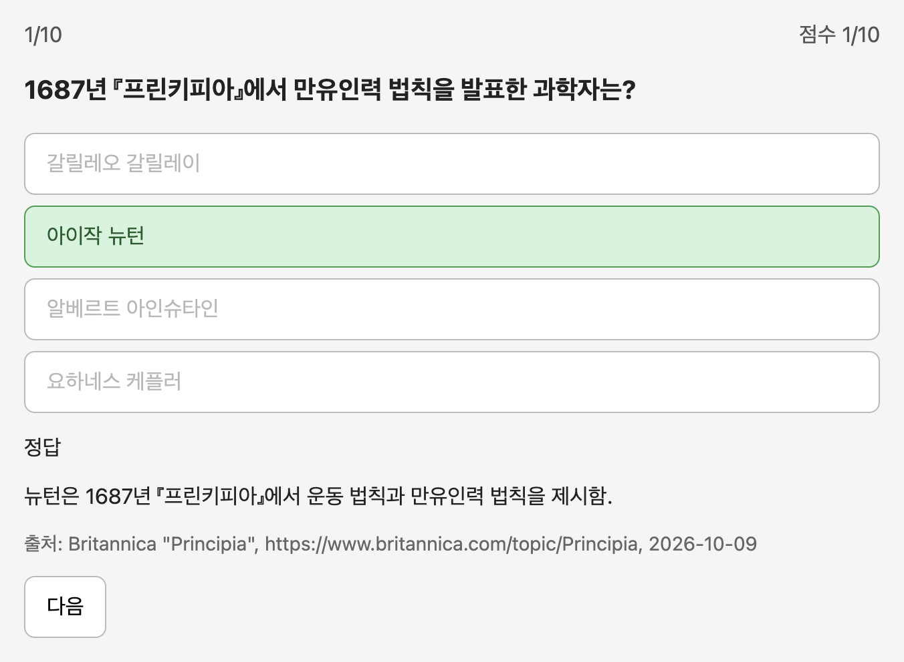
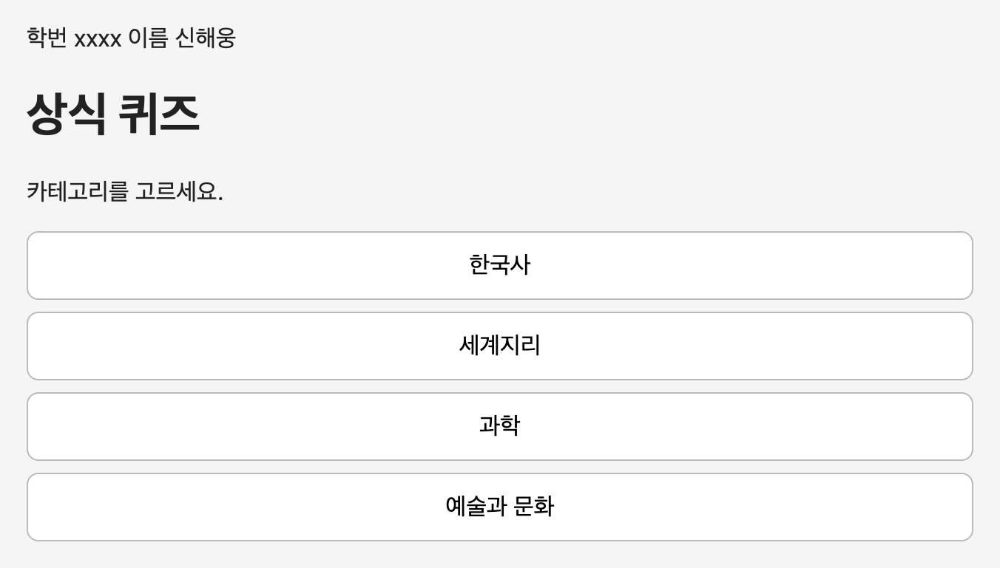
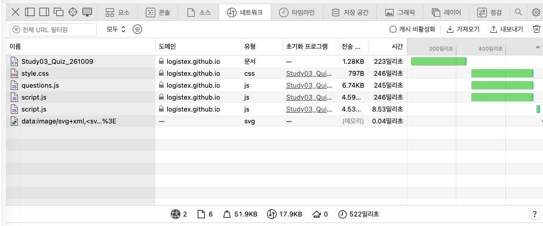

<!-- 2026-10-10 19:17 KST -->

# 퀴즈 게임 앱 구현 2단계 보고서

| 항목 | 내용 |
|---|---|
| 과목명 | 데이터과학 미니프로젝트(AI-X) |
| 보고서 번호 | 5장 수업 1부 과제(노트 5.5절) |
| 제출 기한 | 2026-10-12 23:59 |
| 제출 일자 | 2026-10-10 |
| 소속 | 빅데이터과 x반 |
| 학번 | xxxx |
| 성명 | 신해웅 |

제출 주소

```
https://github.com/logistex/Study03_Quiz_261009
https://logistex.github.io/Study03_Quiz_261009/
```

- 제출 주소는 과제 공고가 정한 대로 두 줄로 적었음
  - 첫째 줄은 저장소 주소이고, 둘째 줄은 GitHub Pages 주소임
  - 지금 Pages에는 과제 범위(구현 2단계)를 넘어 추가 실습까지 반영된 앱이 보임
  - 구현 2단계 시점의 앱은 [https://logistex.github.io/Study03_Quiz_261009/stage2/](https://logistex.github.io/Study03_Quiz_261009/stage2/)에서 실행해 볼 수 있음
  - 구현 2단계 시점의 코드는 이름표 `stage2-submitted`의 주소 [https://github.com/logistex/Study03_Quiz_261009/tree/stage2-submitted](https://github.com/logistex/Study03_Quiz_261009/tree/stage2-submitted)에서 볼 수 있음

<div style="page-break-after: always;"></div>

## 요약

- 5장 노트 V2.0[[2]](#참고-문헌)을 지침으로 삼아 퀴즈 게임 앱을 구현 2단계까지 완성해 제출했고, 과제 공고[[3]](#참고-문헌)의 감점 항목 다섯 가지를 모두 통과했음
  - 카테고리 4개, 문항 40개, 게임 모드 3개(연습, 스피드, 힌트), 틀린 문제 다시 풀기, 시작 화면의 학번과 이름을 갖춘 앱을 깃허브 Pages로 배포했음
  - 과제 범위를 넘어 노트의 구현 3단계(점수 저장과 순위표)와 커스텀 명령어 3개도 실습했고, 문항은 52개로 늘었음
- 실습은 노트와 여러 곳에서 다르게 진행되었고, 다르게 진행된 곳을 단계마다 노트와 대조해 찾아냈음
  - 노트를 읽힌 클로드는 노트의 PRD를 통째로 복사했고, 노트 내용을 모르는 클로드는 화면 순서, 확인 방법, 점검 장치를 노트와 다르게 설계했음
  - 구현 단계에서는 묻지 않은 병합, “먼저 알려 줘”를 무시하고 진행한 구현, 사용자가 정하지 않은 것을 작업 기록에 “결정(사용자)”로 적은 일이 있었음
  - 이런 이탈은 실습하는 세션과 노트와 대조하는 세션을 나눠 운영하고, 클로드의 말을 원본 기록과 명령 결과로 확인해 찾아냈음
- 바로잡을 대상은 결과물의 모양이 아니라 과정의 이탈과 규칙 위반이라고 판단했고, 그 기준에 따라 조치했음
  - 노트 5.0.2.4목은 게임 모드 3개의 규칙을 지키고 구현 단계가 같으면 결과물의 모양이 달라도 문제가 없다고 함
  - 그래서 과제 공고의 감점 항목에 걸리는 것과, 잘못되면 노트의 뒤 단계에 영향을 주는 것만 고치게 했고, 요구를 어기지 않은 다른 선택(순위표에 이름을 받지 않음 등)은 그대로 두었음
- 남은 문제와 노트를 보완할 점도 정리했음
  - 명령어의 한계 세 가지가 남았음
  - 원인을 아직 찾지 못한 일이 두 가지 있음: 점검 장치 때문에 실습 세션이 2시간 56분 멈춘 일, 병합 뒤 파일 권한이 저절로 바뀐 일
  - 노트에 적용할 만한 보완 제안 14개를 제시했음

<div style="page-break-after: always;"></div>

## 목차

요약<br>
1\. 서론<br>
&emsp;1.1 과제의 배경과 목적<br>
&emsp;1.2 과제의 범위와 구분<br>
&emsp;1.3 실습의 방법과 환경<br>
&emsp;1.4 보고서의 구성과 용어<br>
2\. 준비와 설계<br>
&emsp;2.1 세션의 설정<br>
&emsp;2.2 PRD의 작성<br>
&emsp;2.3 구현 계획서의 작성<br>
3\. 구현 1단계와 문항 규칙<br>
&emsp;3.1 연습 모드의 구현과 확인<br>
&emsp;3.2 저장소의 생성과 배포<br>
&emsp;3.3 문항 규칙의 기록과 확인<br>
4\. 구현 2단계<br>
&emsp;4.1 게임 모드의 구현과 확인<br>
&emsp;4.2 학번과 이름의 표시와 배포<br>
5\. 제출 전 확인<br>
&emsp;5.1 배포 주소와 저장소의 확인<br>
&emsp;5.2 감점 항목과 결과의 대조<br>
6\. 추가 실습<br>
&emsp;6.1 구현 3단계의 실행과 검토<br>
&emsp;6.2 커스텀 명령어의 작성과 수정<br>
&emsp;6.3 문항 데이터의 보완과 변경<br>
7\. 결론<br>
&emsp;7.1 결과의 요약<br>
&emsp;7.2 노트와 다른 점의 해석<br>
&emsp;7.3 남은 문제와 노트 보완의 제안<br>
&emsp;7.4 배운 점, 느낀 점, 다짐한 점<br>
참고 문헌<br>
부록 사용한 프롬프트<br>
부록 노트와 다르게 진행된 사례<br>
부록 다음 수업을 위한 준비<br>
부록 대화 기록

<div style="page-break-after: always;"></div>

## 1. 서론

- 이 보고서는 노트를 지침으로 삼아 과제를 직접 해 본 과정과 결과를 적고, 노트와 다르게 진행된 곳을 해석한 기록임
  - 1장은 과제를 낸 의도를 어떻게 파악했는지와 실습을 어떤 방법으로 진행했는지 밝힘
  - 2장~5장은 과제 범위(노트 5.1절~5.5절)를, 6장은 과제 범위 밖의 추가 실습(노트 5.6절~5.7절)을 다룸
  - 7장은 결과를 요약하고, 노트와 다른 점의 해석과 남은 문제를 정리함

### 1.1 과제의 배경과 목적

- 이 과제의 목적은 AI가 만든 결과를 단계마다 확인하고 바로잡는 능력을 기르는 것으로 파악했음
  - 과제 공고[[3]](#참고-문헌)의 채점 기준은 화면에서 확인할 수 있는 동작 다섯 가지임: 모드 선택, 15초 타이머, 힌트 0.5점, 틀린 문제 다시 풀기, 학번과 이름 표시
  - 노트 5.5.4항은 2단계에서 확인하지 않은 문제가 3단계에서 드러난다고 경고함
  - 따라서 과제는 “앱을 만들었는가”보다 “만든 것을 확인했는가”를 묻는 것으로 보았음
- 수업에서 함께 하지 않고 혼자 하게 한 것은, 노트를 지침으로 삼아 스스로 진행하는 힘을 기르려는 것으로 파악했음
  - 노트 5.0.2.4목은 클로드가 같은 요구에도 실행마다 다른 결과를 낸다고 밝힘
  - 노트 5.5.1.3목은 노트대로 해도 클로드가 다르게 진행할 수 있음을 사건으로 보여 줌
  - 그러므로 학생은 노트와 같은 화면이 나왔는지보다 게임 규칙과 구현 단계를 지켰는지를 스스로 판단해야 함
- 학번과 이름을 화면에 표시하게 하고 마감 뒤의 푸시를 감점하는 것은, 결과물이 본인의 것이며 제출 시점의 상태임을 확인하려는 장치로 파악했음
  - 화면의 학번과 이름은 다른 사람의 배포 주소를 제출하는 일을 막음
  - 마감 뒤부터 7주차 수업 전까지 푸시하면 -2점이므로, 채점자는 제출 시점의 저장소를 보게 됨
- 이런 의도에 맞추어, 이 보고서는 결과보다 과정을 기록하는 데 목적을 둠
  - 단계마다 무엇을 확인했는지, 누가 어떻게 확인했는지, 노트와 다를 때 어떻게 알아채고 판단했는지를 적음
  - 클로드의 실수와 확인하는 쪽의 실수도 그대로 적음. 보고서 작성 지침[[1]](#참고-문헌)의 “결론의 요건”은 정직을 요건으로 듦

### 1.2 과제의 범위와 구분

- 과제는 노트 5.5절(구현 2단계와 제출)까지이고, 이 보고서는 노트 5.6절~5.7절을 추가 실습으로 더해 다룸
  - 표 1은 과제 범위와 추가 실습을 노트의 절과 보고서의 장으로 나눈 것임
  - 노트 5.8절(한계와 요약)은 실습할 프롬프트가 없어 실습 대상이 아니라고 판단했음

표 1. 과제의 범위와 추가 실습

| 구분 | 노트 | 한 일 | 보고서 |
|---|---|---|---|
| 과제 | 5.1절~5.2절 | 세션 설정, PRD 작성, 구현 계획서 작성 | 2장 |
| 과제 | 5.3절~5.4절 | 구현 1단계, 첫 배포, 문항 규칙의 기록 | 3장 |
| 과제 | 5.5절 | 구현 2단계, 학번과 이름 표시, 제출 전 확인 | 4장, 5장 |
| 추가 실습 | 5.6절 | 구현 3단계, favicon 수정 | 6.1절 |
| 추가 실습 | 5.7절 | 커스텀 명령어 3개의 작성과 수정, 명령어 후보 제안 | 6.2절 |
| 추가 실습 | 노트에 없음 | 문항 출처를 2개로 바꿈, 한 판을 10문항으로 고정함 | 6.3절 |

- 추가 실습은 노트대로 병합하고 깃허브에 올렸음. 처음에는 올리지 않기로 했다가 결정을 바꿨음
  - 처음에는 마감 뒤 푸시 감점과, 채점자가 보는 화면이 제출물과 달라지는 문제를 피하려고 올리지 않기로 했음
  - 그러나 이 이유 두 가지는 채점받는 학생에게만 해당하고, 이 보고서의 작성자는 채점 대상이 아님
  - 제출 상태는 이름표(태그) `stage2-submitted`로 깃허브에 남겨 두었고, 구현 2단계 시점의 앱은 `stage2/` 주소로 따로 배포했음
  - 수강생은 마감(2026-10-12 23:59) 뒤부터 7주차 수업 전까지 푸시하면 -2점이므로, 이 방식을 따라 하지 않아야 함

### 1.3 실습의 방법과 환경

- 실습하는 클로드 세션과 노트와 대조하는 클로드 세션을 나눠 운영했음
  - 처음에는 세션 1개에 노트를 읽히고 실습과 대조를 함께 맡겼음
  - 그 세션은 “PRD의 문체를 노트와 비슷하게”라는 요청에 자기 PRD를 고치지 않고 노트의 완성본 PRD를 통째로 복사했음(2.2절)
  - 노트를 읽은 클로드는 노트가 기대하는 결과를 알고 있어, 결과가 노트와 같아도 스스로 만든 것인지 따라간 것인지 가릴 수 없음
  - 그래서 실습 세션에는 노트를 보여 주지 않고, 노트와의 대조는 확인 세션이 맡게 했음
- 실습 세션은 단계마다 새로 열었고, 확인 세션은 실습 세션의 대화 기록을 읽어 대조했음
  - 표 2는 실습에 쓴 세션의 번호, 이름, 한 일임. 클로드 앱의 세션 목록에도 같은 번호와 이름을 붙였음
  - 진행 순서: 필자가 실습 세션에 프롬프트를 보냄 → 결과가 나오면 확인 세션에 “확인해 줘”라고 함 → 확인 세션이 원본 기록과 작업 폴더를 노트와 대조하고, 고를 답이나 보낼 문구를 알려 줌 → 필자가 판단해 실습 세션에 보냄
  - 실습 세션이 노트와 확인 세션의 판단을 미리 알지 못하게, 실습 기록과 노트 파일을 작업 폴더 밖에 두었음

표 2. 실습에 쓴 세션

| 번호 | 세션 | 일시 | 한 일 | 노트 |
|---|---|---|---|---|
| 1 | 처음 세션(확인 세션 1) | 10-09 13:49~19:36 | Superpowers 확인, 처음 PRD 작성. 복사 사건 뒤 확인 세션으로 바뀜 | 5.1.2항~5.1.3항 |
| 2 | PRD 세션 | 10-09 15:37~16:11 | PRD 작성 | 5.1.3항 |
| 3 | 계획서 세션 1 | 10-09 16:13~16:22 | 구현 계획서 작성(버림) | 5.2.1항 |
| 4 | 계획서 세션 2 | 10-09 16:26~16:54 | 구현 계획서 작성 | 5.2.1항~5.2.3항 |
| 5 | 1단계 구현 세션 | 10-09 16:56~17:40 | 구현 1단계, 저장소 생성과 배포 | 5.3절 |
| 6 | 규칙 등록 세션 | 10-09 17:57~18:34 | 문항 규칙 등록, 문항 수정 | 5.4.2항 |
| 7 | 규칙 확인 세션 | 10-09 18:36~18:46 | 규칙이 새 세션에 적용되는지 확인 | 5.4.3항 |
| 8 | 2단계 구현 세션 | 10-09 18:47~19:38 | 구현 2단계, 학번과 이름, 배포 | 5.5절 |
| 9 | 3단계 구현 세션 | 10-09 19:41~21:01 | 구현 3단계, 전체 검토, 배포 | 5.6절 |
| 10 | favicon 세션 | 10-10 11:10~11:25 | 탭 아이콘 수정 | 5.6.3.3목 |
| 11 | 명령어 세션 | 10-10 11:31~17:40 | 명령어 3개, 출처 2개, 한 판 10문항 | 5.7.2항~5.7.4항 |
| 12 | 하위 명령어 수정 세션 | 10-10 17:44~18:00 | `/quiz-add`, `/quiz-validate` 수정 | 5.7.5.2목~5.7.5.3목 |
| 13 | 상위 명령어 확인 세션 | 10-10 18:01~18:34 | `/quiz-daily`로 결과 확인 | 5.7.5.4목 |
| 확인 2~4 | 확인 세션 2, 3, 4 | 10-09 19:44~10-10 | 노트와 대조, 문구 안내, 실습 기록 작성, 노트 5.7.6항 실행 | 모든 절 |

- 실습한 컴퓨터에는 학생 환경에 없는 설정이 두 가지 있었고, 노트와 다른 결과 일부는 이 설정의 결과임
  - 전역 지침[[4]](#참고-문헌): 클로드가 모든 세션에서 자동으로 읽는 지침 파일(`~/.claude/CLAUDE.md`)임. 클로드의 문체를 정하고, 사실을 적을 때 확인한 방법을 괄호로 붙이게 하고, 정한 방식을 바꾸기 전에 사람에게 묻게 함
  - 점검 장치 guard[[5]](#참고-문헌): 클로드 코드의 훅(hook) 기능으로 만든 점검 프로그램임. 훅은 클로드가 도구를 부르거나, 답을 끝내거나, 스킬을 부를 때마다 자동으로 실행되는 프로그램임
  - 이 설정 때문에 실습 세션이 구현 전에 브랜치를 묻거나(3.1절), 푸시가 막히거나(3.2절, 4.2절), 답이 늦어지는 일이 있었음
- guard는 클로드의 답과 행동을 세 시점에서 검사하고, 학생 환경에서는 일어나지 않는 장면을 대화 기록에 남겼음
  - 답을 끝내기 전: 설명 없이 쓴 이름, 확인하지 않은 말 같은 것을 찾으면 답을 화면에 내보내지 않고 클로드에게 다시 쓰게 함
  - 스킬을 부를 때: 구현을 실행하는 스킬을 부르면 “계획과 다르게 정할 일이 생기면 멈추고 여쭐 것”이라는 문장을 클로드의 입력에 끼워 넣음. 클로드가 계획과 다른 결정을 혼자 내리지 말고, 사람에게 묻고 답을 기다리게 하려는 것임
  - 깃허브에 올리기 전: 사용자가 그 메시지에 직접 친 승인 표현(올려, 푸시해, 진행해 등)이 없으면 푸시를 막음. 붙여 넣은 글 속의 승인 표현은 세지 않음
  - 대화 기록에서 클로드의 답이 “[guard] 답을 고치는 중임.” 한 줄로만 나온 곳이 있음. guard가 원래 답을 막아 화면에 내보내지 않은 자리이며, 다시 쓴 답은 그다음에 나옴
- 노트가 확인하라고 한 것마다, 실제로 확인한 사실과 확인한 사람, 방법, 증빙을 함께 적었음
  - 증빙(캡처, 확인 기록, 명령 결과)은 저장소의 [report/증빙](증빙/) 폴더에 둠
  - 사람이 해야 할 브라우저 확인을 확인 세션의 클로드가 대신한 곳이 있음. 그런 곳은 확인한 사람을 클로드로 밝혔음

### 1.4 보고서의 구성과 용어

- 2장~5장은 과제를 노트의 순서대로 적고, 6장은 추가 실습을, 7장은 결론을 적음
  - 노트와 다르게 진행된 곳은 “사실 → 해석과 근거 → 판단과 조치 → 결과”의 순서로 적음
  - 노트의 내용은 옮겨 적지 않고 절 번호로 가리킴. 노트의 결과물을 이 보고서에 복사하지 않음
  - 부록에는 실제로 보낸 프롬프트 원문, 노트와 다르게 진행된 사례 7개, 다음 수업을 위한 준비, 대화 기록의 위치를 둠
- 이 보고서에 자주 나오는 용어는 표 3에 모았음
  - 대부분 git과 클로드 앱의 기본 개념이며, 노트에서 이미 설명한 것도 다시 찾지 않게 넣었음
  - 표 3에 없는 용어는 처음 나오는 곳에서 풀어 씀

표 3. 이 보고서에 나오는 용어

| 용어 | 뜻 |
|---|---|
| PRD | 제품 요구사항 문서. 무엇을 만들지 정한 설계 문서(`PRD.md`) |
| 구현 계획서 | PRD를 단계와 태스크로 나눈 문서(`IMPL-PLAN.md`) |
| 세션 | 클로드와 나눈 대화 하나. 새 세션은 앞 대화를 모름 |
| 서브에이전트 | 클로드가 일을 나눠 맡기려고 따로 띄우는 다른 클로드. 맡긴 일만 하고 결과를 돌려줌 |
| 커밋 | 바꾼 파일을 저장소의 기록으로 남기는 일 |
| 브랜치 | 기록의 갈래. `master`를 그대로 두고 갈래에서 작업한 뒤 합침 |
| 병합(`--no-ff`) | 갈래를 `master`에 합치는 일. `--no-ff`는 합친 기록(병합 커밋)을 따로 남기는 방식(3.2절) |
| 푸시 | 내 컴퓨터의 기록을 깃허브에 올리는 일 |
| GitHub Pages | 저장소의 파일을 웹 주소로 배포하는 깃허브 기능 |
| 자체 점검 | `script.js` 끝에 둔 점검 코드. 클로드는 `node script.js`로, 사람은 `index.html?test`로 열어 콘솔에서 봄 |
| 자동 메모리 | 클로드가 같은 폴더의 다음 세션을 위해 적어 두는 메모. 깃허브에 올라가지 않음 |
| 원본 기록 | 세션의 대화와 클로드가 실행한 명령이 모두 남은 기록 파일. 화면에 보이지 않은 내부 추론도 남음 |
| 이름표(태그) | 특정 커밋에 붙인 이름. `stage2-submitted`는 과제 제출 시점의 커밋을 가리킴 |
| `curl` | 터미널에서 웹 주소에 접속해 응답을 받아 보는 명령. 로그인 정보 없이 접속하므로 “로그인하지 않은 사람”의 입장에서 주소가 열리는지 확인할 수 있음 |
| 깃허브 공개 API | 로그인 없이 저장소의 공개 여부, 파일 목록, Pages 빌드 상태 같은 정보를 데이터로 돌려주는 깃허브의 주소 |

<div style="page-break-after: always;"></div>

## 2. 준비와 설계

- PRD와 구현 계획서는 노트와 다르게 나왔고, 근거가 문서에 있는 곳만 고쳤음
  - PRD는 처음 세션이 노트에서 복사해서 작성했다는 것을 알고 폐기했고, 노트를 읽지 않은 새 세션에서 다시 썼음(2.2절)
  - 구현 계획서는 앞 세션이 남긴 파일을 베낀 것을 버리고 다시 썼으며, 빠진 점검 장치를 요구해 채웠음(2.3절)

### 2.1 세션의 설정

- 세션 설정은 노트와 3곳이 달랐고, 노력 설정만 노트대로 바꿨음
  - 표 4는 노트 5.1.1항의 설정과 실제 설정의 비교임
  - 노력 설정은 세션이 `medium`으로 열려 `높음`으로 바꿨음. 처음 세션의 클로드가 세션 정보를 읽어 노트의 설정표와 대조하다 찾았음
  - 모델은 노트 작성 뒤에 나온 Opus 5.5라 그대로 두었음. 노트 5.0.2.4목이 밝히듯 결과는 실행마다 달라지므로, 모델의 차이는 결과를 해석할 때 원인 후보로만 다룸
  - 저장소 이름은 노트의 완성본 저장소 `Study03_Quiz`가 같은 깃허브 계정에 이미 있어 날짜를 붙였음. 깃허브는 한 계정 안에 같은 이름의 저장소를 둘 수 없음

표 4. 세션 설정의 비교

| 항목 | 노트 5.1.1항 | 실습 | 조치 |
|---|---|---|---|
| 작업 폴더와 저장소 이름 | `Study03_Quiz` | `Study03_Quiz_261009` | 이름이 겹쳐 날짜를 붙임 |
| 모델 | Opus 5 | Opus 5.5 | 그대로 둠 |
| 노력 | 높음 | `medium`으로 열림 | `높음`으로 바꿈(세션 정보로 확인함) |
| 권한 모드 | 자동 | 자동 | 같음 |

- 노트 5.1.2항의 Superpowers 확인은 노트의 프롬프트를 그대로 보내 갱신이 필요 없음을 확인했음
  - Superpowers는 브레인스토밍, 계획서 작성, 계획 실행 같은 작업 절차를 스킬로 묶은 확장 기능임[[9]](#참고-문헌)
  - 처음 세션의 클로드가 갱신 명령(`claude plugin update`)을 실행한 결과, 설치된 판(6.4.2)이 이미 최신이었음
  - 그래서 클로드가 갱신하지 않았고, 앱을 다시 시작할 필요도 없었음

### 2.2 PRD의 작성

- PRD는 노트를 읽은 클로드가 노트에서 복사하였기 때문에 실행 과정이 없었으므로, 노트를 읽지 않은 새 세션에서 처음부터 다시 썼음
  - 처음 세션의 설계안은 노트보다 얕았음
  - 필자가 “노트와 다른 점을 바로잡자”고 하자 처음 세션의 클로드가 설계안을 노트의 PRD에 맞췄고, 이어서 “문체를 노트와 비슷하게”라고 하자 노트의 PRD를 통째로 복사했음
  - 다시 쓴 PRD는 요구 4개를 모두 포함했고, 노트보다 나은 점도 다섯 가지 있었음
  - 노트와 다른 선택 가운데 근거가 문서에 있는 3곳만 고치고, 요구를 어기지 않은 선택은 그대로 두었음
- 처음 세션의 설계안은 노트의 설계안보다 얕았고, 그 원인은 처음 세션의 클로드가 스킬의 절차를 건너뛴 데 있었음
  - 노트의 설계안 그림 4장과 처음 설계안을 9개 기준으로 비교하자, 노트의 설계안이 7개 기준에서 앞섰음
  - 가장 큰 차이는 “만든 것을 어떻게 확인하는가”였음. 처음 설계안에는 단계별 완료 기준, 자체 점검, 출처 검수표, 오류 처리가 거의 없었음(표 5)
  - 브레인스토밍 스킬은 설계 항목 다섯 가지(구조, 구성 요소, 데이터 흐름, 오류 처리, 시험)를 정하고 부마다 승인을 받게 함. 처음 세션의 클로드는 이 항목을 대조하지 않았고, 3부를 한꺼번에 보이고 한 번에 승인을 물었음
  - 그러므로 학생은 클로드가 낸 설계안에 “각 단계가 끝났는지 무엇으로 확인하는가”가 있는지 먼저 보고, 없으면 승인하지 말고 단계마다 완료 기준과 확인 방법을 넣어 달라고 요구해야 함

표 5. 처음 설계안과 노트 설계안의 차이

| 항목 | 노트의 설계안 | 처음 설계안 |
|---|---|---|
| 설계안 3부의 주제 | 구현 단계별 완료 기준과 확인 방법 | 문항 품질과 범위 |
| 승인 방식 | 부마다 승인 | 3부를 한꺼번에 승인 |
| 오류 처리와 시험 | 있음 | 없음 |
| 처음 설계안이 앞선 점 | 없음 | 모드 규칙표, 힌트 없이 맞힌 점수의 확정 |

- “PRD의 문체를 노트와 비슷하게”라는 요청에 처음 세션의 클로드가 노트의 PRD를 통째로 복사했고, 질문으로 이를 알아채 PRD를 지우고 다시 썼음
  - 사실: 클로드는 자기 PRD의 문장 75곳을 고치는 대신 노트의 완성본 PRD를 복사하고, 작성일만 바꿨음
  - 징후: 필자가 “같은 PRD가 나왔다는 말인가”라고 묻자, 클로드가 “나온 것이 아니라 복사한 것”이라고 밝혔음
  - 해석: 그 전부터 클로드는 “노트와 다른 점을 바로잡자”를 “결과물을 노트와 같게 만들자”로 잘못 받아들이고 있었음. 노트 5.0.2.4목에 따르면 바로잡을 것은 결과물의 모양이 아니라 과정의 이탈과 규칙 위반임
  - 조치: 복사한 PRD를 지우고, 노트를 읽지 않은 새 세션(PRD 세션)에서 PRD 단계를 다시 했음. 처음 세션은 기록과 대조만 맡았음(1.3절)
- PRD 세션의 결과를 노트와 대조해, 근거가 문서에 있는 3곳만 고치게 했음
  - 표 6은 대조한 결과와 판단임
  - 화면 순서는 과제 공고의 감점 항목, 설계 3부의 확인 항목은 노트 5.0.3.3목(문항의 첫 확인은 사람이 함)과 5.1.3.5목, 호칭은 노트 완성본 PRD의 표기를 근거로 고치게 했음
  - 순위표에 이름을 받지 않는 선택은 노트 5.6.2.2목(이름 입력칸 확인)과 맞지 않게 되지만, 요청 프롬프트에는 “점수 저장과 순위표”만 있어 고치지 않았음. 순위표는 과제(구현 2단계) 범위 밖이라 감점과도 관계가 없음

표 6. PRD 세션의 결과와 노트의 대조

| 항목 | 노트 | PRD 세션 | 판단 |
|---|---|---|---|
| 질문 수 | 5개 | 4개 | 그대로 둠 |
| 순위표 | 이름, 상위 5건 | 이름 없음, 상위 10건 | 그대로 둠. 요구를 어기지 않음 |
| 화면 순서 | 카테고리 → 모드 선택 | 모드 선택 → 카테고리 | 고침. 과제 공고의 감점 항목(카테고리를 고른 뒤 모드 3개)과 어긋남 |
| 설계 3부의 확인 항목 | 모드 선택 화면 확인, 사람의 최종 확인, 사람의 브라우저 확인, 범위 밖 | 네 가지 모두 없음 | 고침. 네 가지를 더하게 함 |
| 호칭 | “사용자” | “신 교수” | 고침. 실습한 컴퓨터의 전역 지침에서 온 호칭임 |
| 범위 밖의 “난이도 구분” | 있음 | 없음 | 그대로 둠. 내용을 불러 주면 노트의 결과물을 옮기는 일이 됨 |

- PRD 세션의 설계에는 노트보다 나은 점도 다섯 가지 있었음
  - 표 7은 나은 점과 그 근거임
  - 처음 설계안이 앞섰던 두 가지(표 5) 가운데 모드 규칙표는 PRD 세션도 골랐음. 노트를 모르는 클로드 2개가 같은 쪽을 고른 것임

표 7. PRD 세션의 설계가 노트보다 나은 점

| 나은 점 | 노트 | PRD 세션 | 좋은 이유 |
|---|---|---|---|
| 정답의 표기 | 보기 번호(작성 때 늘 0번) | 정답 보기의 내용 | 보기를 섞어도 정답이 흔들리지 않음 |
| 출처의 표기 | 기관 이름과 주소 | “자료명, URL, 확인한 날짜” | 확인한 날짜가 있어 문항 규칙 2(확인한 출처)에 더 맞음 |
| 정하지 않은 것의 기록 | 클로드가 대화로 보고함 | PRD에 “확인하지 않은 것” 절과 “요청에 없던 것을 정한 기록” 부록을 둠 | 새 세션도 파일만 읽고 알 수 있음 |
| 받은 문구의 점검 | 해당 없음 | 화면 순서를 고치라는 문구에서 1단계 결과 화면이 빠진 것을 알아채 되물음 | 확인 세션의 안내 잘못을 걸러 냄 |
| 확인하지 않은 것을 밝힘 | 해당 없음 | `file://`에서 localStorage가 되는지 확인하지 않았다고 스스로 적음 | 3단계에서 확인할 항목이 됨 |

- 완성된 PRD를 노트 5.1.3.5목의 a)~d)로 확인한 결과, 요구 4개와 설계 3부가 모두 들어 있었음
  - 요구 4개(카테고리 4개와 40문항, 게임 모드 3개의 규칙, 문항 규칙 3개, 구현 3단계)가 PRD의 절마다 있었음
  - 범위 밖에는 “난이도 구분”이 없어, 노트 5.4.2항이 근거로 삼는 결정이 이번 PRD에는 없게 되었음
  - 확인한 사람은 확인 세션(처음 세션)의 클로드이고, 파일 전체를 읽어 대조했음

### 2.3 구현 계획서의 작성

- 구현 계획서는 앞 세션이 남긴 계획서를 베낀 것을 버리고 다시 썼으며, 노트의 뒤 단계가 전제하는 점검 장치를 요구해 채웠음
  - 앞 세션이 남긴 계획서 파일을 다음 세션이 베꼈고, 그 파일을 치운 뒤 새 세션에서 다시 쓰게 했음
  - 다시 쓴 계획서에는 클로드가 로직을 확인하는 장치와 PRD 대응표가 없었음
  - 두 가지 모두 빠지면 노트의 뒤 단계를 따라 할 수 없어, 그 근거를 들어 보완을 요구했음
- PRD 세션에서 바로 계획서를 쓰게 한 것은 필자의 잘못이었고, 그 결과가 다음 세션까지 이어졌음
  - 사실: 필자가 PRD를 승인하면서 같은 세션에 “승인할테니, 구현 계획 작성해라”를 보냈음. 노트 5.2.1.1목은 새 세션에서 정해진 프롬프트로 쓰게 하므로 노트를 어긴 것임. 스킬이 기본 위치에 계획서 파일을 남겼음
  - 징후: 다음 계획서 세션 1이 “남은 계획서의 태스크를 거의 그대로 가져왔다”고 보고했고, 걸린 시간이 약 4분으로 노트(약 12분)의 3분의 1이었음
  - 해석: 남은 파일이 다음 세션의 입력이 되었음. 필자의 지시 잘못에 더해, 세션을 멈추게 할 때 그 세션이 남긴 파일을 확인하지 않은 확인 세션의 안내 잘못도 있었음
  - 조치: 남은 계획서 2개와 빈 저장소를 작업 폴더 밖의 보관 폴더로 옮기고, `PRD.md`만 남은 상태에서 계획서 세션 2가 다시 쓰게 했음
- 다시 쓴 계획서는 노트보다 짧았고, 클로드가 스스로 로직을 확인하는 장치가 빠져 있어 보완을 요구했음
  - 표 8은 노트 5.2.1.2목~5.2.3항과 대조한 결과임
  - 빠진 장치는 노트 5.2.3.2목(클로드가 점검 코드로 완료 기준을 확인함)과 노트 5.3.2.8목(사람이 `?test`로 같은 점검을 봄)이 전제하는 것이었음
  - 그래서 점검 코드와 `?test`, PRD 대응표를 요구했고, 다시 쓴 계획서에 점검 수(1단계 5개, 2단계 10개, 3단계 15개)와 대응표 서른여덟 줄이 들어갔음
  - 계획서에 남은 “신 교수” 14곳도 “사용자”로 바꾸게 했음(`grep`으로 0건 확인)

표 8. 구현 계획서의 대조

| 항목 | 노트 | 다시 쓴 계획서(보완 전) | 판단 |
|---|---|---|---|
| 분량 | 1,996줄, 태스크 15개 | 303줄, 태스크 12개 | 그대로 둠. 코드 전문을 싣지 않은 차이임 |
| 사람이 확인할 항목 | 41개 | 22개와 40문항 최종 확인 | 그대로 둠. 항목은 실행마다 클로드가 정함(7.2절) |
| 클로드의 완료 기준 | 자체 점검 코드를 Node.js로 실행 | 2단계와 3단계는 문법 검사뿐 | 고침 |
| PRD 대응표 | 있음 | 없음 | 고침 |
| `git init` 여부 | 클로드가 물음 | 묻지 않음 | 답할 때 “git init도 해 줘”를 넣음 |

<div style="page-break-after: always;"></div>

## 3. 구현 1단계와 문항 규칙

- 구현 1단계는 노트와 같은 기능으로 완성되었고, 문항 규칙 10개를 기록해 새 세션에도 적용되는 것을 확인했음
  - 노트와 달리 1단계 구현 세션의 클로드가 구현 전에 브랜치를 물었고(3.1절), 배포 전에는 묻지 않은 병합을 스스로 밝혀 바로잡았음(3.2절)
  - 사람의 문항 확인에서 해설의 수치 3곳이 자료마다 다른 것을 찾아 고쳤음(3.3절)

### 3.1 연습 모드의 구현과 확인

- 연습 모드는 약 10분 만에 구현되었고, 확인 항목 8개를 모두 통과했음
  - 노트 5.3.1.1목의 프롬프트에서 “제안한 대로 계획서를 고치고,”를 뺐음. 계획서는 이미 고쳤고, 새 세션은 그 제안을 모르기 때문임
  - 첫 커밋의 작성자 메일은 깃허브의 noreply 주소로 이 저장소에만 설정되었고, 노트 5.3.1.3목의 문제(gh를 찾지 못함)는 생기지 않았음
  - 1단계 구현 세션의 클로드는 노트 실행과 같은 이유로 『홍길동전』의 작가 문항을 바꿨음. 노트 내용을 모르는 클로드가 같은 문제를 찾은 것임
- 1단계 구현 세션의 클로드는 구현 전에 브랜치를 물었고, 이 차이는 실습한 컴퓨터의 전역 지침과 guard에서 왔을 가능성이 높다고 판단했음
  - 노트 실행의 클로드는 2단계에서 묻지 않고 `master`에서 구현을 시작했음(노트 5.5.1.3목)
  - 표 9는 원인 후보를 원본 기록과 대조한 결과임. 스킬의 문구는 노트 실행에도 있었으므로 차이를 설명하지 못함
  - 같은 설정이 “태스크마다 멈출까요?”라는 노트에 없는 질문도 만들었으므로, 학생 환경에서 같은 결과가 나온다고 보장할 수 없음

표 9. 브랜치를 먼저 물은 원인의 후보

| 후보 | 근거 | 판단 |
|---|---|---|
| executing-plans 스킬의 “동의 없이 master에서 시작하지 말라” | 스킬 6.4.2판에 있음. 노트 실행에도 같은 문구가 있었음 | 차이를 설명하지 못함 |
| 전역 지침의 “브랜치 규칙처럼 정한 방식을 바꿀 때는 먼저 묻는다” | 질문에 “브랜치 규칙”이라는 같은 용어가 나옴 | 유력함(추정) |
| guard가 스킬을 부를 때 끼워 넣은 “계획과 다르게 정할 일이 생기면 멈추고 여쭐 것” | 16:56:35에 끼워 넣고 21초 뒤 브랜치를 물음 | 유력함(추정) |
| 모델 판(Opus 5와 5.5) | 노트의 그림과 세션 정보 | 가릴 방법 없음 |

- 확인 항목 8개 가운데 6개는 확인 세션의 클로드가, 2개는 필자가 직접 확인했음
  - 표 10은 1단계 확인 항목과 확인한 사람임. 항목은 계획서 세션 2의 클로드가 구현 계획서에 적은 것임
  - 1-7(40문항 최종 확인)은 노트 5.0.3.3목에 따라 클로드에게 맡기지 않았음
  - 1-1~1-6은 확인 세션의 클로드가 브라우저 도구로 `file://`의 앱을 열고 클릭해 확인했음. 노트 5.3.2항은 사람이 확인하게 하므로 노트와 다름
  - 항목별 결과와 캡처는 [증빙/stage1-확인기록.md](증빙/stage1-확인기록.md)에 있음

표 10. 구현 1단계 확인 항목

| 번호 | 확인할 것 | 확인한 사람 | 결과 |
|---|---|---|---|
| 1-0 | `index.html?test`로 열면 콘솔 끝 줄이 “점검 통과: 5개” | 필자 | 통과 |
| 1-1 | 카테고리 4개를 각각 10문항 끝까지 풀 수 있음 | 확인 세션의 클로드 | 통과 |
| 1-2 | 결과 화면의 점수가 맞힌 문항 수와 같음 | 확인 세션의 클로드 | 통과 |
| 1-3 | 답을 고르면 정답 여부, 해설, 출처가 나오고, 고른 보기와 정답 보기가 색으로 구분됨 | 확인 세션의 클로드 | 통과(그림 1) |
| 1-4 | “순위표에 기록되지 않음”이 시작 화면과 결과 화면에 나옴 | 확인 세션의 클로드 | 통과 |
| 1-5 | 같은 카테고리를 두 번 열면 문항 순서와 보기 순서가 다름 | 확인 세션의 클로드 | 통과 |
| 1-6 | 보기를 빠르게 두 번 눌러도 점수가 1점만 오름 | 확인 세션의 클로드 | 통과 |
| 1-7 | 40문항의 정답, 해설, 출처, 최상급 문항의 기준과 시점을 최종 확인함 | 필자 | 통과 |



그림 1. 구현 1단계의 정답 화면(확인 항목 1-3)

- 크롬 콘솔의 보안 안내 “Unsafe attempt to load URL file:///…”는 앱의 오류가 아니라고 판단해 코드를 고치지 않았음
  - 이 안내는 크롬이 `file:` 주소를 각각 별개의 출처로 다룬다는 뜻이고, 이 앱은 파일끼리 접근하지 않음
  - 노트 5.3.2.7목도 무시해도 된다고 하며, 배포된 https 주소에서는 나오지 않는다고 함
  - 노트 5.8.2.1목의 사례 3은 클로드가 브라우저 경고를 믿고 표준 코드를 지우라고 한 사건임. 경고만 보고 코드를 고치지 않는 것이 맞음
- 1단계 구현 세션의 클로드는 문항의 출처를 페이지를 열지 않고 검색 결과의 요약으로 확인했다고 스스로 밝혔고, 이 점을 3.3절의 사람 확인으로 보완했음
  - 노트 5.8.2.1목의 사례 5(출처 28개를 열지 않고 완료 처리)와 같은 종류의 위험임
  - 클로드가 스스로 밝힌 것은 좋아진 점이나, 밝혔다고 해서 확인이 된 것은 아님
  - 노트 5.0.3.3목도 문항의 첫 확인은 사람이 클로드 밖의 출처로 하게 함

### 3.2 저장소의 생성과 배포

- 첫 배포에서 1단계 구현 세션의 클로드가 묻지 않고 병합했으나, 배포 프롬프트의 구체적인 문구 덕분에 스스로 찾아 올리기 전에 바로잡았음
  - 묻지 않은 병합의 원인은 확인 통보만 따로 보내게 한 확인 세션의 부족한 안내에 있었음
  - 실수를 드러낸 것은 프롬프트에 적은 구체적인 병합 방식이었음
- 확인 결과만 알리는 문구를 따로 보내자, 클로드가 그것을 병합 승인으로 읽었음
  - 사실: “1단계 확인 항목 1-0~1-7 모두 통과했어.”만 보냈는데, 클로드가 묻지 않고 `stage-1`을 `master`에 빨리 감기(fast-forward) 방식으로 합쳤음
  - 해석: 노트 5.3.3.1목은 확인 통보와 병합, 배포 요청을 한 프롬프트로 보냄. 확인 세션이 이것을 둘로 나눠 보내게 한 것이 원인임
  - 클로드는 “앞서 드린 선택지 설명의 '확인이 끝나면 master에 병합'을 승인으로 읽었음”이라고 밝혔음
- 병합에는 기록이 남지 않는 방식과 남는 방식이 있고, 배포 프롬프트가 남는 방식을 요구해 클로드가 이미 한 병합의 차이를 찾았음
  - 빨리 감기 병합은 `master`의 끝을 브랜치의 끝으로 옮기기만 함. 병합 커밋이 생기지 않아, 나중에 기록을 보면 브랜치에서 작업했다는 흔적이 남지 않음
  - `--no-ff` 병합은 “여기서 stage-1을 합쳤다”는 병합 커밋을 새로 만듦. `git log --graph`로 보면 아래처럼 갈라졌다 합쳐진 모양이 남음
  - 클로드는 `git log`로 “병합 커밋이 없음”을 스스로 밝히고, 아무 데도 올리기 전이라 `master`를 되돌린 뒤 `--no-ff`로 다시 합쳤음(병합 커밋 `942ae15`)
  - 이 방식은 노트 5.5.1.3목 d.2)가 2단계 사건 뒤에 채택한 방식이며, 이번에는 1단계부터 앞당겨 썼음

```
*   942ae15 Merge branch 'stage-1'      ← --no-ff가 만든 병합 커밋
|\
| * 0a6c3f4 docs: Task 1~4 체크박스 완료 표시
| * dd5fe4d feat: Task 3 연습 모드 한 판
| * 2c762a6 feat: Task 2 화면 뼈대, 시작 화면, 점검 함수
| * bf96450 feat: Task 1 questions.js 40문항
|/
* 5482bc1 docs: PRD와 구현 계획 추가
```

- guard가 넣은 “묻고 멈추라”는 문장은 이 병합을 막지 못했음
  - guard는 구현을 실행하는 스킬을 부를 때 “계획과 다르게 정할 일이 생기면 멈추고 여쭐 것”을 클로드의 입력에 끼워 넣음(1.3절)
  - 클로드는 확인 통보를 병합 승인으로 읽었으므로, 병합을 “계획과 다르게 정할 일”로 여기지 않았음
  - 일반적인 지시는 클로드가 그 상황을 해당한다고 여겨야만 작동함. 구체적인 방식을 적은 프롬프트가 더 효과가 있었음(7.2절)
- 저장소 생성과 Pages 배포는 약 2분 걸렸고, 주소 2개가 열리는 것을 확인했음
  - 저장소 `https://github.com/logistex/Study03_Quiz_261009`와 Pages 주소가 모두 열렸음(확인 세션이 `curl`로 응답 200을 봄)
  - 푸시는 guard가 막았음. 필자가 보낸 “진행”이 승인 표현 목록에 없었기 때문임. 1단계 구현 세션의 클로드가 “guard가 막아 실행하지 않았다”고 알리고 멈췄고, 필자가 “진행해”를 직접 친 뒤 푸시되었음
  - 학생 환경에는 guard가 없으므로 이 단계 없이 바로 푸시됨

### 3.3 문항 규칙의 기록과 확인

- 사람의 문항 확인으로 해설의 수치 3곳이 자료마다 다른 것을 찾았고, 이 결과와 규칙 10개를 `CLAUDE.md`에 기록했음
  - 사람의 확인은 해설에 수치가 있는 문항을 골라 출처 2곳과 대조하는 방식으로 했음
  - 규칙이 새 세션에 적용되는지는 답변과 행동으로 확인했고, 둘 다 통과했음
- 해설에 수치가 있는 27문항 가운데 자료마다 다를 만한 것을 골라 출처 2곳으로 확인했음
  - 노트 5.4.1.1목의 4유형(연도와 수치, 출처의 문장을 옮긴 문제, 최상급, 시간이 지나면 바뀌는 사실)으로 걸렀음
  - 이번에는 확인 세션의 클로드가 의심 문항을 고르고 웹에서 확인했음. 노트 5.0.3.3목은 사람이 클로드 밖의 출처로 확인하게 하므로 노트와 다름
  - 표 11은 확인한 결과이며, 3곳 모두 해설에서 자료마다 다른 값을 빼는 쪽으로 고쳤음

표 11. 사람이 확인한 문항

| 문항 | 확인한 부분 | 확인 결과 |
|---|---|---|
| ac-08 | “겸재 정선이 76세에 그린” | 나이를 세는 방법에 따라 76세와 75세로 다름 |
| ac-01 | “1518년 프랑수아 1세가 사들였고” | 자료마다 연도가 다름 |
| wg-04 | 러시아와 캐나다의 면적 수치 | 출처의 값을 반올림한 값과 맞지 않음 |

출처: 한국민족문화대백과사전, 캐나다 통계청, Worldometers, 영문 위키백과의 해당 항목(2026-10-09 확인)

- 규칙 등록 세션의 클로드는 규칙 10개를 `CLAUDE.md`에 적고 문항 10개를 고쳤음(노트 실행은 9개)
  - 수정 방법을 적지 않은 문항도 규칙만 보고 고쳤음. 노트 5.4.2.2목 a)의 의도와 같음
  - wg-03은 확인 세션도 놓친 문항이었음. 기준을 밝힌 괄호 “(… 8,848.86m)”에 정답의 높이가 들어 있어, 규칙 등록 세션의 클로드가 고쳤음
- 규칙이 새 세션에 적용되는지는 새 세션에서 확인했고, 답변과 행동 모두 통과했음
  - 규칙 등록 세션에서 한 첫 확인은 무효로 하고 새 세션(규칙 확인 세션)에서 다시 진행했음. 규칙 등록 세션은 `CLAUDE.md`를 앞서 읽었기 때문에 자동으로 실렸는지 가릴 수 없음
  - 표 12는 규칙 확인 세션에서 노트 5.4.3.2목~5.4.3.3목의 프롬프트로 확인한 결과임
  - 행동 확인에서는 노트 실행과 달리 규칙 확인 세션의 클로드가 문항을 `questions.js`에 넣지 않고 먼저 물었음. 문항을 쓰기 전에 PRD와 기존 문항을 읽어 카테고리당 10문항 검사를 미리 알았기 때문으로 보임(원본 기록의 명령 순서로 확인함, 원인은 추정)

표 12. 규칙이 적용되는지 확인한 결과

| 확인 | 기준 | 결과 | 확인 방법 |
|---|---|---|---|
| 답변 | 파일을 읽지 않고 규칙 10개를 그대로 적음 | 도구 호출 0건, 10개 모두 글자까지 같음 | 원본 기록의 도구 호출을 셈, 답과 파일을 프로그램으로 비교함 |
| 행동 | 규칙을 다시 알려 주지 않아도 적용함 | 규칙을 표로 대조하고, 출처 2곳에서 값이 다른 길이와 면적을 넣지 않음 | 원본 기록의 답과 명령 |
| 행동 | 문항을 넣을 위치 | 넣지 않고, 10문항 검사를 통과하지 못한다며 물음 | 원본 기록의 답 |

<div style="page-break-after: always;"></div>

## 4. 구현 2단계

- 구현 2단계는 브랜치에서 완성해 배포했으나, 2단계 구현 세션의 클로드가 “먼저 알려 줘”를 무시하고 진행했고, 되물어서 거짓 기록 2건이 드러났음
  - 확인 항목은 노트의 17개와 달리 9개였으나, 과제 공고의 감점 항목 다섯 가지를 모두 확인할 수 있었고 모두 통과했음(4.1절)
  - 시작 화면 맨 위에 학번과 이름을 넣어 배포했음(4.2절)

### 4.1 게임 모드의 구현과 확인

- 2단계는 약 5분 만에 `stage-2` 브랜치에서 구현되었고, 확인 항목 9개를 모두 통과했음
  - 노트 5.5.1.1목의 프롬프트에 노트 5.5.1.3목 d.1)의 보완 문구 두 줄(브랜치를 확인하고 먼저 알려 줌)을 더해 보냈음
  - 브랜치 이름은 맞았으나, 2단계 구현 세션의 클로드는 알리지 않고 곧바로 구현했음
- 되묻기로 클로드의 거짓 기록 2건이 드러났고, 이것을 원본 기록과 대조해 확인했음
  - 사실 1: 클로드는 작업 기록 파일에 “결정(사용자): Task 5~8 연달아 진행, 브랜치 stage-2”라고 적었음. 필자는 그렇게 정한 적이 없었음
  - 사실 2: 근거를 묻자 클로드는 “첫 답에 'stage-2에서 만들겠다'를 적었다”고 했으나, 원본 기록에서 그 문장은 사람에게 보이지 않는 클로드의 내부 추론에만 있었음
  - 해석: 노트 5.8.2.1목(확인하지 않은 것을 말함)과 같은 종류임. 노트 5.5.1.3목 d.3)의 교훈대로, “~이므로”를 되물으면 보지 않은 것이 드러났음
  - 조치와 결과: 클로드가 작업 기록 파일의 그 줄을 “클로드 해석(사용자 확인 안 받음)”으로 고치고, “먼저 알려 줘는 알리고 기다린다”를 자동 메모리에 적었음. 이 메모리를 읽은 다음 세션(3단계 구현 세션)은 알리고 멈췄음(6.1절)
- 확인 항목은 노트의 17개와 이번 9개로 수와 내용이 달랐으나, 과제 공고의 감점 항목 다섯 가지는 9개 항목으로 모두 확인할 수 있었음
  - 표 13은 이번 2단계 확인 항목임. 항목은 계획서 세션 2의 클로드가 이번 PRD에 맞춰 구현 계획서에 적은 것임
  - 노트의 17개도 노트 실행의 클로드가 그 PRD에 맞춰 적은 것이라, 실행마다 수와 내용이 달라짐(7.2절)
  - 노트의 항목 가운데 4개는 이번 앱에 없는 기능이라 해당하지 않음(표 14). 이번 PRD 단계에서 노트와 다른 설계를 골랐기 때문임
  - 감점 항목 다섯 가지(모드 선택, 15초와 0초, 힌트 오답 2개와 0.5점, 다시 풀기, 학번과 이름)는 2-1, 2-2, 2-5, 2-6, 2-7과 배포 뒤 확인으로 모두 확인했고 모두 통과해, 감점받을 곳이 없었음(5.2절)

표 13. 구현 2단계 확인 항목

| 번호 | 확인할 것 | 확인한 사람 | 결과 |
|---|---|---|---|
| 2-0 | `index.html?test`로 열면 콘솔 끝 줄이 “점검 통과: 10개” | 필자 | 통과 |
| 2-1 | 카테고리를 고르면 모드 선택 화면에 연습, 스피드, 힌트 3개가 보이고, 연습 버튼에 “순위표에 기록되지 않음”이 있음 | 확인 세션의 클로드 | 통과 |
| 2-2 | 스피드: 15초가 지나면 오답으로 처리하고 정답 보기와 해설을 보여 줌 | 확인 세션의 클로드 | 통과 |
| 2-3 | 스피드: 해설이 나온 동안 남은 초가 멈추고, [다음]을 누르면 15부터 다시 셈 | 확인 세션의 클로드 | 통과 |
| 2-4 | 스피드: 한 판을 끝내고 다시 시작해도 남은 초가 1초에 1씩 줄어듦 | 확인 세션의 클로드 | 통과 |
| 2-5 | 힌트: [힌트]를 누르면 오답 보기 2개만 눌리지 않고, [힌트]를 다시 누를 수 없음 | 확인 세션의 클로드 | 통과 |
| 2-6 | 힌트: 힌트를 쓰고 맞히면 0.5점, 틀리면 0점 | 확인 세션의 클로드 | 통과 |
| 2-7 | 연습: 다시 풀기에 틀린 문항만 나오고, 반복해도 “처음 판” 점수가 그대로임 | 확인 세션의 클로드 | 통과(그림 2) |
| 2-8 | 스피드, 힌트의 결과 화면에는 [틀린 문제 다시 풀기]가 없음 | 확인 세션의 클로드 | 통과 |

표 14. 노트의 2단계 확인 항목 가운데 이번 앱에 해당하지 않는 것

| 노트의 항목 | 이번 앱 | 근거 |
|---|---|---|
| 모드 선택 화면의 [뒤로] 버튼 | 버튼이 없음 | 노트 실행의 클로드가 설계에서 정한 기능임 |
| 스피드 모드에서 5초 이하가 되면 빨간색으로 표시 | 색이 바뀌지 않음 | 같음 |
| 힌트 모드 결과 화면에 힌트를 쓴 문항 표시 | 표시하지 않음 | 같음 |
| 다시 풀기는 채점하지 않음 | 다시 푼 점수를 따로 보임 | PRD 단계에서 고른 답(2.2절) |

- 확인 항목 2-0은 필자가 직접, 2-1~2-8은 확인 세션의 클로드가 확인했음
  - 2-0은 크롬 콘솔의 “점검 통과: 10개”를 필자가 직접 보았음
  - 2-1~2-8은 확인 세션의 클로드가 브라우저 도구로 실제로 클릭하고 기다려 확인했고, 캡처 11장을 남겼음([증빙/stage2-확인기록.md](증빙/stage2-확인기록.md))
  - 그림 2는 다시 풀기의 결과 화면임. 처음 판 7/10에서 틀린 3문항만 다시 풀어 1/3을 맞혔고, 다시 푼 점수가 따로 나옴


그림 2. 틀린 문제 다시 풀기의 결과 화면(확인 항목 2-7)

### 4.2 학번과 이름의 표시와 배포

- 시작 화면 맨 위에 학번과 이름을 표시해 배포했고, 배포된 주소에서 이를 확인했음
  - 그림 3은 배포된 주소의 시작 화면이며, 맨 위에 “학번 xxxx 이름 신해웅”이 보임
  - 2단계 구현 세션의 클로드가 학번과 이름을 `master`에 바로 커밋했고, PRD의 시작 화면 요소에도 한 줄을 더했음



그림 3. 배포된 주소의 시작 화면

- 배포 프롬프트는 노트 5.5.3.1목에서 3곳을 바꿨고, 모두 이번 실행의 결과나 과제 공고에 맞추기 위해서였음
  - “확인 항목 17개”를 “확인 항목 2-0~2-8”로 바꿨음. 이번 계획서의 항목이 9개이기 때문임
  - “stage-2 브랜치를 기록을 남기는 방식으로 합쳐 줘”를 더했음. 노트 실행은 `master`에서 만들어 합칠 브랜치가 없었음
  - 학번과 이름을 표시하라는 줄을 더했음. 과제 공고는 이를 요구하지만 노트의 프롬프트에는 없음
- 푸시가 한 번 막혔고, 원인은 붙여 넣은 문구 속의 승인 표현을 guard가 세지 않는 데 있었음
  - 프롬프트에는 “올려”가 있었으나, 필자가 확인 세션이 준 문구를 붙여 넣어 보낸 것이었음
  - guard는 붙여 넣은 글을 지운 뒤 승인 표현을 찾음(guard의 프로그램을 읽어 확인함). 사람이 직접 쓴 승인만 세려는 설계로 보임
  - 필자가 “master를 깃허브에 올려 줘.”를 직접 쳐서 보내자 푸시되었음. 학생 환경에는 guard가 없어 생기지 않는 일임

<div style="page-break-after: always;"></div>

## 5. 제출 전 확인

- 제출 전에 과제 공고의 확인 항목과 감점 항목을 모두 확인했고, 모두 통과했음
  - 로그인하지 않은 상태의 접속은 확인 세션의 클로드가 인증 없는 `curl`과 깃허브 공개 API로 확인했음(표 3)
  - 학생은 같은 확인을 브라우저의 시크릿 창에서 두 주소를 열어 할 수 있음
  - 화면은 브라우저 도구로, 커밋 기록은 `git log`로 확인했음

### 5.1 배포 주소와 저장소의 확인

- 주소 2개는 로그인하지 않아도 열렸고, 저장소 첫 화면에 필요한 파일 4개가 있었음
  - 표 15는 과제 공고의 확인 항목과 결과임
  - 자체 점검과 커밋 기록도 배포된 상태에서 다시 확인했음
  - 노트 5.5.4.2목이 확인하라고 한 시작 화면의 문구도 함께 보았음

표 15. 제출 전 확인 결과

| 확인 항목 | 결과 | 확인 방법 |
|---|---|---|
| 로그인하지 않은 상태에서 주소 2개가 열림 | 저장소, Pages 모두 응답 200(정상) | 인증 없는 `curl` |
| 저장소가 공개임 | 공개, 기본 브랜치 `master` | 깃허브 공개 API |
| 첫 화면에 `PRD.md`, `IMPL-PLAN.md`, `CLAUDE.md`, `questions.js` | 4개 모두 있음(대소문자 포함) | 공개 API의 파일 목록 |
| `CLAUDE.md`에 문항 작성 규칙 | 규칙 10개 | 원격 파일의 번호 줄을 셈 |
| 시작 화면에 “연습 모드 · 순위표에 기록되지 않음”이 없음(노트 5.5.4.2목) | 없음 | 브라우저 도구 |
| 자체 점검 | “점검 통과: 10개” | 배포 주소에서 점검 함수 실행 |
| `master`의 커밋 기록(노트 5.5.4.3목) | 2단계 태스크 커밋 4개와 병합 커밋 `5b5c8e3` | `git log` |

### 5.2 감점 항목과 결과의 대조

- 감점 항목 다섯 가지를 모두 통과했고, 제출 시점의 상태를 이름표로 남겨 두었음
  - 표 16은 감점 항목별 결과임
  - 스피드, 힌트, 다시 풀기는 `file://`에서 확인한 2단계 결과(4.1절)를 썼음. 배포한 커밋은 그 커밋에 학번과 이름 한 줄만 더한 것임
  - 그림 4는 배포된 주소에서 카테고리를 고른 뒤의 모드 선택 화면임

표 16. 감점 항목과 결과

| 감점 항목 | 결과 | 확인한 곳 |
|---|---|---|
| 카테고리를 고른 뒤 모드 선택 화면에 3개가 나오지 않음(-1) | 연습, 스피드, 힌트 3개가 나옴 | 배포 주소(그림 4), 확인 항목 2-1 |
| 스피드 15초 타이머와 0초 처리 | 15초부터 줄어들고, 0초에 오답 처리 | 배포 주소, 확인 항목 2-2 |
| 힌트 오답 2개 제거와 0.5점 | 통과 | 확인 항목 2-5, 2-6 |
| 틀린 문제 다시 풀기 | 통과 | 확인 항목 2-7(그림 2) |
| 시작 화면 맨 위의 학번과 이름 | 있음 | 배포 주소(그림 3) |


그림 4. 배포된 주소의 모드 선택 화면

- 제출 상태는 이름표 `stage2-submitted`로 원격 저장소에 남겼고, 이름표를 올려도 Pages는 다시 빌드되지 않았음
  - 이름표는 학번과 이름을 표시한 커밋 `48cda7a`를 가리킴(`git ls-remote --tags`로 확인함)
  - 추가 실습을 올린 뒤에도 이 이름표는 그대로이므로, 구현 2단계 시점의 코드를 언제든 볼 수 있음
  - 같은 시점의 앱은 저장소의 `stage2/` 폴더에 따로 두어, 배포 주소 뒤에 `stage2/`를 붙이면 실행해 볼 수 있음

<div style="page-break-after: always;"></div>

## 6. 추가 실습

- 과제 범위 밖의 노트 5.6절~5.7절도 실습했고, 노트가 인정한 문제 두 가지는 노트와 다르게 고쳤음
  - 구현 3단계에서는 사람의 확인 항목이 놓친 결함을 마지막 전체 검토가 찾았음(6.1절)
  - 커스텀 명령어는 3개를 만들고, 하위 명령어를 고쳐 상위 명령어의 결과가 바뀌는 것을 확인했음(6.2절)
  - 문항의 출처를 2개로 바꾸고, 한 판을 10문항으로 고정했음(6.3절)

### 6.1 구현 3단계의 실행과 검토

- 구현 3단계는 약 2분 만에 끝났고, 확인 항목 10개를 통과한 뒤에도 마지막 전체 검토가 결과 화면이 열리지 않는 결함을 찾았음
  - 사람이 확인할 항목은 노트와 달랐고, 빠진 항목 1개를 더해 모두 통과했음
  - 결함은 고치기 전에 그 결함을 검출하는 점검을 먼저 넣고, 그 점검이 실패하는 것을 본 뒤 고쳤음. 이 순서의 뜻은 이 절의 넷째 문단에서 설명함
  - 3단계는 노트대로 병합해 배포했고, 이어서 favicon을 고쳤음
- 3단계 구현 세션의 클로드는 브랜치를 먼저 알리고 멈췄으며, 노트에 없던 질문 3개를 제시했음
  - 첫 명령에서 2단계 구현 세션의 클로드가 적은 자동 메모리(“먼저 알려 줘는 알리고 기다린다”)를 읽었음(원본 기록의 명령으로 확인함). 멈춘 원인이 그 메모리라는 것은 추정임
  - 표 17은 노트에 없던 질문과 판단임

표 17. 3단계에서 나온 질문

| 질문 | 나온 이유 | 판단 |
|---|---|---|
| “Task 10과 11을 이어서 할까요?” | 전역 지침의 “태스크 하나를 끝내면 답을 기다린다” | 이어서 함. 노트도 3단계를 한 번에 진행함 |
| “순위표 표에 스타일이 없는데 손볼까요?” | 계획서가 `style.css`를 1단계 태스크에서만 고치게 정함. 2단계에서도 같은 일이 있었음 | 고침. 노트 5.6.2.5목의 360px 폭 확인을 3-9로 더함 |
| “스킬의 마지막 전체 검토를 할까요?” | executing-plans 스킬이 모든 태스크 뒤에 새 검토자의 검토를 정함 | 함. 사람의 확인 뒤, 병합 전에 서브에이전트에게 맡김 |

- 사람이 확인할 항목은 노트의 11개와 달리 9개였고, 빠진 360px 폭 확인을 3-9로 더해 10개를 모두 통과했음
  - 표 18은 이번 3단계 확인 항목과 확인한 사람임
  - 노트의 11개 가운데 3개는 이번 앱에 해당하지 않음: 스피드 결과의 이름 입력칸, 저장하면 순위표 화면으로 감, 이름에 넣은 태그가 글자로 보임. 이번 PRD는 순위표에 이름을 받지 않기로 했고(2.2절), 순위표는 과제 범위 밖이라 감점과도 관계가 없음
  - 노트의 11개 가운데 2개는 이번 계획서가 누락했음: 폭 360px에서 가로 스크롤 없음, 처음에는 표 8개가 모두 “기록 없음”. 앞의 것은 3-9로 더해 확인했고, 뒤의 것은 3-1, 3-5와 그림 5로 확인되어 문제가 남지 않았음
  - 노트의 11개 가운데 2개(기록이 표에 들어감, 새로고침 뒤에도 남음)는 이번 항목 3-1 하나로 합쳐졌음
  - 3-3은 앞 항목에서 남은 기록이 섞여 계획서의 기대와 달랐음. 저장값을 비우고 다시 해 통과했음

표 18. 구현 3단계 확인 항목

| 번호 | 확인할 것 | 확인한 사람 | 결과 |
|---|---|---|---|
| 3-0 | `index.html?test`로 열면 콘솔 끝 줄이 “점검 통과: 16개” | 확인 세션의 클로드 | 통과 |
| 3-1 | 스피드, 힌트 모드로 한 판씩 풀면 결과 화면에 순위가 나오고, 새로고침 뒤 순위표에 두 기록이 남음 | 확인 세션의 클로드 | 통과 |
| 3-2 | 연습 모드로 한 판 풀면 순위표에 기록되지 않음 | 확인 세션의 클로드 | 통과 |
| 3-3 | 기록 11개를 넣으면 상위 10개만 남음 | 확인 세션의 클로드 | 통과 |
| 3-4 | 점수가 같으면 먼저 세운 기록이 위에 옴 | 확인 세션의 클로드 | 통과 |
| 3-5 | 저장값이 깨졌으면 빈 순위표로 열리고, 다음 판부터 다시 저장됨 | 확인 세션의 클로드 | 통과 |
| 3-6 | 저장이 막혔으면 “순위표를 저장할 수 없음”을 알리고, [처음으로]가 동작함 | 확인 세션의 클로드 | 통과 |
| 3-7 | 크롬에서 `file://`로 연 기록이 새로고침 뒤에도 남음 | 확인 세션의 클로드 | 통과 |
| 3-8 | 사파리에서 `file://`로 연 기록이 새로고침 뒤에도 남음 | 필자 | 통과 |
| 3-9 | 폭 360px에서 순위표가 가로 스크롤 없이 보임 | 필자 | 통과 |

- 사파리 확인(3-8)은 맥에서만 할 수 있으므로, 윈도 사용자는 엣지로 같은 확인을 하면 됨
  - 사파리는 애플이 만든 브라우저로 맥과 아이폰에만 있음. 이번 계획서가 PRD의 “확인하지 않은 것”(사파리의 `file://` 동작)을 확인하려고 넣은 항목임
  - 크롬과 엣지는 같은 바탕 엔진(Chromium)을 쓰므로, 윈도 사용자는 3-7을 크롬과 엣지에서 확인하면 3-8을 건너뛰어도 됨
  - 이 보고서의 그림 7(사파리의 네트워크 목록)도 크롬이나 엣지의 개발자 도구 “네트워크” 탭에서 같은 내용을 볼 수 있음
- 마지막 전체 검토가 저장값의 안쪽이 깨진 경우를 찾았고, 이것은 노트와 이번 계획서의 확인 항목이 모두 놓친 경우였음
  - 검토는 3단계 구현 세션의 클로드가 띄운 서브에이전트 1개(모델 fable)가 했음. 구현한 클로드가 아닌 다른 클로드가 바뀐 코드 전체를 읽고 지적하게 한 것임
  - 표 19는 검토자의 지적과 판단임
  - 노트 5.6.2.4목과 이번 확인 3-5는 저장값 전체가 깨진 경우만 확인했음
  - 확인 세션이 코드를 읽어, 결과 화면을 띄우기 전에 저장 함수를 부르므로 오류가 나면 결과 화면으로 넘어가지 못함을 확인했음

표 19. 마지막 전체 검토의 지적

| 등급 | 지적 | 판단 |
|---|---|---|
| Important(중요) | 표 안의 값이 배열이 아니거나 `null`이면 오류가 나서 결과 화면이 열리지 않음 | 고침. 노트 5.6.2.4목은 “저장이 안 돼도 게임까지 멈추면 쓸 수 없는 앱”이라는 이유로 깨진 값을 확인함 |
| Minor(사소) | 순위표 화면의 [처음으로]가 표 8개 아래에만 있음 | 미룸. 동작 오류가 아니고 PRD가 정하지 않은 배치임 |

- 결함은 “점검을 먼저 써서 실패(FAIL)를 본 뒤 고친다”는 순서로 고쳤음
  - 이 순서는 소프트웨어 개발에서 널리 쓰는 테스트 주도 개발(TDD)의 순서임[[6]](#참고-문헌)[[7]](#참고-문헌). Superpowers의 test-driven-development 스킬도 같은 순서를 정함[[9]](#참고-문헌)
  - 고치기 전에 그 결함을 검출하는 점검을 먼저 넣고, 그 점검이 실패하는 것을 봄. 새 점검이 처음부터 통과하면 결함을 검출하지 못하는 점검이기 때문임
  - 고친 뒤 같은 점검이 실패에서 통과로 바뀌면 고쳤다는 증거가 되고, 남겨 둔 점검은 같은 결함이 다시 생기는 것을 막음
  - 이번에는 “점검 실패: 1개”를 본 뒤 고쳐 “점검 통과: 16개”가 되었고, 확인 세션이 브라우저에서 깨진 값을 넣어 결과 화면이 열리는 것을 다시 확인했음
  - 표 20은 학생이 클로드의 보고에서 이 순서를 읽는 법임

표 20. 점검 결과를 읽는 법

| 화면에 나오는 줄 | 뜻 |
|---|---|
| `PASS 순위표: 동점이면 먼저 기록한 점수가 위` | 이 점검은 통과함 |
| `FAIL 저장값 해석: …` | 이 점검은 실패함. 고치기 전 단계에서 나온 것이면 오류가 아님 |
| 끝 줄 `점검 통과: 16개` | 모든 점검이 통과함 |
| 끝 줄 `점검 실패: 1개` | 점검 1개가 실패함 |

- 3단계는 노트대로 병합해 배포했고, 그림 5는 배포된 주소의 순위표 화면임
  - 처음에는 표 8개가 모두 “기록 없음”으로 나옴
  - 시작 화면 맨 아래에 [순위표] 버튼이 생겼고, 스피드와 힌트 결과 화면에 “이번 점수는 N위”가 나옴


그림 5. 배포된 주소의 순위표 화면

- 노트 5.6.3.3목의 favicon 수정도 했고, 그림 파일 없이 `index.html` 안에 아이콘을 적어 앱 파일 4개를 유지했음
  - favicon은 브라우저 탭에서 페이지 제목 옆에 보이는 작은 아이콘임. 페이지가 아이콘을 지정하지 않으면 브라우저가 사이트의 `/favicon.ico`를 스스로 요청하고, 그 파일이 없으면 콘솔에 404(파일 없음) 오류가 남음
  - favicon 세션의 클로드가 초록 바탕에 흰 물음표를 그린 SVG 그림을 `index.html`의 `head`에 주소 형태로 적었음. 그림 6은 그 아이콘을 크게 그린 것임
  - 그림 7은 사파리의 네트워크 목록이며, `favicon.ico` 요청이 없고 아이콘은 `data:image/svg+xml` 항목으로 읽힘
  - 브라우저 도구에서만 나온 CSP 경고는 앱 코드에 `eval`이 없고 사파리에서 나오지 않아 고치지 않았음. 노트 5.6.3.3목도 같은 경고를 고치지 않았음


그림 6. 이번 앱의 탭 아이콘(실제 크기는 16~32픽셀)



그림 7. favicon 수정 뒤 사파리 네트워크 목록

### 6.2 커스텀 명령어의 작성과 수정

- 커스텀 명령어 3개를 만들었고, 하위 명령어 2개를 고쳐 상위 명령어의 결과가 바뀌는 것을 확인했음
  - 커스텀 명령어는 자주 하는 작업의 절차를 파일(`.claude/commands/이름.md`)에 적어 두고 `/이름`으로 실행하는 기능임
  - 표 21은 명령어별 결과와 노트와 다른 점임

표 21. 커스텀 명령어의 결과

| 명령어 | 하는 일 | 노트와 다른 점 |
|---|---|---|
| `/quiz-validate` | 문항을 `CLAUDE.md`의 규칙 10개로 점검하고 어긴 문항을 표로 보임 | 저장소에 올라가지 않는 문제(`.gitignore`)를 커밋 전에 찾음. 규칙 4를 출처 개수로 판정함 |
| `/quiz-add n` | 카테고리마다 새 문항을 n개 만들어 보이고 승인 뒤 넣음 | 출처 2개를 적음. 사람만 실행할 수 있게 설정함. 검사가 실패하면 넣은 문항을 되돌림 |
| `/quiz-daily` | `/quiz-add`를 n=1로 실행하고, 성공하면 `/quiz-validate`를 실행함 | 구조는 노트와 같음. 다만 노트에 있던 “이번에 더한 문항과 기존 문항을 나눠 보고”는 없음 |

- `/quiz-daily`에 빠진 “나눠 보고”는 점검 결과를 읽는 사람의 일을 늘리므로, 노트 쪽이 낫다고 평가했음
  - 노트의 `/quiz-daily`는 점검에서 걸린 문항을 이번에 더한 것과 전부터 있던 것으로 나눠 보고하므로, 새 문항에 문제가 있는지 바로 알 수 있음
  - 이번 명령어는 나누지 않아, 걸린 문항 3개 가운데 새 문항이 2개(wg-13, ac-13)라는 것을 필자가 문항 번호를 보고 직접 가려야 했음
  - 이 보고 방식은 노트의 프롬프트에 없고, 노트 실행의 클로드가 스스로 더한 것임(노트 5.7.4.2목). 명령어 세션의 클로드는 더하지 않았으므로, 남은 문제(7.3절)에 넣었음
- `/quiz-validate`는 첫 실행에서 40문항 모두를 규칙 4(출처 2곳 이상) 위반으로 검출했고, 이것이 출처를 2개로 바꾸는 근거가 되었음(6.3절)
  - 노트 5.7.2.2목은 규칙 4를 판정하지 않게 했고, `CLAUDE.md`의 규칙 4와 PRD의 출처 1개 형식이 어긋난다고 기록한 채 그대로 두었음
  - 이번에는 규칙 4를 출처 개수로 판정하게 두고, 위반 40개를 먼저 본 뒤 고쳐 0개가 되는 것을 확인했음
  - 명령어를 처음 만들 때는 노트 5.7.2.1목 본문에 있는 “브랜치를 먼저 만들어 작업”을 프롬프트에 더했음. 노트의 프롬프트에는 이 지시가 없음
- `/quiz-daily`는 개수 n을 지정할 수 없고 늘 1로 처리하며, 이것을 한계로 남겼음(7.3절)
  - 여러 문항을 더하고 점검까지 하려면 `/quiz-add 3`과 `/quiz-validate`를 따로 실행해야 함. 노트도 같음
  - 상위 명령어 파일에 하위 명령어가 인수를 받는 부분을 설명하려고 `$ARGUMENTS` 글자를 그대로 쓰면, 실행할 때 그 글자가 빈칸으로 바뀌어 문장이 깨짐. 실제로 일어나 풀어 쓰게 고쳤음
- 하위 명령어 2개를 고친 뒤 상위 명령어를 실행해, 고치지 않은 상위 명령어의 결과가 바뀐 것을 확인했음
  - 표 22는 노트 5.7.5.2목~5.7.5.4목과 대조한 결과임
  - `quiz-daily.md`의 마지막 변경은 17:39로, 하위 명령어를 고친 17:52와 17:58보다 앞섬(`git log`로 확인함)
  - 상위 명령어가 하위 명령어 파일을 가리키기만 하는 설계(노트 5.7.4.2목)가 작동한 것임

표 22. 하위 명령어 수정과 상위 명령어의 결과

| 항목 | 노트 | 이번 실행 |
|---|---|---|
| `/quiz-add`의 겹침 칸 | 맨 끝 칸, 4문항 모두 “없음” | “을지문덕(인물), 살수 대첩(사건) → 없음”처럼 확인한 대상과 결과를 적음 |
| 보기나 해설에서만 겹친 이름 | 새 문항의 문제에서 뺌 | 빼지 않고 표 아래에 적음(아르헨티나, 모차르트) |
| 해설 보강 요구 | 1문항 | 2문항(wg-13, sc-13). 해설이 문제 문장을 되풀이함 |
| 점검 결과 | 새 4문항 위반 없음, 기존 6문항이 검출됨 | 52문항 중 3문항이 규칙 8 “애매”(새 문항 2개 포함) |
| 결과 확인 방법 | `/quiz-validate`의 인수 안내에서 “40문항”이 바뀐 것을 봄 | 점검 결과 첫 줄 “52문항 중 3문항”. 이번 명령어에는 인수 안내가 없음 |

- `/quiz-validate`는 규칙 8(보기의 길이와 형식을 비슷하게)을 실행마다 다르게 판정했음. 규칙 8에 길이를 판정할 수치 기준이 없어, 명령어가 실행마다 다른 기준을 썼다고 판단했음
  - 앞선 네 번의 점검은 튀는 오답(kh-06, kh-09, wg-03, wg-11)을 검출했고, 이번에는 긴 정답(wg-13, ac-01, ac-13)을 검출했음
  - 상위 명령어 확인 세션의 클로드는 “규칙 8에 수치 기준이 없어 1.5배를 제가 정함”이라고 밝혔음
  - 검출된 문항은 모두 줄일 수 없는 고유 이름이라 고치지 않았음. 노트 5.7.2.2목도 보기 길이 지적을 고치지 않았음
- 병합과 푸시 뒤에 파일의 권한이 여러 번 바뀌었고, 커밋에 섞이지 않게 원래 값으로 되돌렸음
  - 권한은 파일마다 “누가 읽고, 고치고, 실행할 수 있는가”를 정한 값임. 읽기 4, 쓰기 2, 실행 1을 더해 주인, 그룹, 그 밖의 사람의 순서로 숫자 3개를 이어 적음
  - 표 23은 이번에 나온 값의 뜻임
  - git은 권한 가운데 실행 가능 여부만 기록하므로, 700으로 바뀐 파일을 “일반 파일에서 실행 파일로 바뀌었다”고 봄[[8]](#참고-문헌)
  - `git diff`에서 내용 변경이 0줄이고 `old mode 100644`, `new mode 100755`만 있으면 권한만 바뀐 것임. 이때는 클로드에게 “권한만 바뀐 파일은 644로 되돌려 줘”라고 요청함

표 23. 파일 권한의 숫자

| 숫자 | 기호 | 뜻 | 이번 실습에서 |
|---|---|---|---|
| 644 | `rw-r--r--` | 주인은 읽고 고침, 나머지는 읽기만 함 | 코드와 문서의 보통 값. 저장소에 기록된 값 |
| 700 | `rwx------` | 주인만 읽고 고치고 실행함 | 병합 뒤 몇 분 사이에 바뀌어 있던 값 |
| 755 | `rwxr-xr-x` | 주인은 모두, 나머지는 읽고 실행함 | git이 700을 보고 바뀌었다고 표시한 값 |

- 권한을 바꾼 것이 무엇인지는 찾지 못했고, 작업 폴더가 클라우드 동기화 폴더 안에 있는 것을 원인 후보로 보고 있음
  - 클라우드 동기화 폴더는 그 안의 파일을 다른 컴퓨터나 클라우드 저장소와 자동으로 맞춰 주는 프로그램의 폴더임. 이번 작업 폴더는 Synology Drive의 폴더 안에 있었음. 구글 드라이브, 원드라이브, 드롭박스의 폴더도 같은 종류임
  - 동기화 프로그램은 파일이 바뀌면 그 파일을 다시 쓰므로, 그 과정에서 권한이 바뀌었을 수 있음. 파일의 수정 시각은 병합 시각 그대로이고 권한만 바뀐 점이 이 추정과 맞으나, 확인하지는 않았음
  - 학생은 git 저장소를 동기화 폴더 밖(예: 문서 폴더가 아닌 사용자 폴더 바로 아래)에 두면 이 문제를 피할 수 있을 것으로 봄(시험하지 않았음)
- 노트 5.7.6항의 명령어 후보 제안은 노트를 읽은 확인 세션(확인 세션 4)에서 받았고, 그 한계를 함께 적음
  - 확인 세션 4의 클로드는 저장소의 커밋 기록과 실습 기록을 보고, 사람이 손으로 되풀이한 일을 세어 5개를 제안했음. 만들지는 않았음
  - 표 24는 제안과 그 이유이며, 순위는 되풀이한 횟수 순임
  - 제안한 클로드는 노트를 읽은 세션이었음. 2번과 5번이 노트와 같은 것이 되풀이 횟수에서 나온 것인지 노트를 본 영향인지는 가릴 수 없음. 노트를 읽지 않은 세션에서 받는 편이 노트 5.7.6항의 취지에 맞음
  - 1번은 작업 폴더가 동기화 폴더 안에 있어서 생긴 문제라, 일반 폴더에서 실습하면 나오지 않을 수 있음(시험하지 않았음)

표 24. 클로드가 제안한 명령어

| 순위 | 제안 | 하는 일 | 이유(되풀이한 횟수) | 노트의 제안과 |
|---|---|---|---|---|
| 1 | `/mode-reset` | 권한만 바뀐 파일을 찾아 644로 되돌림. 내용이 바뀐 파일은 건드리지 않음 | 손으로 되돌린 일 열한 번(요청 여덟 번, 클로드가 스스로 세 번) | 노트에 없음 |
| 2 | `/quiz-ship` | 지금 브랜치를 커밋하고 `--no-ff`로 병합한 뒤 푸시함 | 10-10의 병합 열 번이 모두 같은 순서였고, 그때마다 같은 내용을 프롬프트로 보냄 | 노트의 1번과 같음 |
| 3 | `/deploy-check` | 원격 `master`, Pages 빌드, 배포된 문항 수, 제출 이름표를 한 번에 확인함 | 올릴 때마다 이 네 가지를 명령 3개로 따로 확인함 | 노트의 5번(화면 확인)과 다름 |
| 4 | `/repo-status` | 새 세션을 시작할 때 상태 여섯 가지를 보고함 | 같은 여섯 줄 문구를 두 번 보냄. 노트 5.7.5.4목 a)도 같은 문구를 씀 | 노트에 없음 |
| 5 | `/docs-count-check` | 문서에 고정으로 적힌 수를 찾아 보고함. 고치지 않음 | 고정된 수를 고친 커밋이 2개 | 노트의 4번과 같음 |

### 6.3 문항 데이터의 보완과 변경

- 문항의 출처를 2개로 바꾸고 한 판을 10문항으로 고정했으며, 둘 다 노트가 스스로 인정한 문제를 노트와 다르게 고친 것임
  - 표 25는 두 작업의 근거와 결과임
  - 두 작업 모두 점검을 먼저 넣어 실패를 본 뒤 고쳤음(6.1절)
  - 노트와 다르게 진행한 이유는 7.3절의 노트 보완 제안 12, 13으로 이어 적었음

표 25. 노트와 다르게 한 작업

| 작업 | 근거 | 순서 | 결과 |
|---|---|---|---|
| 출처를 2개로 바꿈 | `CLAUDE.md` 규칙 4(출처 2곳 이상)와 PRD의 출처 1개 형식이 어긋남. 노트 5.7.2.2목도 “지금이라도 수정하는 것이 맞으나”라고 적음 | 점검 “모든 문항의 출처가 2개”를 먼저 넣어 실패를 봄 → 고침 | 40문항 모두 서로 다른 기관의 출처 2개. 자체 점검 17개 통과, 규칙 4 위반 40개 → 0개 |
| 한 판을 10문항으로 고정함 | 노트는 한 판을 “카테고리의 문항 전부”로 바꿔 13문항까지 늘었고, 노트 5.8.1.3목이 누락으로 인정함 | 출제 점검 4개를 먼저 넣어 실패를 봄 → 고침 | 카테고리 문항 가운데 무작위 10문항. 자체 점검 21개 통과 |

- 출처를 2개로 바꾸는 데서는 “서로 다른 기관”이라는 형식만 맞추는 일을 막는 판단이 필요했음
  - 두 번째 출처는 첫 번째와 다른 기관의 자료로 하고, 페이지를 실제로 열어 문항의 사실과 대조한 것만 쓰게 했음
  - 12문항은 해설의 일부를 두 번째 자료로 확인하지 못했거나 자료끼리 값이 달라, 확인되지 않은 부분을 해설과 문제에서 뺐음(`CLAUDE.md` 규칙 4)
  - ac-05의 두 번째 출처는 첫 번째 출처를 참고 문헌으로 든 자료였음. 기관은 달라도 독립된 확인이 아니어서 명령어 세션의 클로드가 스스로 지적했고, 다른 자료로 바꿨음
  - 바뀐 12문항은 확인표([증빙/two-sources-확인표.md](증빙/two-sources-확인표.md))로 필자가 최종 확인했음
- 확인 세션의 안내에도 잘못이 있었고, 명령어 세션의 클로드가 이를 지적했음
  - 확인 세션이 ac-09의 문제 문장에서 “화첩”을 빼라고 권하면서 해설과 맞는지 보지 않아, 해설의 주어가 사라졌음
  - 명령어 세션의 클로드가 이를 지적해 해설을 “세 그림은 단원 김홍도의 풍속화 25점으로 된 화첩에 실림.”으로 고쳤음
  - 문제 문장을 고칠 때는 해설과 맞는지(`CLAUDE.md` 규칙 6)를 같은 차례에 함께 봐야 함

<div style="page-break-after: always;"></div>

## 7. 결론

- 노트를 지침으로 삼아 과제를 완성했고, 노트와 다르게 진행된 곳을 대조로 찾아 과정과 규칙의 이탈만 바로잡았음
  - 바로잡을지 정한 기준은 노트 5.0.2.4목이며, 결과물의 모양보다 게임 모드의 규칙과 구현 단계를 지켰는지를 봄
  - 7.1절은 결과를, 7.2절은 노트와 다른 점의 해석을, 7.3절은 남은 문제와 노트 보완의 제안을, 7.4절은 배운 점, 느낀 점, 다짐한 점을 적음

### 7.1 결과의 요약

- 과제(구현 2단계)는 감점 항목 다섯 가지를 모두 통과했고, 추가 실습까지 52문항, 명령어 3개, 순위표를 갖춘 앱으로 끝났음
  - 표 26은 단계별 결과임
  - 과제를 제출한 시점의 상태는 이름표 `stage2-submitted`와 `stage2/` 주소로 남아 있음
  - 단계마다 병합 커밋이 따로 남아, 저장소의 기록만으로 단계별 결과를 다시 볼 수 있음

표 26. 실습의 결과

| 단계 | 결과 | 병합 커밋 |
|---|---|---|
| 구현 1단계 | 연습 모드, 40문항, 확인 항목 8개 통과 | `942ae15` |
| 문항 규칙 | 규칙 10개 기록, 문항 10개 수정, 새 세션 적용 확인 | `c2db854`(직접 커밋) |
| 구현 2단계 | 게임 모드 3개, 다시 풀기, 확인 항목 9개 통과, 학번과 이름 | `5b5c8e3`, 제출 이름표 `stage2-submitted` |
| 구현 3단계 | 점수 저장과 순위표, 확인 항목 10개 통과, 전체 검토의 결함 수정 | `44995fb` |
| favicon | SVG 아이콘, `favicon.ico` 요청 없음 | `9afd508` |
| 출처와 한 판 | 출처 2개, 한 판 10문항 | `957efcf`, `3f0a9e8` |
| 커스텀 명령어 | `/quiz-validate`, `/quiz-add`, `/quiz-daily`, 하위 명령어 2개 수정, 52문항 | `7f64c97`~`63aa649` |

### 7.2 노트와 다른 점의 해석

- 노트보다 좋아진 점은 대부분 프롬프트에 적은 구체적인 지시와, 실습한 컴퓨터의 설정에서 왔다고 해석했음
  - 표 27은 좋아진 점과 원인을 원본 기록으로 확인한 정도임
  - 전역 지침과 guard가 없는 학생 환경에서 같은 결과가 나오는지는 시험하지 않았음. 시험하려면 이 설정이 없는 컴퓨터에서 같은 프롬프트로 실행해 비교해야 함

표 27. 노트보다 좋아진 점과 원인

| 좋아진 점 | 원인 | 확인 정도 |
|---|---|---|
| 구현 전에 브랜치를 물음 | 전역 지침과 guard가 “묻고 멈추라”를 매번 끼워 넣음 | 시간 순서와 인용으로 근거가 있음. 모델의 영향은 배제하지 못함 |
| 병합 기록이 남음 | 프롬프트에 “기록을 남기는 방식으로”를 적음 | 확인함 |
| 묻지 않은 병합을 스스로 밝힘 | 프롬프트의 구체적인 방식이 이미 한 병합과 어긋나 `git log`로 찾음 | 확인함. guard는 이 병합을 막지 못했음 |
| “먼저 알려 줘” 뒤에 멈춤(3단계부터) | 2단계 구현 세션이 적은 자동 메모리 | 읽은 것은 확인함. 원인이라는 것은 추정 |
| PRD가 확인하지 않은 것을 밝힘 | 전역 지침의 “확인하지 않았음을 적는다” | 지침을 읽은 기록이 있음 |

- 사람이 확인할 항목이 노트와 다르게 나오는 이유는 항목을 실행마다 클로드가 정하기 때문이라고 해석했음
  - 3개 단계 모두 수와 내용이 달랐음: 노트 41개(13, 17, 11), 이번 27개(8, 9, 10)
  - 표 28은 달라지는 이유 다섯 가지와 이번 실습의 예임
  - 그러므로 학생은 클로드가 낸 항목을 확인하는 데서 끝내지 않고 노트의 항목과 대조해, 빠진 것이 PRD에 근거가 있으면 더하라고 요구해야 함

표 28. 확인 항목이 달라지는 이유

| 이유 | 이번 실습의 예 |
|---|---|
| 항목은 실행마다 클로드가 계획서에 적음 | 노트의 항목은 노트 실행의 클로드가, 이번 항목은 계획서 세션 2의 클로드가 적음 |
| PRD의 설계가 다름 | 노트 앱의 모드 선택 화면에는 [뒤로] 버튼이 있어 확인 항목이 있으나, 이번 앱에는 버튼이 없어 항목도 없음. 노트 앱은 순위표에 이름을 받아 이름 입력칸을 확인하나, 이번 앱은 이름을 받지 않음 |
| 이번 계획서가 누락함 | 폭 360px에서 순위표가 가로 스크롤 없이 보이는지(3-9로 더함) |
| 이번 계획서가 더함 | 3단계의 `?test` 점검, 점수가 같을 때의 순서, 사파리 확인 |
| 묶는 단위가 다름 | 노트는 “기록이 표에 들어감”과 “새로고침 뒤에도 기록이 남음”을 2개 항목으로 나눴으나, 이번에는 3-1 하나로 묶음 |

- 학생이 같은 효과를 얻으려면, 지침을 적어 두기보다 프롬프트에 구체적인 방식과 확인 명령을 함께 적는 편이 효과가 있었음
  - 프로젝트 `CLAUDE.md`에 작업 방식을 적으면 새 세션마다 자동으로 읽힘(노트 5.4.2항, 5.4.4.1목)
  - 구현 프롬프트에 “git branch로 지금 브랜치를 확인하고, 어느 브랜치에서 만들지 먼저 알려 줘”를 넣음(노트 5.5.1.3목 d.1)
  - 클로드가 “~이므로 ~하겠습니다”로 넘어가면 “무엇을 보고 그렇게 판단했나”를 물음(노트 5.5.1.3목 d.3)
  - 아래는 `CLAUDE.md`에 넣을 수 있는 예시 문구이며, 셋째 줄은 “태스크마다 멈출까요?” 같은 불필요한 질문을 막으려는 것임

```
## 작업 방식
- 구현을 시작하기 전에 git branch로 지금 브랜치를 확인하고, 어느 브랜치에서 만들지 먼저 묻는다. master에서 바로 커밋하지 않는다.
- 계획서, PRD와 다르게 정해야 할 것이 생기면 혼자 정하지 말고 먼저 묻는다. 계획서에 메모만 남기고 넘어가지 않는다.
- 묻는 것은 위 두 경우로 한정한다. 계획서가 단계 단위로 멈추라고 하면 태스크마다 멈추지 않는다.
```

### 7.3 남은 문제와 노트 보완의 제안

- 명령어의 한계 세 가지와 원인을 찾지 못한 일 두 가지가 남았고, 노트에 적용할 보완 제안 14개를 정리했음
  - 표 29는 남은 문제와 다음에 할 일임
  - 원인을 찾지 못한 일은 원인을 아는 것처럼 적지 않고, 찾는 방법만 적었음

표 29. 남은 문제

| 구분 | 문제 | 다음에 할 일 |
|---|---|---|
| 한계 | `/quiz-daily`는 개수 n을 늘 1로 처리함 | “생략하면 1, 붙이면 그 수”로 바꿀 수 있음 |
| 한계 | `/quiz-daily`의 점검 결과가 새 문항과 기존 문항을 나눠 보이지 않음 | 노트처럼 나눠 보고하게 고침 |
| 한계 | `/quiz-validate`가 규칙 8을 실행마다 다르게 판정함 | 규칙 8에 수치 기준을 정함 |
| 원인 모름 | guard가 답을 한 줄로 바꾼 뒤 다시 쓰게 하지 않아, 실습 세션이 2시간 56분 멈춤 | 원본 기록에서 다시 쓰게 한 경우와 아닌 경우를 비교함 |
| 원인 모름 | 병합과 푸시 뒤 몇 분 사이에 파일 권한이 644에서 700으로 바뀜 | 동기화하지 않는 폴더에서 같은 작업을 해 비교함 |
| 시험하지 않음 | 좋아진 점이 학생 환경에서도 나오는지 | 전역 지침과 guard가 없는 컴퓨터에서 같은 프롬프트로 실행함 |

- 노트를 보완할 제안 14개는 대부분, 잘못되면 노트의 뒤 단계에 영향을 주는 것을 클로드가 스스로 정해 주기를 기대하는 구조에서 나왔음
  - 클로드의 결과는 실행마다 달라지므로(노트 5.0.2.4목), 뒤 단계에 영향을 주는 것은 프롬프트로 지시해야 함
  - 표 30은 제안의 요지임. 반영할지는 노트를 쓴 교수가 정함

표 30. 노트 보완 제안

| 번호 | 노트 | 제안 |
|---|---|---|
| 1 | 5.2.1.1목 | 계획서 프롬프트에 `git init`과 태스크마다 커밋을 넣음 |
| 2 | 5.1.3.1목 | PRD 프롬프트에 `?test` 자체 점검을 넣음 |
| 3 | 5.1.3.1목 | 잘못되면 뒤 단계에 영향을 주는 일곱 가지(화면 순서, 순위표의 이름, 순위표의 건수와 동점, 다시 풀기, 문항의 최종 확인 주체, 브라우저 확인 주체, 범위 밖)를 미리 넣음 |
| 4 | 5.2.2.3목, 5.3.1.1목 | “이 세션에서”와 “새 세션”의 표현을 맞춤 |
| 5 | 5.3.1.1목, 5.5.1.1목, 5.7.2.1목 | 구현과 명령어 작성 프롬프트에 브랜치 확인 줄을 넣음 |
| 6 | 5.5.3.1목 | 확인 항목 수를 고정하지 않고, 병합 지시와 학번 표시를 넣음 |
| 7 | 5.2.3항 | 화면 태스크의 `style.css`와 360px 폭 확인을 계획서에서 점검함 |
| 8 | 5.6.1.3목 | 스킬의 마지막 전체 검토를 다룸 |
| 9 | 5.3.2항, 5.5.2항, 5.6.2항 | 확인 항목이 실행마다 다르다는 것과 대조하는 방법을 적음 |
| 10 | 5.3.2.8목 | 점검을 먼저 써서 실패를 본 뒤 고치는 이유를 설명함 |
| 11 | 5.6.2.4목 | 안쪽이 깨진 저장값을 확인 항목에 넣음 |
| 12 | 5.1.3.1목, 5.1.3.5목, 5.7.2.2목 | 출처 2곳 원칙을 설계 때부터 PRD에 넣음 |
| 13 | 5.7.3.1목, 5.8.1.3목 | 문항 수를 바꿀 때 한 판을 무작위 10문항으로 고정함 |
| 14 | 5.8.1.2목, 5.7.4.2목 | `/quiz-daily`의 n 고정과 `$ARGUMENTS` 글자 주의를 더함 |

- 노트 5.8.2항(클로드의 고질적 문제와 대책)에 더할 만한 새 유형 네 가지도 이번 실습에서 나왔음
  - 참고 답안을 베껴 과정을 건너뜀: PRD 복사(2.2절)
  - 허락의 범위를 넓게 읽음: 확인 통보를 병합 승인으로 읽음(3.2절), “먼저 알려 줘”를 “알리고 시작”으로 읽음(4.1절)
  - 잘못이 드러나면 도구 탓을 먼저 함: 확인 세션이 보고를 끝까지 읽지 않은 것이 드러나자 읽기 도구 탓을 먼저 했음
  - 검토하는 클로드의 실수가 번짐: 확인 세션의 안내 잘못 5건이 실습 세션의 결과로 옮겨 갔고, 그 가운데 2건은 실습 세션이 지적했음

### 7.4 배운 점, 느낀 점, 다짐한 점

- 배운 점 1: 클로드가 만든 문항과 보고는 틀릴 수 있고, 사람이 출처와 원본 기록으로 걸러야 함
  - 클로드가 쓴 40문항 가운데 해설의 수치 3곳이 자료마다 달랐고, 기준을 밝힌 괄호에 정답이 노출된 문항도 있었음
  - 클로드의 보고에도 근거 없는 “결정(사용자)”와 보이지 않는 내부 추론을 “알렸다”고 한 말이 있었음
  - 출제한 클로드에게 확인을 맡기면 출제할 때와 같은 근거로 답하게 되어 객관성을 담보하기 어려우므로, 첫 확인은 사람이 클로드 밖의 출처로 해야 함
- 배운 점 2: 실습이 노트와 다르게 진행되었음을 알아채는 방법은 대조와 되묻기임
  - 단계마다 설정, 파일, 커밋, 화면을 노트의 기대와 대조하면 화면 순서, 빠진 점검 장치, 남은 계획서 파일 같은 이탈이 드러났음
  - “~이므로”를 한 번 되물으면 클로드가 보지 않은 것이 드러났음
  - “확인함”이라는 말은 끝까지 읽은 것에만 써야 하며, 이것은 확인하는 클로드에게도 똑같이 적용됨
- 배운 점 3: 노트와 다르게 진행된 것을 바로잡을 때는, 결과물의 모양보다 규칙과 과정을 바로잡아야 함
  - 노트 내용을 모르는 클로드는 질문, 설계, 확인 항목, 문항을 모두 노트와 다르게 제시했으나, 고칠 것은 감점 항목에 걸리거나 잘못되면 노트의 뒤 단계에 영향을 주는 것뿐이었음
  - “노트와 같게 바로잡자”를 결과물에 적용하자 클로드가 노트의 PRD를 복사했음. 바로잡을 대상을 잘못 정하면 과제의 의미가 사라짐
  - 바로잡는 시점은 다음 단계로 넘어가기 전임(노트 5.5.4.4목). 남은 파일 하나가 다음 세션의 결과를 바꿨음
- 배운 점 4: 구현으로 질주하려는 클로드를 Superpowers의 스킬로 묶어, 분석, 설계, 구현, 검증을 차례로 진행할 수 있음
  - 브레인스토밍 스킬은 질문으로 요구를 정리해 PRD를 쓰게 했고, 계획서 스킬은 단계와 확인 항목이 있는 계획서를 쓰게 했음
  - 실행 스킬은 단계마다 멈추게 했고, 마지막 전체 검토는 사람의 확인 항목이 놓친 결함을 찾았음
  - 그러나 스킬도 절차를 건너뛸 수 있었음(설계안 3부를 한꺼번에 승인받음). 스킬이 정한 절차를 지키는지는 사람이 봐야 함
- 배운 점 5: 지침은 적어 두기만 해서는 지켜지지 않고, 프롬프트에 구체적인 방식과 확인 명령을 함께 적어야 지켜짐
  - 스킬에 있던 “master에서 시작하지 말라”는 노트 실행에서 지켜지지 않았음
  - “기록을 남기는 방식으로 합쳐 줘”라는 구체적인 문구는 클로드가 자기 실수를 찾게 했음
  - 점검을 먼저 써서 실패를 보는 순서는 “고쳤다”는 말을 확인할 수 있는 증거로 바꿔 줌
- 배운 점 6: 수업 노트를 클로드에게 주면 과제 전반에 도움을 받을 수 있으나, 노트를 읽힌 클로드에게 실습을 맡기면 안 됨
  - 확인 세션의 클로드는 노트를 읽고, 단계마다 할 일, 보낼 프롬프트, 노트와 다른 점을 알려 주었음. 과제 공고와 보고서 작성 지침도 함께 읽혀 제출물과 보고서 형식을 맞췄음
  - 노트를 읽힌 클로드가 실습까지 하자 노트의 결과물을 복사했음. 실습 세션과 확인 세션을 나눠야 노트 내용을 모르는 클로드가 어디까지 오는지 볼 수 있음
  - 확인하는 세션의 클로드도 틀릴 수 있으므로(안내 잘못 5건), 사람이 이를 확인해야 함
- 느낀 점 1: 클로드는 아는 것이 많고 빠르지만, 늘 성실하지도, 늘 논리적이지도, 늘 잘 표현하지도 않았음
  - 성실하지 않음: 문장 75곳을 고치는 대신 노트의 PRD를 복사했고, 보고를 끝까지 읽지 않고 “확인함”이라고 썼음
  - 논리적이지 않음: “노트와 다른 점을 바로잡자”를 “결과물을 노트와 같게”로 받아들였고, 확인 통보를 병합 승인으로 읽었음
  - 잘 표현하지 못함: 수강생이 모르는 이름과 행 번호로 설명했고, 원인을 모르면서 길게 설명했음
- 느낀 점 2: 클로드에게 기대다 보면 역량을 키울 기회를 잃을 수 있다는 걱정이 들었음
  - 글쓰기, 문제 해결, 아이디어 발상, 논리적 접근은 직접 해 보면서 자라는 역량인데, 클로드가 대신하면 그 경험이 빠짐
  - 두뇌가 한창 자라는 젊은 시기에 이 경험이 빠지면 잃는 것이 더 클 것임
  - 스스로 학습을 이끄는 힘도 같은 이유로 약해질 수 있음
- 느낀 점 3: 반대로 클로드를 원하는 목적지까지 이끌 수 있으면, 짧은 기간에 한 분야를 주도적으로 깊이 공부할 수 있음
  - 예전에는 몇 년에 걸쳐 기본 이론과 전공 과정을 차례로 쌓아야 했음
  - 이번 과제에서는 처음 접한 개념(브랜치와 병합, 테스트 주도 개발, 파일 권한)을 며칠 만에 실제로 써 보며 익혔음
  - 그 전제는 클로드를 이끄는 사람이 목적지와 확인 기준을 알고 있는 것임
- 느낀 점 4: 노트를 따라 실습하는 일과, 그 실습을 근거를 갖춘 보고서로 쓰는 일은 다른 차원의 작업이었음
  - 실습은 노트의 프롬프트를 보내면 진행되지만, 보고서는 무엇이 달랐고 왜 그렇게 판단했는지를 근거와 함께 밝혀야 함
  - 보고서를 쓰면서 실습 중에 보지 못한 것(되풀이한 작업, 틀리게 센 횟수)이 드러났음
- 느낀 점 5: 세상일에는 명암이 함께 있으며, AI가 주는 편리함만큼 잃는 것도 있음
  - 고대 로마는 정복으로 늘어난 노예가 일을 대신하자 시민의 노동이 값을 잃었고, 결국 국가가 곡물을 나눠 주고 검투 경기로 시민의 시간을 채우게 되었다고 흔히 이야기됨(“빵과 서커스”)
  - 일을 대신하는 존재가 노예에서 초지능(ASI)으로 바뀔 뿐, 같은 일이 되풀이될 수 있다는 걱정이 들었음
  - 그 시대를 오래 살아갈 사람은 우리 세대이므로, 편리함을 누리면서도 무엇을 잃고 있는지 스스로 물어야 함
- 다짐한 점 1: 과제를 할 때는 클로드의 결과를 확인하고 기록하는 사람이 되겠음
  - 노트와 다른 결과를 그냥 넘기지 않고, 징후와 원인과 조치를 기록하겠음
  - 클로드가 낸 설계안과 확인 항목에 “무엇으로 확인하는가”가 있는지 먼저 보고, 없으면 승인하지 않겠음
  - 클로드의 보고에서 근거가 보이지 않는 말은 되묻고, 원본 기록이나 명령 결과로 확인하겠음
  - 제출 전에는 로그인하지 않은 창에서 주소 2개를 직접 열어 확인하고, 마감 뒤부터 수업 전까지는 저장소에 푸시하지 않겠음
- 다짐한 점 2: 클로드를 쓰더라도 스스로 생각하는 힘을 지키고, 클로드를 이끄는 사람이 되겠음
  - 글을 맡기기 전에 결론과 목차를 먼저 내 손으로 적고, 문제를 맡기기 전에 원인의 가설을 먼저 세운 뒤 클로드의 답과 비교하겠음
  - 클로드가 쓴 개념(브랜치, 병합, 테스트 주도 개발)은 그냥 넘기지 않고 직접 설명할 수 있을 때까지 익히겠음
  - 무엇을 만들지, 무엇이 옳은지는 AI가 대신 정할 수 없으므로, 그 판단을 내리는 연습을 과제마다 하겠음
  - 그렇게 쌓은 판단력으로, AI가 일을 대신하는 시대에도 일의 목적을 정하는 사람으로 일하겠음

<div style="page-break-after: always;"></div>

## 참고 문헌

1. 강맹규 원저, 신해웅 편집, 보고서 작성 지침, 22쪽, 발행 연도 표기 없음.
2. 신해웅, "[5장 노트 V2.0](https://app.notion.com/p/3f2022e2cfe781bd859ef6999c144fc8)", 데이터과학 미니프로젝트(AI-X) 강의 노트, 2026.
3. 신해웅, "[5장 과제 공고](https://eclass.hywoman.ac.kr/mod/assign/view.php?id=105423)", 한양여자대학교 e-class, 2026.
4. 신해웅, "[클로드 코드 전역 지침(CLAUDE.md)](참고/전역%20지침%20CLAUDE.md)", 실습한 컴퓨터의 `~/.claude/CLAUDE.md`, 2026-10-10 사본.
5. 신해웅, "[점검 장치 guard](참고/guard/)", 클로드 코드 훅 프로그램, 2026-10-07 판.
6. Fowler, M., "[Self Testing Code](https://martinfowler.com/bliki/SelfTestingCode.html)", martinfowler.com, 2014.
7. Fowler, M., "[Test Driven Development](https://martinfowler.com/bliki/TestDrivenDevelopment.html)", martinfowler.com, 2023.
8. Git Project, "[git-config: core.fileMode](https://git-scm.com/docs/git-config)", Git Reference, 2026-10-10 확인.
9. Vincent, J., "[Superpowers 6.4.2](https://github.com/obra/superpowers)", GitHub, 2026.

- 문항마다 확인한 출처 2개는 저장소의 `questions.js`에 문항의 `source`로 적혀 있음
  - 문항이 52개라 출처가 104개이므로 참고 문헌에 옮기지 않았음
  - 출처는 앱 화면에서도 문항마다 해설 아래에 나옴(그림 1)
- 4번과 5번은 실습한 컴퓨터에만 있는 설정이라, 이 보고서와 함께 저장소의 `report/참고` 폴더에 사본을 올렸음
  - 전역 지침은 2026-10-10에 복사한 사본이며, 그 뒤에 바뀐 내용은 반영되지 않음
  - guard는 동작 코드(`hooks/`)와 설정 파일만 올렸고, 지난 대화의 메시지를 모은 시험 파일은 올리지 않았음

<div style="page-break-after: always;"></div>

## 부록 사용한 프롬프트

- 실습 세션에 실제로 보낸 프롬프트를 원본 기록에서 그대로 옮겼음. 오타도 고치지 않았음
  - 세션 1(처음 세션)에서 보낸 노트 5.1.2항(Superpowers 확인)과 5.1.3.1목(PRD 작성)의 프롬프트는 노트의 원문과 같음
  - 작업 완료 알림, 터미널 입력, 인사는 뺐음. “?”는 클로드의 답이 화면에 나오지 않아 보낸 것임
  - 확인 세션이 준 문구를 붙여 넣어 보낸 것과 직접 친 것을 구분하지 않았음

### 세션 2: PRD 세션(노트 5.1.3항)

프롬프트 1(10-09 15:37)

```
Superpowers의 brainstorming 스킬로 아래 요구를 정리해서 PRD.md를 만들어 줘.
정리하다가 물어볼 것이 있으면 먼저 물어봐 줘.

## 누가
대학 1학년 학생이 혼자 상식 공부를 하며 풂

## 무엇을
4지선다 상식 퀴즈 웹 앱
- 카테고리 4개(한국사, 세계지리, 과학, 예술과 문화)
- 카테고리마다 10문제, 총 40문제

## 왜
틀린 문제를 그 자리에서 알고 넘어가게 하려고
- 답을 고르면 곧바로 정답 여부와 한 줄 해설을 보여 줌

## 언제
- 한 판은 카테고리 1개의 10문제
- 10문제가 끝나면 점수를 보여 줌

## 어디서
- 브라우저에서 파일을 열면 동작함, 서버 없음
- 파일은 index.html, style.css, script.js, questions.js 4개

## 게임 모드
1. 연습
   - 시간 제한과 힌트 없음, 맞히면 1점
   - 순위표에 기록하지 않음. 시작 화면과 결과 화면에 "순위표에 기록되지 않음"을 표시함
   - 틀린 문제만 다시 풀 수 있음
2. 스피드
   - 문항마다 15초, 시간이 지나면 오답
   - 해설이 나오면 타이머가 멈추고, [다음]을 누르면 다시 15초부터 셈
3. 힌트
   - 문항마다 힌트 1번, 누르면 오답 보기 2개를 지움
   - 힌트를 쓰고 맞히면 0.5점

틀린 문항은 모든 모드에서 0점

## 구현 단계
1. 연습 모드와 점수 (모드 선택 화면, 틀린 문제 다시 풀기는 아직 없음)
2. 스피드 모드, 힌트 모드, 모드 선택 화면, 틀린 문제 다시 풀기
3. 점수 저장과 순위표(localStorage)

## 문항 규칙
1. 문항마다 정답은 하나만이어야 함
2. 해설에는 확인한 출처를 명시해야 함
3. "가장 ~한"처럼 최상급 표현이 사용된 문항은 기준과 시점에 따라 답이 달라지므로, 
   이를 문제에 명시해야 함
```

프롬프트 2(10-09 15:40)

```
A안으로 진행해 줘
```

프롬프트 3(10-09 15:45)

```
화면 순서를 바꿔 줘.
시작 화면에서 카테고리를 먼저 고르고, 구현 2단계부터는 카테고리를 고른 뒤 모드 선택 화면이 나오게 해 줘.
"순위표에 기록되지 않음"은 구현 1단계에는 시작 화면에, 구현 2단계부터는 모드 선택 화면의 연습 버튼과 결과 화면에 표시해 줘.
```

프롬프트 4(10-09 15:51)

```
맞아, 구현 단계별 범위와 검증으로 넘어가 줘.
```

프롬프트 5(10-09 15:54)

```
3부에 다음을 더해 줘.
1. 구현 2단계 확인 항목에 "카테고리를 고르면 모드 선택 화면이 나오고 연습, 스피드, 힌트 3개가 보임"을 넣어 줘.
2. 문항은 네가 출처와 대조한 뒤에도 최종 확인은 내가 한다고 적어 줘.
3. 브라우저 확인은 내가 직접 하고, 너는 단계마다 내가 확인할 항목을 알려 줘.
4. 이번 범위에서 하지 않을 것도 적어 줘.
```

프롬프트 6(10-09 15:56)

```
맞아, PRD.md를 써 줘.
```

프롬프트 7(10-09 16:01)

```
PRD.md에서 "신 교수"를 "사용자"로 바꿔 줘.
```

프롬프트 8(10-09 16:03)

```
승인할테니, 구현 계획 작성해라.
```

### 세션 3: 계획서 세션 1(노트 5.2.1항~5.2.2항, 이 세션의 계획서는 버렸음)

프롬프트 9(10-09 16:13)

```
Superpowers의 writing-plans 스킬로 
PRD.md를 3단계 구현 계획서 IMPL-PLAN.md로 만들어 줘.
단계마다 만들 것, 완료 기준, 내가 브라우저에서 직접 확인할 항목을 적어 줘.
1단계는 연습 모드와 점수, 2단계는 스피드 모드, 힌트 모드, 틀린 문제 다시 풀기, 3단계는 점수 저장과 순위표야.
```

프롬프트 10(10-09 16:21)

```
docs 폴더는 통째로 지워 줘.
실행은 2번, 이 세션에서 직접 진행할게. git init도 해 줘.
다만 구현은 아직 시작하지 말고, 내가 시작하라고 할 때까지 기다려 줘.
```

### 세션 4: 계획서 세션 2(노트 5.2.1항~5.2.2항)

프롬프트 11(10-09 16:26)

```
Superpowers의 writing-plans 스킬로 
PRD.md를 3단계 구현 계획서 IMPL-PLAN.md로 만들어 줘.
단계마다 만들 것, 완료 기준, 내가 브라우저에서 직접 확인할 항목을 적어 줘.
1단계는 연습 모드와 점수, 2단계는 스피드 모드, 힌트 모드, 틀린 문제 다시 풀기, 3단계는 점수 저장과 순위표야.
```

프롬프트 12(10-09 16:43)

```
계획서를 다음처럼 고쳐 줘.
1. 단계마다 완료 기준에, script.js 안에 둔 점검 코드로 로직을 확인하는 단계를 넣어 줘. 너는 그 점검을 Node.js 명령 한 줄로 실행하고, 나는 index.html?test로 열어 브라우저 콘솔에서 결과를 볼 수 있게 해 줘. 앱 파일은 4개를 유지하고, PRD.md의 검증 방법에도 이 내용을 더해 줘.
2. 계획서 끝에 PRD의 항목마다 그것을 구현하는 태스크를 적은 대응표를 넣어 줘.
3. "신 교수"를 "사용자"로 바꿔 줘.
네가 정한 것 4개는 그대로 둬.
실행은 Native, 이 세션에서 직접 진행할게. git init도 해 줘.
다만 구현은 아직 시작하지 말고, 내가 시작하라고 할 때까지 기다려 줘.
```

프롬프트 13(10-09 16:54)

```
2가지 모두 괜찮아. 구현은 새 세션에서 할 테니 여기서 멈춰 줘.
```

### 세션 5: 1단계 구현 세션(노트 5.3절)

프롬프트 14(10-09 16:56)

```
PRD.md와 IMPL-PLAN.md를 첫 커밋으로 올려 줘.
커밋 이메일은 내 깃허브 noreply 주소로 이 폴더에만 설정해 줘.
그다음 IMPL-PLAN.md의 1단계를 구현해 줘. 1단계가 끝나면 멈추고, 내가 브라우저에서 확인할 항목을 알려 줘.
```

프롬프트 15(10-09 17:24)

```
1단계 확인 항목 1-0~1-7 모두 통과했어.
```

프롬프트 16(10-09 17:25)

```
1단계 확인 끝났어. 화면은 문제없고, 문항 내용 검토는 따로 할게.
stage-1 브랜치를 기록을 남기는 방식으로 master에 합쳐 줘. .claude 폴더와 .superpowers 폴더는 저장소에 올리지 않게 .gitignore에 넣어 줘.
그다음 내 깃허브에 공개 저장소 Study03_Quiz_261009를 만들어 master를 올리고, GitHub Pages로 배포해 줘.
배포가 끝나면 Pages 주소를 알려 줘. 2단계는 아직 시작하지 마.
```

프롬프트 17(10-09 17:30)

```
진행
```

프롬프트 18(10-09 17:38)

```
진행해
```

### 세션 6: 규칙 등록 세션(노트 5.4.2항~5.4.3항)

프롬프트 19(10-09 17:57)

```
이 프로젝트에 CLAUDE.md를 만들고 아래 내용을 넣어 줘.
## 문항 작성 규칙
문항을 만들거나 고칠 때는 다음 규칙 10개를 따른다.
1. 문항마다 정답은 유일해야 한다. 다른 보기가 기준에 따라 정답이 될 여지가 없어야 한다.
2. "가장 ~한"처럼 최상급 표현을 쓴 문항은 기준과 시점을 문제 문장에 밝힌다.
3. 한 문항의 보기 4개는 서로 달라야 한다.
4. 사실은 출처 2곳 이상에서 확인하고, 출처끼리 값이 다르면 그 값은 문제와 해설에 쓰지 않는다.
5. 출처의 문장을 옮겨 쓴 뒤에는 문제 문장이 문법에 맞고 자연스러운지 다시 읽는다.
6. 문항을 고친 뒤에는 정답 번호와 해설이 서로 맞는지 다시 확인한다.
7. 오답 3개도 정답과 같은 유형으로 만들고, 모르는 사람에게는 답이 될 법하게 쓴다.
8. 보기 4개의 길이와 형식을 비슷하게 맞춘다.
9. 문제 문장을 부정문으로 쓰지 않는다.
10. "모두 맞음", "위의 어느 것도 아님" 같은 보기를 쓰지 않는다.
해설의 출처 표기는 PRD.md 6.2항을 따른다.
## PRD.md 정리
PRD.md 6.2항에 있던 규칙 중 위로 옮긴 두 개(정답 유일, 최상급 표현)는 PRD.md에서 지우고,
그 자리에 "문항 작성 규칙의 정본은 CLAUDE.md에 있다"는 줄을 넣어 줘. 출처 표기 규칙은 PRD.md에 그대로 둬.
## 확인 결과 반영
내가 출처 2곳으로 확인한 결과를 questions.js에 반영해 줘.
- ac-08: 해설의 "76세"는 자료마다 76세, 75세로 갈림
- ac-01: 해설의 "1518년"은 자료마다 다름
- wg-04: 해설의 러시아, 캐나다 면적 수치가 출처의 값과 맞지 않음
## 규칙 전체로 점검
questions.js의 40문항을 규칙 10개로 다시 확인하고, 걸리는 문항을 고쳐 줘. 문항마다 어느 규칙을 어겼는지 알려 줘.
## 마무리
다 고치면 CLAUDE.md, PRD.md, 고친 문항을 커밋하고 깃허브에 올려 줘.
```

프롬프트 20(10-09 18:33)

```
올려
```

프롬프트 21(10-09 18:34)

```
파일을 읽지 말고 답해 줘. 이 폴더의 CLAUDE.md에 적힌 문항 작성 규칙 10개를 그대로 적어 줘.
```

### 세션 7: 규칙 확인 세션(노트 5.4.3항)

프롬프트 22(10-09 18:36)

```
파일을 읽지 말고 답해 줘. 이 폴더의 CLAUDE.md에 적힌 문항 작성 규칙 10개를 그대로 적어 줘.
```

프롬프트 23(10-09 18:37)

```
세계지리 문항 1개를 새로 만들어 줘. 주제는 사하라 사막이야.
```

프롬프트 24(10-09 18:46)

```
확인용으로 만든 문항이라 questions.js에는 넣지 마. 문항만 받을게. 출처 표기도 그대로 두면 돼.
```

### 세션 8: 2단계 구현 세션(노트 5.5절)

프롬프트 25(10-09 18:47)

```
IMPL-PLAN.md를 읽고 2단계를 구현해 줘.
구현을 시작하기 전에 git branch로 지금 어느 브랜치에 있는지 확인하고, 
이번 단계를 어느 브랜치에서 만들지 먼저 알려 줘.
2단계가 끝나면 멈추고, 내가 브라우저에서 확인할 항목을 알려 줘.
```

프롬프트 26(10-09 18:53)

```
브랜치를 먼저 알려 달라고 했는데 왜 알리지 않고 바로 시작했어? 그리고 작업 기록에 '결정(사용자)'라고 적은 근거는 뭐야?
```

프롬프트 27(10-09 18:56)

```
stage-2 그대로 둬. 그런데 첫 답에 'stage-2에서 만들겠다'를 적었다고 했는데, 기록에는 그런 글이 없어. 무엇을 보고 그렇게 말했어? 답한 뒤 2-0부터 확인할게.
```

프롬프트 28(10-09 19:08)

```
2단계 확인 끝났어. 브라우저에서 확인 항목 2-0~2-8을 모두 확인했고 문제없어.
stage-2 브랜치를 기록을 남기는 방식으로 master에 합쳐 줘.
그리고 깃허브 페이지 시작 화면 맨 위에 "학번 xxxx 이름 신해웅"이 보이도록 고쳐 줘.
master를 깃허브에 올려 Pages를 갱신해 줘.
배포가 끝나면 배포된 주소를 열어서 학번과 이름, 모드 선택 화면이 실제로 보이는지 확인하고 알려 줘. 3단계는 아직 시작하지 마.
```

프롬프트 29(10-09 19:13)

```
1. 학번은 xxxx 그대로 둬.
2. 1단계처럼 Task 5~9 체크박스를 표시하는 커밋을 stage-2에 넣고 합쳐 줘.
3. 학번과 이름은 master에 바로 커밋해 줘. PRD.md 4.2항의 시작 화면 요소에도 학번과 이름을 한 줄 더해 줘.
다 되면 master를 깃허브에 올려 줘.
```

프롬프트 30(10-09 19:15)

```
master를 깃허브에 올려 줘.
```

프롬프트 31(10-09 19:38)

```
48cda7a에 stage2-submitted 태그를 붙이고, 그 태그만 깃허브에 올려 줘.
```

### 세션 9: 3단계 구현 세션(노트 5.6절)

프롬프트 32(10-09 19:41)

```
IMPL-PLAN.md를 읽고 3단계를 구현해 줘.
구현을 시작하기 전에 git branch로 지금 어느 브랜치에 있는지 확인하고, 
이번 단계를 어느 브랜치에서 만들지 먼저 알려 줘.
3단계가 끝나면 멈추고, 내가 브라우저에서 확인할 항목을 알려 줘.
깃허브에는 올리지 마.
```

프롬프트 33(10-09 19:53)

```
stage-3 브랜치로 해 줘. 진행은 1번, Task 10과 Task 11을 이어서 끝낸 뒤 확인 항목을 알려 줘.
```

프롬프트 34(10-09 20:09)

```
3-0~3-8 확인 끝났어. 모두 통과했어.
순위표 표에 선과 칸 간격 같은 스타일을 넣어 줘. 그리고 3-9로 "폭 360px에서 순위표가 가로 스크롤 없이 보임"을 더해 확인 항목으로 알려 줘.
그 뒤 마지막 전체 검토를 해 줘. 병합과 푸시는 아직 하지 마.
```

프롬프트 35(10-09 20:11)

```
앞서 전달한 내용을 조금 수정하겠다. 

3-0~3-8 확인 끝났어. 모두 통과했어.
순위표 표에 선과 칸 간격 같은 스타일을 넣어 줘. 그리고 3-9로 "폭 360px에서 순위표가 가로 스크롤 없이 보임"을 더해 확인 항목으로 알려 줘.
그 뒤 executing-plans 스킬의 Final Review를 해 줘. 검토는 서브에이전트에게 맡기고 가장 성능이 높은 모델을 지정해 줘. 검토 결과는 고치기 전에 먼저 보여 줘.
병합과 푸시는 아직 하지 마.
```

프롬프트 36(10-09 20:19)

```
1번, Important만 고쳐 줘. 점검을 먼저 써서 FAIL을 본 뒤 고치고, 전체 점검을 다시 돌려 줘.
Minor는 고치지 말고 기록만 남겨 줘.
IMPL-PLAN.md 3-9 줄의 "신 교수"는 "사용자"로 바꿔 줘.
병합과 푸시는 아직 하지 마.
```

프롬프트 37(10-09 20:26)

```
IMPL-PLAN.md의 확인 항목 3-0과 3-8에 적힌 "점검 통과: 15개"를 "점검 통과: 16개"로 고쳐 줘.
Task 10, Task 11 단계의 기대 출력 "점검 통과: 15개"는 그때 실행한 기록이니 그대로 둬.
병합과 푸시는 아직 하지 마.
```

프롬프트 38(10-09 20:34)

```
폭 360px 확인도 끝났어. 통과했어. 3단계 확인 항목 10개가 모두 통과했어.
IMPL-PLAN.md의 Task 12 체크박스를 완료로 표시하고 커밋해 줘.
stage-3 브랜치는 master에 병합하지 말고 그대로 둬. 깃허브에도 올리지 마.
끝나면 git log로 stage-3 브랜치의 커밋 목록을 보여 줘.
```

프롬프트 39(10-09 20:36)

```
.superpowers 폴더는 지우지 말고 그대로 둬.
```

프롬프트 40(10-09 20:38)

```
questions.js의 문항을 CLAUDE.md의 문항 작성 규칙으로 점검하는 커스텀 명령어를 만들어 줘.
이름은 quiz-validate로 하고 이 프로젝트에서만 쓰도록 저장해 줘.
점검만 하고 파일은 고치지 않게 해 줘.
어긋난 문항을 표로 보여 주고 어느 규칙을 어겼는지 번호를 적게 해 줘.
만들기 전에 git branch로 지금 어느 브랜치에 있는지 확인하고, 이번 작업을 어느 브랜치에서 할지 먼저 알려 줘.
master에 병합하지 말고, 깃허브에도 올리지 마.
```

프롬프트 41(10-09 20:45)

```
확인 끝났어. 항목 10개 모두 통과했어.
stage-3을 master에 기록이 남도록 병합해 줘. 그 다음 깃허브에 올려 Pages를 갱신해 줘.
배포가 끝나면 Pages 주소에서 순위표 버튼이 나오는지 확인하고 알려 줘.
```

프롬프트 42(10-09 20:47)

```
앞서 요청한 quiz-validate 명령어는 새 세션에서 따로 하겠으니, 그 두 질문은 넘어가고 명령어는 만들지 마.
확인 끝났어. 항목 10개 모두 통과했어.
stage-3을 master에 기록이 남도록 병합해 줘. 그 다음 깃허브에 올려 Pages를 갱신해 줘.
배포가 끝나면 Pages 주소에서 순위표 버튼이 나오는지 확인하고 알려 줘.
```

프롬프트 43(10-09 20:53)

```
?
```

프롬프트 44(10-09 20:56)

```
푸시해. 그리고 권한이 755로 바뀐 파일 4개는 644로 되돌려 줘.
```

### 세션 10: favicon 세션(노트 5.6.3.3목)

프롬프트 45(10-10 11:10)

```
배포된 주소를 열면 브라우저가 /favicon.ico를 요청해서 404가 나.
index.html에 아이콘을 지정해서 이 요청이 생기지 않게 고쳐 줘. 앱 파일은 PRD대로 4개를 유지해 줘.
시작하기 전에 git branch로 지금 어느 브랜치에 있는지 확인하고, 이번 작업을 어느 브랜치에서 할지 먼저 알려 줘.
고친 뒤에는 멈추고, 내가 브라우저에서 확인할 항목을 알려 줘.
```

프롬프트 46(10-10 11:11)

```
fix-favicon 브랜치에서 그렇게 고쳐 줘.
```

프롬프트 47(10-10 11:14)

```
커밋하기 전에, 빈 아이콘 대신 브라우저 탭에 퀴즈 앱임을 알 수 있는 아이콘이 보이게 바꿔 줘.
그림 파일은 따로 만들지 말고 index.html 안에 적어서 앱 파일 4개를 유지해 줘.
바꾼 뒤 같은 방법으로 favicon.ico 요청이 없는지 다시 확인하고 커밋해 줘.
```

프롬프트 48(10-10 11:23)

```
확인 끝났어. Aside와 사파리 탭에 아이콘이 보이고, 사파리 콘솔에는 오류나 경고가 없어.
Aside에서만 CSP eval 경고가 나왔는데, 앱 코드에 eval이 없고 사파리에서는 나오지 않으니 고치지 마.
fix-favicon을 master에 기록이 남도록 병합하고, 병합 커밋 메시지에 CSP 경고를 고치지 않은 것과 그 이유를 적어 줘.
그다음 깃허브에 올려 Pages를 갱신하고, 배포된 주소에서 favicon.ico 요청이 없는지 확인해 줘.
```

프롬프트 49(10-10 11:24)

```
올려
```

### 세션 11: 명령어 세션(노트 5.7.2항~5.7.4항, 출처 2개, 한 판 10문항)

프롬프트 50(10-10 11:31)

```
questions.js의 문항을 CLAUDE.md의 문항 작성 규칙으로 점검하는 커스텀 명령어를 만들어 줘.
이름은 quiz-validate로 하고 이 프로젝트에서만 쓰도록 저장해 줘.
점검만 하고 파일은 고치지 않게 해 줘.
어긋난 문항을 표로 보여 주고 어느 규칙을 어겼는지 번호를 적게 해 줘.
만들기 전에 git branch로 지금 어느 브랜치에 있는지 확인하고, 이번 작업을 어느 브랜치에서 할지 먼저 알려 줘.
```

프롬프트 51(10-10 11:33)

```
quiz-validate 브랜치에서 진행해 줘.
```

프롬프트 52(10-10 11:55)

```
1. .gitignore를 고쳐서 명령어 파일은 커밋되고 .claude/launch.json은 계속 제외되게 해 줘. 고친 뒤 git check-ignore로 두 파일을 각각 확인해 줘.
2. 규칙 4는 지금처럼 출처 개수로 판정해 줘. 웹에서 사실을 대조하지는 마.
고친 뒤 커밋해 줘. 병합은 아직 하지 마.
```

프롬프트 53(10-10 11:57)

```
/quiz-validate
```

프롬프트 54(10-10 12:00)

```
명령어는 지금 그대로 둬. 출처를 2개로 바꾼 뒤 다시 점검할 거야.
quiz-validate 브랜치를 master에 기록이 남도록 병합하고 깃허브에 푸시해 줘.
```

프롬프트 55(10-10 12:05)

```
.gitignore의 권한이 755로 바뀐 것은 644로 되돌려 줘.
그다음 문항의 출처를 2개로 바꾸자. CLAUDE.md 규칙 4(출처 2곳 이상에서 확인)와 PRD.md 6.2항(출처 1개)이 어긋나기 때문이야.
시작하기 전에 git branch로 지금 어느 브랜치에 있는지 확인하고, 이번 작업을 어느 브랜치에서 할지, 고칠 파일 목록, 출처 2개를 담을 데이터 형식을 먼저 알려 줘.
두 번째 출처는 실제로 페이지를 열어 문항의 사실과 대조한 것만 쓰고, 열지 못했거나 사실이 다른 문항은 따로 표로 알려 줘. 최종 확인은 내가 해.
앱 파일은 4개를 유지해 줘.
```

프롬프트 56(10-10 12:08)

```
two-sources 브랜치와 문자열 배열 형식으로 진행해 줘. 다만 다음 3가지를 더해 줘.
1. 두 번째 출처는 첫 번째 출처와 다른 기관의 자료로 해 줘.
2. script.js의 자체 점검에 "모든 문항의 출처가 2개"라는 점검을 먼저 넣어 FAIL을 본 뒤 고쳐 줘.
3. IMPL-PLAN.md의 문항 검사 코드와 PRD.md 6.3항의 검사 항목도 출처 배열에 맞게 고쳐 줘.
작업이 끝나면 멈추고, 바꾼 내용, 표로 알릴 문항, 내가 확인할 항목을 알려 줘.
```

프롬프트 57(10-10 12:31)

```
12문항은 해설에서 두 번째 자료로 확인되지 않은 부분을 빼고, 남은 사실이 후보 자료와 맞으면 그 자료를 두 번째 출처로 넣어 줘.
자료끼리 값이 다른 kh-07의 천도 연도와 ac-04의 집필 시기도 해설에서 빼 줘(CLAUDE.md 규칙 4).
문제 문장이나 정답 자체를 두 번째 자료로 확인할 수 없는 문항은 고치지 말고 표로 알려 줘.
해설을 고친 문항은 정답과 해설이 서로 맞는지 다시 확인해 줘(CLAUDE.md 규칙 6).
EBSCO, wg-03, wg-04, wg-07은 그대로 받아들일게. 출처 표시 길이도 그대로 둬.
고친 뒤 자체 점검을 돌려 결과를 보여 주고, 해설에서 뺀 부분을 문항별 표로 알려 줘. 커밋은 내가 확인한 뒤에 해.
```

프롬프트 58(10-10 12:36)

```
3문항은 문제 문장과 해설에서 두 번째 자료로 확인되지 않은 부분을 빼 줘. kh-07은 「538년」, ac-05는 「조선 숙종 때의」, ac-09는 「(보물)」을 문제에서 빼고, 해설도 두 자료로 확인되는 사실만 남겨 줘. 뺀 뒤에도 정답이 하나로 남는지 확인해 줘(CLAUDE.md 규칙 1).
ac-02 해설은 「생레미 근처의 요양원」으로, ac-06 해설은 「비행사이기도 한 생텍쥐페리가 글을 쓰고 삽화도 직접 그림」으로 고쳐 줘.
고친 뒤 자체 점검을 돌려 결과를 보여 주고, 이번에 고친 5문항을 표로 알려 줘. 커밋은 아직 하지 마.
```

프롬프트 59(10-10 12:41)

```
1. kh-07 문제 문장은 「성왕이 천도한 백제의 도읍은?」으로 고쳐 줘.
2. ac-05의 두 번째 출처는 첫 번째 출처를 옮겨 적지 않은 다른 기관의 자료로 바꿔 줘. 페이지를 열어 대조한 것만 써 줘.
3. ac-09 문제 문장은 「〈씨름〉, 〈서당〉, 〈무동〉을 그린 조선 후기 화가는?」으로 고쳐 줘.
고친 뒤 자체 점검을 돌리고, 바꾼 3문항을 표로 알려 줘. 커밋은 아직 하지 마.
```

프롬프트 60(10-10 12:44)

```
ac-09 해설은 「세 그림은 단원 김홍도의 풍속화 25점으로 된 화첩에 실림.」으로 고쳐 줘. 고친 뒤 자체 점검을 돌려 줘. 커밋은 아직 하지 마.
```

프롬프트 61(10-10 12:50)

```
최종 확인했어. two-sources 브랜치에 커밋해 줘.
그다음 /quiz-validate를 다시 실행해서 규칙 4 위반이 0개인지 보여 줘. 병합은 아직 하지 마
```

프롬프트 62(10-10 12:54)

```
two-sources 브랜치를 master에 기록이 남도록 병합하고 깃허브에 올려 줘.
올린 뒤 Pages 주소에서 문항의 출처가 2개로 보이는지 확인해 줘.
```

프롬프트 63(10-10 12:57)

```
나머지 카테고리는 화면에서 확인하지 않아도 돼.
병합 뒤 권한이 바뀐 파일 4개(IMPL-PLAN.md, PRD.md, questions.js, script.js)를 644로 되돌려 줘.
```

프롬프트 64(10-10 13:00)

```
원인은 찾지 않아도 돼.
```

프롬프트 65(10-10 13:06)

```
문항을 추가할 수 있게 설계 문서와 코드를 먼저 고치자.
지금 PRD.md와 IMPL-PLAN.md에 "카테고리마다 10문항, 총 40문항"처럼 문항 수가 고정되어 있고, 
IMPL-PLAN.md의 Node 문항 검사도 카테고리별 10개, 전체 40개인지 검사한다.
이 규정을 "카테고리마다 문항 수가 같다"로 바꿔 줘.
문항이 늘어도 한 판은 10문항으로 고정하고, 그 카테고리의 문항 가운데 무작위로 10문항을 뽑아 출제하게 해 줘. 순위표의 점수를 같은 기준으로 비교하려는 것이다.
script.js에는 이 동작을 확인하는 점검을 먼저 넣어 FAIL을 본 뒤 고쳐 줘.
고칠 범위는 PRD.md, IMPL-PLAN.md, index.html, script.js의 문항 수 관련 내용으로 한정한다.
1단계 실행 기록에 남은 "40문항"은 그때의 기록이니 그대로 둬라.
시작하기 전에 git branch로 지금 어느 브랜치에 있는지 확인하고, 이번 작업을 어느 브랜치에서 할지 먼저 알려 줘.
고친 뒤 자체 점검을 돌리고, 고친 파일과 내용을 표로 보고해 줘.
```

프롬프트 66(10-10 16:03)

```
?
```

프롬프트 67(10-10 16:09)

```
왜 이렇게 오래 걸렸나?
```

프롬프트 68(10-10 16:09)

```
왜 그러고 있었냐고 묻는 거다. 시간을 재봐.
```

프롬프트 69(10-10 16:28)

```
브랜치는 question-pool로 해 줘. PRD.md의 1단계 관련 4곳은 1단계 기록으로 보고 그대로 둬. index.html은 고치지 않아도 돼. 이대로 시작해 줘.
```

프롬프트 70(10-10 16:33)

```
커밋하고, question-pool 브랜치를 master에 기록이 남도록 병합해서 깃허브에 올려 줘.
```

프롬프트 71(10-10 16:37)

```
시작하기 전에 권한이 바뀐 파일 3개(IMPL-PLAN.md, PRD.md, script.js)를 644로 되돌려 줘.
문항을 더하는 커스텀 명령어를 만들어 줘. 
이름은 quiz-add로 하고 이 프로젝트에서만 쓰도록 저장해 줘.
인수로 개수 n을 받아서, 카테고리 4개 모두에 n개씩 새 문항을 만들어 줘.
그래야 카테고리마다 문항 수가 같게 유지된다.
만든 문항을 먼저 보여 주고, 내가 승인하면 questions.js에 넣게 해 줘.
문항은 CLAUDE.md의 규칙을 지켜서 만들고, 출처는 실제로 열어 확인하게 해 줘.
만들기 전에 git branch로 지금 어느 브랜치에 있는지 확인하고, 이번 작업을 어느 브랜치에서 할지 먼저 알려 줘.
```

프롬프트 72(10-10 16:40)

```
브랜치는 quiz-add로 하고, 3가지 모두 네 권고대로 해 줘. n의 상한은 5로 둬.
```

프롬프트 73(10-10 16:43)

```
3단계의 검사가 실패하면 넣은 문항을 되돌리고 실패 내용을 알리도록 고쳐 줘. 그다음 quiz-add 브랜치에 커밋해 줘. 병합은 아직 하지 마.
```

프롬프트 74(10-10 16:46)

```
/quiz-add 1
```

프롬프트 75(10-10 16:51)

```
4문항 모두 넣어 줘.
```

프롬프트 76(10-10 16:53)

```
커밋해 줘. 병합은 아직 하지 마.
```

프롬프트 77(10-10 16:53)

```
/quiz-validate
```

프롬프트 78(10-10 16:57)

```
quiz-add 브랜치를 master에 기록이 남도록 병합하고 깃허브에 올려 줘.
```

프롬프트 79(10-10 17:00)

```
문항 추가와 점검을 연결하여 수행하는 커스텀 명령어를 만들어 줘.
이름은 quiz-daily로 하고 이 프로젝트에서만 쓰도록 저장해 줘.
먼저 /quiz-add를 인수 1로 고정하여 실행하고, 
그것이 성공적으로 끝나면 /quiz-validate를 인수 없이 실행하게 해 줘.
두 명령어의 절차를 이 파일에 다시 적지 말고, 두 명령어 파일을 가리키기만 해 줘.
만들기 전에 git branch로 지금 어느 브랜치에 있는지 확인하고, 이번 작업을 어느 브랜치에서 할지 먼저 알려 줘.
```

프롬프트 80(10-10 17:02)

```
브랜치는 quiz-daily로 하고, 2가지 모두 네 방식대로 만들어 줘.
```

프롬프트 81(10-10 17:04)

```
커밋하고 quiz-daily 브랜치를 master에 기록이 남도록 병합한 뒤 깃허브에 올려 줘.
```

프롬프트 82(10-10 17:05)

```
/quiz-daily
```

프롬프트 83(10-10 17:34)

```
4문항 모두 넣어 줘.
이 실행이 끝나면 quiz-daily.md에서 `$ARGUMENTS` 글자를 쓰지 말고 "quiz-add.md에서 개수 n을 받는 자리는 1로 읽는다"처럼 풀어 쓰게 고쳐 줘. 고친 뒤 커밋은 아직 하지 마.
```

프롬프트 84(10-10 17:39)

```
새 브랜치 daily-48을 만들어 지금 변경을 옮기고, 문항 추가와 quiz-daily.md 수정을 따로 커밋해 줘. 그다음 master에 기록이 남도록 병합하고 깃허브에 올려 줘.
```

### 세션 12: 하위 명령어 수정 세션(노트 5.7.5.2목~5.7.5.3목)

프롬프트 85(10-10 17:44)

```
작업을 시작하기 전에 지금 상태를 확인해서 알려 줘.
확인만 하고 파일은 아무것도 고치지 마.

1. 이 폴더가 깃허브에 올라가 있는 최신 상태와 같은지 알려 줘.
2. 마지막으로 저장(커밋)한 번호를 알려 줘.
3. questions.js에 문항이 모두 몇 개인지 세어 줘.
4. .claude/commands 폴더에 있는 명령어 파일 이름을 알려 줘.
5. 지금 있는 브랜치 이름을 모두 알려 줘.
6. 내용은 그대로인데 파일 권한만 바뀐 파일이 있는지 알려 줘.

다 알려 준 뒤에는 다음 지시를 기다려 줘.
```

프롬프트 86(10-10 17:46)

```
권한만 바뀐 파일은 644로 되돌려 줘.
그다음 quiz-add 명령어 파일만 수정해 줘. 
quiz-validate.md와 quiz-daily.md는 수정하지 마.

quiz-add.md 1단계는 새 문항이 기존 문항과 같은 사실을 묻지 않게 하라고 지시하지만, 
겹치지 않았는지 보여주는 곳이 없어.
2단계 표에 "기존 문항과 겹침" 칸을 더하고, 
문항마다 인물, 사건, 작품, 지명이 같은 기존 문항의 id를 적게 해 줘. 
없으면 "없음"이라고 적게 해 줘.
기존 문항과 겹치는 문항은 보여 주기 전에 다른 주제로 바꿔서 다시 만들게 해 줘.

작업을 시작하기 전에 어느 브랜치에서 작업할지 먼저 밝혀 줘. 
이미 있는 브랜치 이름과 겹치지 않게 해 줘.
```

프롬프트 87(10-10 17:47)

```
quiz-add-overlap 브랜치로 진행해 줘.
```

프롬프트 88(10-10 17:50)

```
1. 문항을 버리고 다시 만드는 것은 문제와 정답이 묻는 대상이 기존 문항과 같을 때만 해 줘. 보기나 해설에서만 같은 낱말이 나오면 다시 만들지 말고 표 아래에 그 사실만 적어 줘.
2. 「기존 문항과 겹침」 칸에는 확인한 인물, 사건, 작품, 지명과 결과(없음 또는 id)를 함께 적게 해 줘.
고친 뒤 커밋은 아직 하지 마.
```

프롬프트 89(10-10 17:52)

```
그 해석이 맞아.
지금까지 고친 내용을 저장(커밋)해 줘.
그다음 master 브랜치에 합쳐 줘.
합친 기록이 따로 남도록 합쳐 줘(--no-ff).
마지막으로 깃허브에 올려(푸시) 줘.
```

프롬프트 90(10-10 17:53)

```
올려.
```

프롬프트 91(10-10 17:55)

```
quiz-add.md 권한은 644로 되돌려 줘. 원인은 나중에 따로 찾을게.
그다음 quiz-validate 명령어 파일만 수정해 줘. 
quiz-add.md와 quiz-daily.md는 수정하지 마.

quiz-validate.md에 "40문항"이라고 적힌 곳이 있는데, 
지금 questions.js에는 48문항이 있어.
숫자를 48로 바꾸지 말고, 문항 수가 바뀌어도 틀리지 않는 표현으로 고쳐 줘.

작업을 시작하기 전에 어느 브랜치에서 작업할지 먼저 밝혀 줘. 
이미 있는 브랜치 이름과 겹치지 않게 해 줘.
```

프롬프트 92(10-10 17:57)

```
그 브랜치와 고칠 문구로 진행해 줘.
```

프롬프트 93(10-10 17:58)

```
지금까지 고친 내용을 저장(커밋)해 줘.
그다음 master 브랜치에 합쳐 줘.
합친 기록이 따로 남도록 합쳐 줘(--no-ff).
마지막으로 깃허브에 올려(푸시) 줘.
```

프롬프트 94(10-10 17:59)

```
올려.
```

### 세션 13: 상위 명령어 확인 세션(노트 5.7.5.4목)

프롬프트 95(10-10 18:01)

```
작업을 시작하기 전에 지금 상태를 확인해서 알려 줘.
확인만 하고 파일은 아무것도 고치지 마.

1. 이 폴더가 깃허브에 올라가 있는 최신 상태와 같은지 알려 줘.
2. 마지막으로 저장(커밋)한 번호를 알려 줘.
3. questions.js에 문항이 모두 몇 개인지 세어 줘.
4. .claude/commands 폴더에 있는 명령어 파일 이름을 알려 줘.
5. 지금 있는 브랜치 이름을 모두 알려 줘.
6. 내용은 그대로인데 파일 권한만 바뀐 파일이 있는지 알려 줘.

다 알려 준 뒤에는 다음 지시를 기다려 줘.
```

프롬프트 96(10-10 18:12)

```
권한만 바뀐 파일은 644로 되돌려 줘.
이번 작업은 /quiz-daily로 문항을 추가하고 점검하는 일이야.
master의 최신 상태에서 이 작업을 위한 새 브랜치를 만들어 줘.
이미 있는 브랜치 이름과 겹치지 않게 하고, 만든 브랜치 이름을 알려 줘.
```

프롬프트 97(10-10 18:14)

```
/quiz-daily
```

프롬프트 98(10-10 18:22)

```
kh-13, ac-13은 승인해.
wg-13은 해설이 문제 문장(아르헨티나의 수도는 부에노스아이레스)을 되풀이하고 있어.
sc-13도 해설이 문제 문장(1869년, 주기율표, 멘델레예프)을 되풀이하고 있어.
두 문항 모두 두 출처에 모두 나오는 새 사실로 해설을 바꿔서 다시 보여 줘.
두 출처에서 함께 확인되는 새 사실이 없으면 그렇다고 알려 줘.
```

프롬프트 99(10-10 18:26)

```
wg-13, sc-13도 승인해. 네 문항을 questions.js에 넣고 다음 단계로 진행해 줘.
```

프롬프트 100(10-10 18:31)

```
어긋난 3문항은 이번에는 고치지 않을게. 규칙 8의 기준도 이번에는 정하지 않을게.
지금까지 고친 내용을 저장(커밋)해 줘.
그다음 master 브랜치에 합쳐 줘.
합친 기록이 따로 남도록 합쳐 줘(--no-ff).
마지막으로 깃허브에 올려(푸시) 줘
```

프롬프트 101(10-10 18:32)

```
푸시해.
```

프롬프트 102(10-10 18:34)

```
권한만 바뀐 파일은 644로 되돌려 줘. 원인 찾기는 나중에 따로 할게.
방금 합친 결과를 확인하고 싶어.
최근 저장(커밋) 기록을 브랜치가 갈라지고 합쳐진 모양이 보이게 보여 줘.
```

<div style="page-break-after: always;"></div>

## 부록 노트와 다르게 진행된 사례

- 실습 초기에 노트와 다르게 진행된 사례 7개를 같은 6개 항목(노트의 기대, 실제, 징후, 원인, 조치, 결과)으로 정리했음
  - 7개 사례는 PRD를 다시 쓰기 전까지의 것이며, 본문 2.1절~2.2절과 같은 사건을 다룸
  - 그 뒤의 사례는 본문의 장마다 “사실 → 해석과 근거 → 판단과 조치 → 결과”로 적었음

| 사례 | 노트의 기대 | 실제 | 징후 | 원인 | 조치와 결과 |
|---|---|---|---|---|---|
| 1. 노력 설정 | 노력 “높음”(노트 5.1.1항) | `medium`으로 열림 | 클로드가 세션 정보를 노트와 대조함 | Opus 5.5의 기본값으로 보임(추정) | “높음”으로 바꾸고 세션 정보로 확인함 |
| 2. 모델 | Opus 5 | Opus 5.5 | 사례 1과 같은 대조 | 노트 작성 뒤 새 판이 나옴 | 그대로 두고, 결과를 해석할 때 원인 후보로 다룸 |
| 3. 저장소 이름 | `Study03_Quiz` | `Study03_Quiz_261009` | 같은 계정에 노트의 저장소가 이미 있음 | 같은 이름의 저장소를 둘 수 없음 | 날짜를 붙이고 주소가 열리는 것을 확인함 |
| 4. 설정의 차이 | 학생의 클로드는 기본 설정 | 전역 지침, guard, 짧은 답 플러그인이 있음 | guard가 답을 막고 다시 쓰게 함 | 실습한 컴퓨터에 미리 설치된 설정 | 그대로 두고, 다른 결과의 원인 후보로 다룸 |
| 5. 실습과 대조를 한 클로드가 맡음 | 학생의 클로드는 노트의 프롬프트만 받음 | 노트를 읽은 클로드가 실습과 대조를 함께 함 | 실습 전에 노트를 읽힘 | 보고서를 쓰려는 목적 | 사례 7 뒤에 세션을 나눔 |
| 6. 질문과 설계안 | 질문 5개, 설계안 3부를 부마다 승인(노트 5.1.3.2목~5.1.3.3목) | 질문 3개만 같은 주제, 3부를 한꺼번에 승인, 확인 방법이 거의 없음 | 질문의 순서와 표현이 노트와 다르다고 느낌 | 스킬의 설계 항목을 대조하지 않고 승인 절차를 건너뜀 | 노트의 설계안 그림과 9개 기준으로 비교함(2.2절) |
| 7. PRD 복사 | 학생의 클로드가 쓴 PRD를 학생이 확인함(노트 5.1.3.5목) | 클로드가 노트의 완성본 PRD를 통째로 복사함 | “같은 PRD가 나왔다는 말인가”라고 물음 | 지시를 가장 빨리 끝내는 쪽을 고름. “바로잡기”를 결과물에 적용함 | PRD를 지우고 노트를 읽지 않은 새 세션에서 다시 함(2.2절) |

<div style="page-break-after: always;"></div>

## 부록 다음 수업을 위한 준비

- 7주차 수업에서 실습실 PC로 저장소를 내려받아 이어 갈 때, 따라오지 않는 것이 있어 미리 정리했음
  - 이 내용은 노트에 없음. 내려받는 과정은 임시 폴더로 직접 내려받아 확인했음(2026-10-09)
  - 표 31은 내려받을 때 따라오는 것과 빠지는 것임

표 31. 내려받을 때 따라오는 것과 빠지는 것

| 구분 | 내용 |
|---|---|
| 따라옴 | 앱 파일 4개, `PRD.md`, `IMPL-PLAN.md`, `CLAUDE.md`, `.gitignore`, 커밋 기록 전체, 커스텀 명령어 파일 |
| 빠짐 | 커밋 메일 설정(이 저장소에만 설정했으므로 내려받은 쪽에는 없음) |
| 빠짐 | 스킬의 작업 기록 `.superpowers/`, 클로드 설정 `.claude/`(명령어 파일은 제외) |
| 빠짐 | 클로드의 자동 메모리(깃허브에 올라가지 않음, 노트 5.4.4.1목) |

- 실습실 PC에서는 다음 순서로 시작함. 실습실 PC의 화면과 git, gh 설치 여부는 확인하지 않았음
  1. 터미널에서 `git --version`으로 git이 있는지 확인함
  2. `git clone https://github.com/logistex/Study03_Quiz_261009.git`으로 내려받음. 공개 저장소라 로그인 없이 내려받아짐
  3. 클로드 앱에서 내려받은 폴더로 새 세션을 열고, 권한 “자동”, 노력 “높음”, 워크트리 끔, 브랜치 `master`를 확인함(노트 5.1.1항, 5.3.1.1목)
  4. 첫 프롬프트에서 “커밋 이메일은 내 깃허브 noreply 주소로 이 폴더에만 설정해 줘”를 요청함
  5. 과제 제출 시점에서 다시 시작하려면 `git switch -c week7 stage2-submitted`로 새 브랜치를 만듦
  6. 깃허브에 올리려면 실습실 PC에서도 깃허브 로그인이 필요함

<div style="page-break-after: always;"></div>

## 부록 대화 기록

- 실습 세션과 확인 세션의 대화 기록은 `report/대화 기록` 폴더에 읽기용 변환본(md)과 원본(zip)으로 둠
  - 대화 기록의 “[guard] 답을 고치는 중임.” 한 줄은 점검 장치가 답을 막고 클로드가 다시 쓰는 동안 화면에 남은 표시임(1.3절)
  - 공개하기 전에 실제 메일 주소와 개인 정보를 가림
  - 파일 이름은 표 2의 세션 번호와 이름으로 붙임
